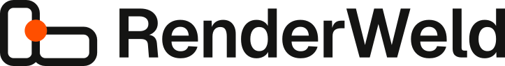

# Brand and production standard

How RenderWeld looks and ships in production. It covers:

- the name and how to write it;
- the brand mark;
- how UI icons are defined;
- the app-icon, share-image and metadata files;
- the domain and its hosts;
- DNS and email security;
- the enterprise checklist.

The product was called RenderWeld until the rename (#408). The full brand standard, with the mark geometry, the colour table with contrast ratios and the index of every asset, is [`brand/BRAND.md`](brand/BRAND.md). Colours come from the founder's palette decision (#247). This page doesn't repeat that decision: it applies it.

State checked on 2026-11-24.

## 1. Do first

These are ranked by what they cost us while we sell.

| # | What | Who | Issue |
| --- | --- | --- | --- |
| 1 | Buy `renderweld.com` and `renderweld.dev`, claim the `renderweld` handles, run the trademark search, rename the GitHub org and repository | Founder | #409 |
| 2 | DNSSEC, CAA, SPF/DKIM/DMARC, MTA-STS and the four mailboxes on the new zone (section 7) | Founder + agent, after #409 | #275 |
| 3 | Move the site and store to `renderweld.com` with the kit's icons and share images, and 301 every old URL path for path | Agent | #411 |
| 4 | HSTS is `max-age=0` on `renderweld.com`: a Cloudflare zone setting on `buildbase.app` overrides the Worker's header. Our own zone ends this; fix it on the old host while it still serves pages | Founder (Cloudflare dashboard) | #272 |
| 5 | Uptime and error alerts, status page, versioned releases with a changelog | Agent + founder | #271 |

## 2. Name

**RenderWeld**: one word, capital R and capital W. It replaces ReelForge, which tied the product to vertical reels; RenderWeld renders any size and welds the engines, voice, music and captions into one file (#408).

| Rule | Right | Wrong |
| --- | --- | --- |
| One word, two capitals | RenderWeld | Render Weld, Render-Weld, Renderweld |
| Never all caps or all lower case in running text | RenderWeld | RENDERWELD, renderweld |
| Never shortened | RenderWeld | Weld, RW |
| Lower case only where the system needs it | `renderweld.com`, the `renderweld` CLI, `@renderweld/*` packages, `RENDERWELD_*` settings, `renderweld://` resources | |
| No effects on the name | Plain ink or `#F1F2F4` | Gradient, outline, shadow, glow |

**Descriptor:** "Self-hosted video rendering for AI agents."\
**Tagline:** "Agents write the manifest. RenderWeld renders the video." Use it unchanged; don't pair it with a second slogan.

**Words to avoid**

| Avoid | Why | Say instead |
| --- | --- | --- |
| "deploy", "hosting", "host your apps" | Render Services' space; we render video, we don't host apps | "run it on your server", "self-hosted" |
| "open source" | We are source-available | "source-available" |
| "weld" as our name, "Weld", "RW" | The name is only RenderWeld | RenderWeld |
| "revolutionary", "magic", "AI-powered", exclamation marks, emoji | Hype reads as AI-written copy | Say what it does, with a number |

Old names keep working for customers during the rename (settings, CLI, MCP URIs, metrics, image name; see [RENAMED.md](RENAMED.md)). In new copy, write only RenderWeld; mention ReelForge only to say it was the old name.

## 3. Brand mark

**The mark** is two rounded frames, a portrait one (about 9:16) and a landscape one (about 16:9). They stand on one baseline and share a wall. A solid signal-orange dot sits on the joint:
- **the weld point**, where every format becomes one file;
- **a camera's tally light**, the "recording" lamp the RenderWeld mark already had.

The two frames say "any format", the shared wall says "joined". It replaces the vertical reel-frame mark (#273).

| Rule | Value |
| --- | --- |
| Colours | No gradients, glows or shadows. Ink `#141413` frames and an orange `#FF4F00` dot on light; `#F1F2F4` frames and the orange dot on dark; one colour (all ink or all white) only for print, embossing and single-colour UI |
| The dot | Always orange in the two-colour mark; never recoloured |
| Clear space | Twice the frame stroke on every side, from the outer edge of the strokes (5 units of the 32-unit grid; about 5 px on a 30 px-wide mark) |
| Minimum size | 16 px for the mark alone, with the hand-tuned `mark-16.svg`; 24 px for the lockup (mark next to the wordmark) |
| Small sizes | `mark-16.svg` (16 px grid, 2 px strokes) at 16 px; `mark-32.svg` (2 px strokes on whole pixels) at 24–40 px; the master `mark-light.svg` / `mark-dark.svg` from 48 px |
| Wordmark | "RenderWeld" in Geist Semibold, tracking −0.02em, the r–W pair kerned a further −0.03em; outlined in the SVGs, so no font is needed |
| Lockup | Mark to the left of the wordmark, frame height 1.35 × cap height, gap one dot diameter (`lockup-horizontal-*.svg`); stacked version for square spaces (`lockup-stacked-*.svg`) |
| App tile | The dark mark on a `#191B1F` square, 60 % of the tile wide, inside the 80 % maskable safe zone (`app-tile.svg`, corners at 22.5 % of the side; `app-tile-square.svg` without corners) |
| Never | Stretch, rotate, outline, shadow, glow, gradient, a photo behind it without a solid plate, another company's logo inside our assets |
| Use by others | Governed by [`TRADEMARK.md`](../TRADEMARK.md) |

Status: **name decided (#408); mark and kit approved (#410, 2026-11-24: the founder asked us to decide and proceed).**

**Source of truth: [`docs/brand/`](brand/).** The master SVGs are hand-written in `brand/src/`; `brand/build.mjs` renders every other file from them and the Geist fonts (SIL OFL 1.1), checks sizes and safe zones, and zips the full kit. How to rebuild: [`brand/BRAND.md`](brand/BRAND.md), section 10.

## 4. UI icons: how to define one

The store uses **one icon library: [Lucide](https://lucide.dev)** (`lucide-react`). Don't add a second set: mixed stroke widths and corner styles are the fastest way to look assembled rather than designed.

**Where each kind of icon comes from**

| Kind | Source | Why |
| --- | --- | --- |
| Icon in a server component | `import { Download } from 'lucide-react'` (named import only) | Rendered on the server: costs the browser nothing |
| Icon in a client component on a public page | `src/components/icons/lite.tsx` (Lucide's own markup, copied byte for byte; a test compares them) | Keeps Lucide's runtime out of the 150 KB first-load budget |
| Third-party brand logo (GitHub, X, LinkedIn…) | `src/components/icons/brand.tsx` only | Lucide removed brand logos; one file keeps trademark use in one place |
| RenderWeld mark | `docs/brand/src/mark-*.svg` (or `icon.svg` for a theme-aware tab icon), inlined as a component in the store and the dashboard | Our own mark is never an icon-font glyph or a PNG in the UI |

**Rules for every icon**

1. **Size:** 16 px inline with text, 20 px in buttons and menus, 24 px stand-alone. Set it with a size class; don't scale with transforms.
2. **Stroke:** Lucide's default 2 px. Don't change it per icon.
3. **Colour:** `currentColor` only, so it follows the text colour and both themes. The orange accent goes on an icon only when that icon *is* the primary action.
4. **Accessibility:**
   - **Decorative icons** next to a text label get `aria-hidden="true"` (lite icons already do this).
   - **Icon-only buttons** get an `aria-label` that says the action ("Copy command"), not the glyph name ("Copy icon").
5. **Meaning:** one icon means one thing across the site. For example, `Download` is always "get the file" and never "install".
6. **Never:**
   - emoji as icons;
   - icons in headings just for decoration;
   - an icon on every list item;
   - animated icons other than the loading spinner (which respects `prefers-reduced-motion`).
7. **Adding a new client-side icon:** copy it from Lucide into `lite.tsx` with the `lucide()` helper. The existing test then checks it against Lucide's render.

**Enforcement to add (#274):** an ESLint `no-restricted-imports` rule that blocks other icon packages (`react-icons`, `@heroicons/*`, `@radix-ui/react-icons`, `@tabler/*`, `@phosphor-icons/*`) and blocks `lucide-react` in client components under the public pages.

## 5. App icons, share images and page metadata

The kit writes these files; copy them, don't redraw them. Paths are under `docs/brand/`.

| File | Size and rule | Where it goes |
| --- | --- | --- |
| `web/icon.svg` (= `favicon.svg`) | The 16 px design on a 32 grid, with a `prefers-color-scheme` style so the tab icon follows the OS theme | Next: `src/app/icon.svg`; dashboard: inlined |
| `web/favicon.ico` | 16/32/48 px, each hand-tuned, for old browsers and bookmarks | Next: `src/app/favicon.ico` |
| `web/favicon-16x16.png`, `web/favicon-32x32.png` | PNG fallbacks | Site root |
| `web/apple-touch-icon.png` | 180×180, **opaque** `#191B1F` (iOS fills transparency with black and rounds the corners itself) | Next: `src/app/apple-icon.png` |
| `web/android-chrome-192x192.png`, `web/android-chrome-512x512.png` | Rounded app tile, purpose `any` | Manifest icons |
| `web/maskable-512x512.png` | Full-bleed tile, mark inside the central 80 %, purpose `maskable` | Manifest icon |
| `web/site.webmanifest` | `name` and `short_name` RenderWeld, the tagline, `theme_color` and `background_color` `#191B1F`, the icons above | Next: `src/app/manifest.ts` with the same values |
| `web/mstile-150x150.png`, `web/browserconfig.xml` | Windows pinned tile: opaque `#191B1F` square with the dark mark, `TileColor` `#191B1F` | Site root |
| `web/safari-pinned-tab.svg` | One colour, black on transparent | Site root |
| `web/head-snippet.html` | Every `<link>` and `<meta>` tag above plus Open Graph and X tags, for pages Next doesn't generate | `<head>` |
| Theme colour | `#F4F3EF` for light and `#191B1F` for dark, so the mobile browser bar matches the page | Next: `viewport.themeColor` |
| `share/og-image.png` | 1200×630, light; `og-image-dark.png` for dark contexts; `og-image-square.png` 1200×1200 for square unfurls | Next: `opengraph-image.png` |
| `share/twitter-card.png` | 1200×675, `summary_large_image` | Next: `twitter-image.png` |
| `share/linkedin-share.png` | 1200×627 | Founder's posts |
| `github/readme-banner-light.png`, `-dark.png` | 1280×320, README header in a light/dark `<picture>` | README (docs sweep, #415) |
| `github/social-preview.png` | 1280×640, content inside the central 1200×600 | Founder (repository settings) |
| `github/org-avatar.png` | 500×500, circle-safe | Founder (organisation settings) |

**Outside the repositories** (in the downloadable kit only, `renderweld-brand-kit.zip` from `node build.mjs`): avatars and banners for X, LinkedIn, YouTube, Instagram and Threads, TikTok, Facebook, Discord, Bluesky, Product Hunt, Reddit and Mastodon; Slack, Discord and GitHub App icons; Docker Hub, npm and MCP directory listing icons; business cards, letterhead, invoice, press kit, email signature and slide templates. The founder or an agent uploads them per platform; [`brand/BRAND.md`](brand/BRAND.md) section 7 says who uploads which file, and section 8 gives each platform's size source.

The Docker image carries no brand files except the dashboard's icon (a few KB, D-042 budget unaffected). Its `org.opencontainers.image.*` labels (title, url, source, vendor) name RenderWeld from phase 4 (#413).

## 6. Domain

**`renderweld.com` is the main domain** (#408). `renderweld.dev` redirects to it (the whole `.dev` TLD is HSTS-preloaded, so it is HTTPS-only from the first visit). Why our own domain, not `renderweld.com`:

- **Trust:** business buyers and their security reviewers expect the vendor's own domain.
- **Control:** settings on the `buildbase.app` zone apply to us; the HSTS override (#272) is one example. On our own zone we set CAA records and can HSTS-preload.
- **Search and links:** authority builds up on our name, not on `buildbase.app`.
- **Email:** our own SPF/DKIM/DMARC and sender reputation.

Buying is the founder's (#409): Cloudflare Registrar, auto-renew on, registrar lock on, 2FA on the account.

**Old links never break.** `renderweld.com/<path>` answers `301` to `renderweld.com/<path>`, path and query kept (#411).

| Host | Purpose |
| --- | --- |
| `renderweld.com` (apex; `www` redirects to it) | Marketing, store, docs |
| `dev.renderweld.com` | Dev store, `noindex` |
| `media.renderweld.com` | Gallery reels on R2 |
| `status.renderweld.com` | Status page, hosted off Workers |
| `send.renderweld.com` | Transactional mail only, so its reputation is kept apart from the apex |
| `renderweld.dev`, `www.renderweld.dev` | `301` to the same path on `renderweld.com` |
| `renderweld.com` | `301` to the same path on `renderweld.com` |

## 7. DNS and email security

The checklist for the new `renderweld.com` zone (and `renderweld.dev`, which sends no mail). Full issue: #275.

**DNS**
- [ ] DNSSEC on, DS record published at the registrar.
- [ ] CAA: `0 issue` only for the CAs Cloudflare uses, `0 issuewild` the same, `0 iodef "mailto:security@renderweld.com"`.
- [ ] Hosts that never send mail (`renderweld.dev`, `media.`, `status.`, `dev.`): `v=spf1 -all` and a null MX (`0 .`).
- [ ] HSTS: two years with `includeSubDomains` on every host; submit `renderweld.com` to the preload list only once every subdomain is HTTPS-only.

**Mail**
- [ ] Mailboxes: `hello@`, `support@` (set as `NEXT_PUBLIC_SUPPORT_EMAIL`), `security@` (in `security.txt` and `SECURITY.md`), `billing@` (the Stripe contact), and `dmarc@` for reports.
- [ ] Transactional mail sends only from `send.renderweld.com`: SPF and DKIM for the mail provider on that host; the apex SPF lists only the mailbox provider.
- [ ] DMARC on the apex and `send.`: start `p=none; rua=mailto:dmarc@renderweld.com`, move to `p=quarantine` after two clean weeks of reports, then `p=reject`.
- [ ] MTA-STS (`_mta-sts` TXT plus the policy at `mta-sts.renderweld.com`) and TLS-RPT (`_smtp._tls` TXT) for inbound mail.
- [ ] Check with a DMARC report and an external mail tester before the launch emails go out.

## 8. Enterprise-readiness checklist

What a buyer's security review asks, and where we stand.

| Area | Status | Evidence or issue |
| --- | --- | --- |
| Signed container image, multi-arch | Done | `ci.yml`: cosign keyless on `main` and `v*` |
| SBOM | Done | CycloneDX per arch, attached as an attestation |
| Open dependency alerts | **18 open on `main`** (2 high, 14 moderate, 2 low) | #277 |
| Pinned CI actions, CodeQL, Dependabot, dependency review | Done | `.github/workflows/` |
| Strict CSP with nonces, `frame-ancestors 'none'`, nosniff, referrer and permissions policy | Done, live | `src/lib/security/csp.ts` (store) |
| HSTS | **Broken live** (`max-age=0`) | #272 |
| `security.txt`, `SECURITY.md`, disclosure path | Done; `security@` to add | #275 |
| Terms, privacy, refund, contact pages | Done | `/terms`, `/privacy`, `/refund`, `/contact` |
| Support email | Missing | #275 |
| Own domain, DNSSEC, CAA, DMARC | Domain chosen (`renderweld.com`); zone records missing | #409, #275, section 7 |
| Uptime, error alerting, status page | Missing | #271 |
| Versioned releases, CHANGELOG, upgrade notes, `cosign verify` how-to | Missing | #271 |
| Licence activation at scale, one activation per deployment | Done | D-098 (docs/DECISIONS.md), `apps/server/test/licence-scale.test.ts` |
| Tests on SQLite, PostgreSQL and MySQL in CI | Done | `ci.yml` database jobs |
| Brand mark, icons, metadata files | Kit in `docs/brand/`, mark approved (#410) | #410, #411, #413 |

Not planned now: SOC 2 and ISO 27001. RenderWeld is self-hosted, so the customer's data stays on the customer's servers. Say that in sales conversations, and point security reviewers to this page, `SECURITY.md` and the signed image.
