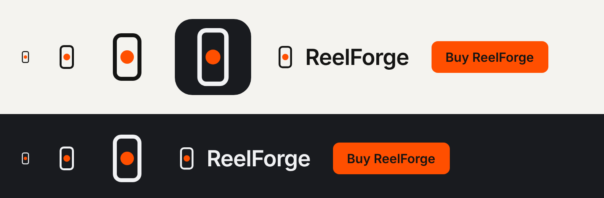

# Brand and production standard

How ReelForge looks and ships in production. It covers:

- the brand mark;
- how UI icons are defined;
- the app-icon and metadata files;
- the domain;
- DNS and email security;
- the enterprise checklist.

Every open item links to its issue under #269. Colours come from the founder's palette decision (#247). This page doesn't repeat that decision: it applies it.

State checked live on 2026-11-23.

## 1. Do first

These are ranked by what they cost us while we sell.

| # | What | Who | Issue |
| --- | --- | --- | --- |
| 1 | HSTS is `max-age=0` in production: a Cloudflare zone setting on `buildbase.app` overrides the Worker's two-year header | Founder (Cloudflare dashboard) | #272 |
| 2 | Choose and buy the ReelForge domain **before** the launch emails and posts bake in `reelforge.buildbase.app` | Founder | #270 |
| 3 | Approve the reel-frame mark that replaces the gradient "R" | Founder | #273 |
| 4 | Ship the icon and metadata set (favicon, apple icon, manifest, theme colour, OG image) | Agent, after #247 and #273 | #274 |
| 5 | DNSSEC, CAA, SPF/DKIM/DMARC, MTA-STS, `support@` and `security@` | Founder + agent, after #270 | #275 |
| 6 | Uptime and error alerts, status page, versioned releases with a changelog | Agent + founder | #271 |

## 2. Brand mark

**The mark** is a vertical 9:16 rounded frame (a reel) with a signal-orange dot in the centre: the tally light a camera shows while it records. It says "a vertical video being made" without words.
- It stays legible at 16 px.
- It uses the palette's one accent.
- It's one SVG with no gradient.
- Source: [`brand/reelforge-mark.svg`](brand/reelforge-mark.svg), and the opaque app tile [`brand/reelforge-app-tile.svg`](brand/reelforge-app-tile.svg).

It replaces `public/logo.png` in the store (a white "R" on a blue→purple gradient). That one goes because:
- the gradient tile is a stock AI-template look;
- it fights the orange accent.

Status: **proposed, waiting for founder approval (#273).**

**Wordmark:** "ReelForge" in Geist Semibold, letter-spacing −0.02em, ink colour. The mark sits to the left, separated by one dot diameter. Never set the name in all caps, never split it as "Reel Forge", and never put the name in a gradient.

**Rules**

| Rule | Value |
| --- | --- |
| Colour sets | Ink `#141413` + orange `#FF4F00` on light; `#F1F2F4` + orange on dark; all-ink for one-colour print |
| Minimum size | 16 px (favicon); 24 px next to the wordmark |
| Clear space | Twice the frame's stroke width on every side |
| Never | Gradients, shadows, glows, outlines, rotation, recolouring the dot, placing it on a photo without a solid plate |
| Use by others | Governed by [`TRADEMARK.md`](../TRADEMARK.md) |

## 3. UI icons: how to define one

The store uses **one icon library: [Lucide](https://lucide.dev)** (`lucide-react`). Don't add a second set: mixed stroke widths and corner styles are the fastest way to look assembled rather than designed.

**Where each kind of icon comes from**

| Kind | Source | Why |
| --- | --- | --- |
| Icon in a server component | `import { Download } from 'lucide-react'` (named import only) | Rendered on the server: costs the browser nothing |
| Icon in a client component on a public page | `src/components/icons/lite.tsx` (Lucide's own markup, copied byte for byte; a test compares them) | Keeps Lucide's runtime out of the 150 KB first-load budget |
| Third-party brand logo (GitHub, X, LinkedIn…) | `src/components/icons/brand.tsx` only | Lucide removed brand logos; one file keeps trademark use in one place |
| ReelForge mark | The SVG in `docs/brand/`, inlined as a component in the store | Our own mark is never an icon-font glyph or a PNG in the UI |

**Rules for every icon**

1. **Size:** 16 px inline with text, 20 px in buttons and menus, 24 px stand-alone. Set it with a size class; don't scale with transforms.
2. **Stroke:** Lucide's default 2 px. Don't change it per icon.
3. **Colour:** `currentColor` only, so it follows the text colour and both themes. The orange accent goes on an icon only when that icon *is* the primary action.
4. **Accessibility:**
   - **Decorative icons** next to a text label get `aria-hidden="true"` (lite icons already do this).
   - **Icon-only buttons** get an `aria-label` that says the action ("Copy command"), not the glyph name ("Copy icon").
5. **Meaning:** one icon means one thing across the site. For example, `Download` is always "get the file" and never "install".
6. **Never:**
   - emoji as icons;
   - icons in headings just for decoration;
   - an icon on every list item;
   - animated icons other than the loading spinner (which respects `prefers-reduced-motion`).
7. **Adding a new client-side icon:** copy it from Lucide into `lite.tsx` with the `lucide()` helper. The existing test then checks it against Lucide's render.

**Enforcement to add (#274):** an ESLint `no-restricted-imports` rule that blocks other icon packages (`react-icons`, `@heroicons/*`, `@radix-ui/react-icons`, `@tabler/*`, `@phosphor-icons/*`) and blocks `lucide-react` in client components under the public pages.

## 4. App icons and page metadata

Use the Next.js App Router file conventions in `src/app/`. Next writes the `<link>` and `<meta>` tags, so don't hand-write them. Full spec in #274.

| File | Size and rule |
| --- | --- |
| `icon.svg` | The mark; contains a `prefers-color-scheme` style so the browser tab icon follows the OS theme |
| `favicon.ico` | 16/32/48 px, for old browsers and bookmarks |
| `apple-icon.png` | 180×180, **opaque** `#191B1F` background (iOS fills transparency with black and rounds the corners itself) |
| `manifest.ts` | `name`, `short_name`, `theme_color`, `background_color`, icons 192 and 512, and a 512 `maskable` icon with the mark inside the central 80 % |
| `viewport.themeColor` | `#F4F3EF` for light and `#191B1F` for dark, so the mobile browser bar matches the page |
| `opengraph-image.png` | 1200×630, static, palette colours, a real reel frame, no gradient |

**Outside the site:**

| Place | Size | Who uploads it |
| --- | --- | --- |
| GitHub repository social preview | 1280×640 | Founder (repo settings) |
| Product Hunt thumbnail | 240×240 | Founder |
| X / LinkedIn / Product Hunt avatar | 400×400, the app tile | Founder |
| MCP directory listings | The app tile | Founder or agent (per directory) |
| Docker image | `org.opencontainers.image.*` labels (title, source, licenses, url) | Agent |

## 5. Domain

The store runs on `reelforge.buildbase.app`. That was right for a fast start, but it costs us now that we take money:

- **Trust:** business buyers and their security reviewers expect the vendor's own domain.
- **Control:** settings on the `buildbase.app` zone apply to us. The HSTS override (#272) is one example. We also can't set our own CAA records or HSTS-preload.
- **Search and links:** authority builds up on `buildbase.app`, not on ReelForge.
- **Email:** our own SPF/DKIM/DMARC and sender reputation need our own domain.

**Decision needed (#270).** Run a trademark search, then buy at Cloudflare Registrar. Preference order:

1. `reelforge.com` if it can be bought at a sane price;
2. `reelforge.dev` (the whole `.dev` TLD is HSTS-preloaded);
3. `reelforge.studio`;
4. `getreelforge.com`.

Then:
- turn on auto-renew, registrar lock and 2FA;
- send a 301 from `reelforge.buildbase.app` to the same path on the new domain, so no link breaks.

| Host | Purpose |
| --- | --- |
| apex (`www` redirects to it) | Marketing, store, docs |
| `dev.` | Dev store, `noindex` (already sent today) |
| `media.` | Gallery reels on R2 |
| `status.` | Status page, hosted off Workers |
| `send.` | Transactional mail, so its reputation is kept apart from the apex |

## 6. DNS and email security

Full checklist: #275.

- **DNS:** DNSSEC on. CAA limited to the CAs Cloudflare uses. Hosts that never send mail get `v=spf1 -all` and a null MX.
- **HSTS:** two years with `includeSubDomains`. Submit to the preload list only once every subdomain is HTTPS-only.
- **Mail authentication:** SPF and DKIM on `send.`. DMARC rollout:
  1. `p=none` with reports to `dmarc@`;
  2. `quarantine` after two clean weeks;
  3. then `reject`.

  Add MTA-STS and TLS-RPT for inbound mail.
- **Addresses:**
  - `support@`, set as `NEXT_PUBLIC_SUPPORT_EMAIL` (unset today; pages fall back to `/contact`);
  - `security@`, in `security.txt` and `SECURITY.md`;
  - `billing@`, the Stripe contact;
  - `dmarc@`.

## 7. Enterprise-readiness checklist

What a buyer's security review asks, and where we stand.

| Area | Status | Evidence or issue |
| --- | --- | --- |
| Signed container image, multi-arch | Done | `ci.yml`: cosign keyless on `main` and `v*` |
| SBOM | Done | CycloneDX per arch, attached as an attestation |
| Pinned CI actions, CodeQL, Dependabot, dependency review | Done | `.github/workflows/` |
| Strict CSP with nonces, `frame-ancestors 'none'`, nosniff, referrer and permissions policy | Done, live | `src/lib/security/csp.ts` (store) |
| HSTS | **Broken live** (`max-age=0`) | #272 |
| `security.txt`, `SECURITY.md`, disclosure path | Done; `security@` to add | #275 |
| Terms, privacy, refund, contact pages | Done | `/terms`, `/privacy`, `/refund`, `/contact` |
| Support email | Missing | #275 |
| Own domain, DNSSEC, CAA, DMARC | Missing | #270, #275 |
| Uptime, error alerting, status page | Missing | #271 |
| Versioned releases, CHANGELOG, upgrade notes, `cosign verify` how-to | Missing | #271 |
| Licence activation at scale, one activation per deployment | Done | D-098 (docs/DECISIONS.md), `apps/server/test/licence-scale.test.ts` |
| Tests on SQLite, PostgreSQL and MySQL in CI | Done | `ci.yml` database jobs |
| Brand mark, icons, metadata files | Proposed | #273, #274 |

Not planned now: SOC 2 and ISO 27001. ReelForge is self-hosted, so the customer's data stays on the customer's servers. Say that in sales conversations, and point security reviewers to this page, `SECURITY.md` and the signed image.
