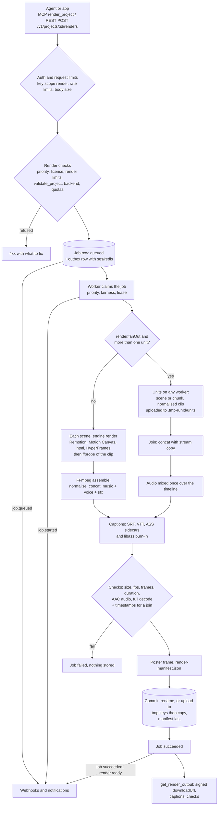

# How a video is made

What happens between `render_project` and a playable MP4 (issue #288). Each step
names the code that does it and the settings that change it; every setting is in
[CONFIG.md](CONFIG.md), every driver in [PROVIDERS.md](PROVIDERS.md).

## 1. The request

An agent calls MCP `render_project` (or REST `POST /v1/projects/:id/renders`;
`preview_scene` / `POST /v1/projects/:id/preview` for a quick low-resolution
scene). Before anything is looked up, the request passes the per-address limits
`limits.preAuthPerMinute` and `limits.authFailuresPerMinute` (lockout
`limits.authLockoutSeconds` doubling to `limits.authLockoutMaxSeconds`), then the
API key is checked (scope `render`, expiry, IP allowlist), then the per-key
`limits.rateLimitPerMinute` (`limits.rateLimitStore`). Bodies are capped by
`limits.maxJsonBytes` (REST; the MCP transport's own 4 MiB cap is issue #321).
`/mcp` checks Host and Origin against `server.publicUrl` and
`server.allowedHosts`. Code: `apps/server/src/app.ts`, `authGuard.ts`, `mcp.ts`.

## 2. The manifest

The project was created earlier with `create_project` and edited with
`update_project`, `add_scene` and friends. Every write validates the whole
manifest (schema v0.2; v0.1 is migrated) with Zod and answers
`422 invalid_manifest` with every problem at once (`details.issues`, `path` +
`message`). Each accepted write is a new project version. Assets are referenced
as `asset://<id>`: uploaded, or imported from a URL with `add_asset_from_url`
(https only, private addresses refused, `limits.maxUploadBytes`). Code:
`packages/project-schema`, `packages/core/src/service.ts`.

## 3. Render checks, in order

`RenderWeldService.renderProject` / `enqueueRender`
(`packages/core/src/service.ts`), all before a job exists:

1. **Priority:** the requested class may not exceed the key's `maxPriority`
   (`403 priority_not_allowed`).
2. **Licence:** renders and previews need a valid licence or the 14-day grace
   (`403 licence_required` / `licence_invalid`); nothing else does
   ([ISOLATION.md](ISOLATION.md#offline)).
3. **Render limits:** `limits.maxRenderSeconds`, `limits.maxRenderFrames`,
   `limits.maxScenes`, `limits.maxRenderDimension`, `limits.maxRenderFps`
   (`422` with the limit and the value). These have upper bounds in the schema
   today (180 s, 10 800 frames, 50 scenes, 4096 px, 60 fps); raising them is
   issue #302.
4. **Validation:** `validate_project` errors block the render
   (`422 validation_failed`); warnings do not.
5. **Backend:** the manifest's `render.backend` (or the call's `backend`) must
   be configured and implemented (`local` is; `remotion-lambda` answers `501`).
6. **Quotas and admission**, in the same database transaction as the insert:
   the key's renders per day / month, `limits.maxQueuedJobsPerKey`,
   `limits.maxQueuedJobs`, `limits.maxEstimatedWaitSeconds`
   (`429 queue_full` with `Retry-After`). A project with `variants` queues one
   render per variant under one `batchId`.

The job row is written as `queued` and the call answers `202` with the job.
With `queue.dispatch` `sqs` or `redis` the same transaction writes an outbox
row, published right after the commit; with `notify` the transaction sends a
PostgreSQL `NOTIFY`. A `job.queued` event goes to the webhook outbox.

## 4. Queue and claim

With `queue.driver: inprocess` (one instance) the accepting server runs the
job. With `database` (the `api` and `worker` roles), an idle worker claims it:
woken by a broker message or `NOTIFY`, or by its own poll
(`queue.pollIntervalMs` backing off to `queue.pollMaxIntervalMs`; with a broker,
at least every `queue.dispatchFallbackSeconds`). The claim takes the next job by
priority (aged by `queue.priorityAgingSeconds`) and fairly across keys,
skipping keys at `limits.maxRunningJobsPerKey`; it uses `SELECT ... FOR UPDATE
SKIP LOCKED` on PostgreSQL and MySQL. A worker claims nothing while storage is
unreachable or the stored licence state disallows renders. The claim is a lease
(`queue.leaseSeconds`, renewed every quarter); a job whose lease runs out is
queued again, up to `queue.maxAttempts`. On SIGTERM a worker stops claiming and
gives running jobs `queue.shutdownGraceSeconds` before handing them back. Each
worker runs `server.workerConcurrency` jobs at once. The job turns `running`
and emits `job.started`. Code: `packages/core/src/jobs.ts`,
`dispatch*.ts`; details: [providers/queue-and-scaling.md](providers/queue-and-scaling.md).

Job states: `queued` → `running` → `succeeded`, `failed` or `cancelled`
(`cancel_job`; `retry_job` starts a new job with the same parameters and project version). A job
interrupted by a restart is `failed` (`interrupted`) with `inprocess`, and queued
again with `database`.

## 5. Fan-out (optional)

With `render.fanOut` `scenes` or `scenes+chunks`, the database queue, the
`local` backend and a full render of two or more units, the render job becomes
units (`render_unit`), one per scene, or per `render.chunkSeconds` chunk of a
scene of at least `render.chunkMinSceneSeconds` whose engine renders frame
ranges (Remotion). Any worker takes a unit, renders it, normalises the clip to
the final encoding and uploads it with a small manifest to
`projects/<id>/renders/.tmp-<runId>/units/`. The last unit queues the join
(`render_join`). Code: `packages/core/src/fanout.ts`, `render-fanout.ts`.

## 6. Engine render per scene

The worker resolves the theme and the project's assets (asset files are read
from storage and cached in `storage.cacheDir`), then renders each scene with its
engine (`renderSceneClip` in `packages/core/src/render.ts`):

- `remotion` and `motion-canvas`: built-in templates with the scene's props;
- `html` and `hyperframes`: the agent's HTML and CSS in an offline sandbox
  (Content-Security-Policy, no network, files only from the scene).

Every engine writes an H.264 MP4 of exactly the scene's frames at the output
size and fps, in a temporary directory; `render.sceneTimeoutSeconds` bounds one
scene, `render.chromiumPath` and `render.chromiumNoSandbox` choose the browser
and its sandbox. `ffprobe` checks each clip (size, fps, at least the scene's
frames). Progress goes to the job (`get_job`, `GET /v1/jobs/:id/events`) and,
every 10 %, to `job.progress` subscribers.

## 7. Assembly and audio

`assemble` (`packages/media-pipeline`) runs FFmpeg once: it normalises the clips
(pixel format, exact frame counts), concatenates them, and mixes the project's
audio (`audio.music` with volume and fade-out, `audio.voice` at its start frame,
`audio.sfx` at their frames) into AAC. A preview of a scene subset gets silence
instead, because its timing differs. A fan-out join concatenates the units'
clips with the concat demuxer and stream copy (no second encode) and mixes the
audio once over the whole timeline. FFmpeg comes from `render.ffmpegPath` /
`render.ffprobePath` (Debian's FFmpeg 5.1 in the image).

Voice-overs are made before the render, not during it: `generate_voice`
(ElevenLabs, `providers.elevenlabs.apiKey`) stores the audio as an asset with
word timestamps and sets `audio.voice`.

## 8. Captions

After assembly, `captionPass` (`packages/core/src/captions.ts`, D-107) builds
cues from the manifest's caption cues (written or imported with `import_captions`) or from
the voice's word timestamps, styles them from the theme's caption tokens inside
the platform's safe area, writes SRT, WebVTT and ASS sidecars, and with mode
`burned` or `both` burns them in with libass. The mode comes from the manifest's
caption mode, the render's `captions` override or the server default
`captions.defaultMode`; off by default. Caption QA
(line length, reading speed, gaps) is reported with the render
([CAPTIONS.md](CAPTIONS.md)).

## 9. Checks

`finishRender` probes the result and refuses it (`validate:output`, job
`failed`) unless the size, fps, frame count, duration (within one frame) and AAC
audio match, and FFmpeg decodes every frame (`assertDecodable`). A join also
checks that every frame appears once, one frame apart, and that audio and video
have the same length. Then a 270-pixel poster of the first frame is written,
and `render-manifest.json` last: versions (server, Node, FFmpeg, engines,
browser), the FFmpeg arguments, the checks, caption results and the project as
rendered.

## 10. Storage

Nothing is visible until every check passed (D-067):

- `storage.driver: local`: the render is built in `renders/.tmp-<runId>` and
  renamed to `renders/<runId>`;
- `s3`, `azure`, `gcs`: built in `<cacheDir>/render-staging/`, uploaded to
  `.tmp-<runId>/` keys, copied to `<runId>/` with the manifest last, and the
  staging directory removed. A failure leaves nothing behind; a render is never
  overwritten.

Retention later removes old renders per `storage.retention.*`.

## 11. Result and events

The job turns `succeeded` with the render summary. The webhook outbox gets
`job.succeeded` and `render.ready` (and `job.failed` on failure); every
endpoint subscribed to them receives a signed webhook, a chat message or an
email, retried with backoff (`webhooks.*`). The agent calls `get_render_output`
(`GET /v1/renders/:id`): a `downloadUrl` signed by the bucket or by the server
(`storage.downloads`), the poster, the caption files and the checks. Spans for
the request, the job, every engine render and every FFmpeg step go to the OTLP
endpoint if one is set (`observability.*`); counts and durations are on
`/metrics`.

## Where each setting acts

| Step | Settings |
| --- | --- |
| Request | `limits.preAuthPerMinute`, `limits.authFailuresPerMinute`, `limits.authLockoutSeconds`, `limits.authLockoutMaxSeconds`, `limits.rateLimitPerMinute`, `limits.rateLimitStore`, `limits.maxJsonBytes`, `limits.maxUploadBytes`, `server.allowedHosts`, `server.trustProxy` |
| Render checks | `licence.*`, `limits.maxRenderSeconds`, `limits.maxRenderFrames`, `limits.maxScenes`, `limits.maxRenderDimension`, `limits.maxRenderFps`, `limits.maxQueuedJobsPerKey`, `limits.maxQueuedJobs`, `limits.maxEstimatedWaitSeconds` |
| Queue and claim | `server.role`, `server.workerConcurrency`, `limits.renderConcurrency`, `limits.maxRunningJobsPerKey`, `queue.*` |
| Fan-out | `render.fanOut`, `render.chunkSeconds`, `render.chunkMinSceneSeconds` |
| Engine render | `render.chromiumPath`, `render.chromiumNoSandbox`, `render.sceneTimeoutSeconds`, `storage.cacheDir` |
| Assembly, captions, checks | `render.ffmpegPath`, `render.ffprobePath`; per project: `audio`, `captions`, `output` |
| Storage | `storage.driver`, `storage.s3.*`, `storage.azure.*`, `storage.gcs.*`, `storage.retention.*`, `storage.downloads` |
| Events | `webhooks.*`, `notifications.email.*`, `audit.sinks`, `observability.*` |
