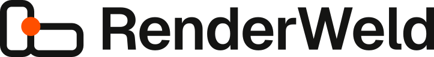
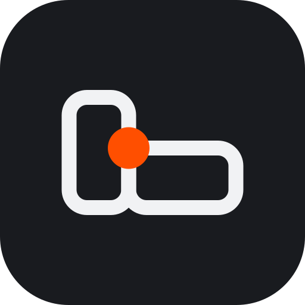

# RenderWeld brand

**Status:** the name RenderWeld is decided (#408, founder, 2026-11-24). The mark and asset set are approved (#410, 2026-11-24: the founder asked us to decide and proceed). This file is the full brand standard; [`docs/BRAND_AND_PRODUCTION.md`](../BRAND_AND_PRODUCTION.md) summarises it and holds the domain, DNS and email rules. It follows the palette decision (#247).

**Tagline:** "Agents write the manifest. RenderWeld renders the video."
Use it unchanged everywhere a line of copy is needed. Don't pair it with a second slogan.

## 1. Name

| Rule | Example |
| --- | --- |
| One word, capital R and capital W | RenderWeld |
| Never split | ~~Render Weld~~, ~~Render-Weld~~ |
| Never all caps or all lower case in running text | ~~RENDERWELD~~, ~~renderweld~~ (the domain `renderweld.com` is the only lower-case use) |
| Never in a gradient, outline or effect | |
| Describe it as **source-available** | Never "open source" |

Write all copy in images and documents in sentence case, with no exclamation marks, no emoji and no hype words ("revolutionary", "magic", "AI-powered").

## 2. The mark





Every asset at its real size, light and dark, is on the two contact sheets that `node build.mjs` writes next to this file (`contact-sheet-1.png`, `contact-sheet-2.png`). They ship in the downloadable kit and are not committed.

**Concept: any format, joined into one.** The mark is two rounded frames:
- a portrait one (about 9:16);
- a landscape one (about 16:9).

They stand on one baseline and share a wall. A solid signal-orange dot sits on the joint, where the landscape frame's top edge meets the shared wall. The dot is:
- **the weld point**, where the formats become one file;
- **a camera's tally light**, the "recording" lamp the ReelForge mark already used.

It keeps the old mark's spirit: the portrait frame and the orange dot are still there. The second frame adds "every format", and the shared wall adds "joined".

**Geometry** (master, `src/mark-*.svg`, 32-unit grid):

| Part | Value |
| --- | --- |
| Portrait frame | centre-line `x2 y6.75 w10 h18.5`, corner radius 3 |
| Landscape frame | centre-line `x12 y15.25 w18 h10`, corner radius 3 |
| Shared wall | `x = 12` |
| Stroke | 2.5 |
| Dot | centre (12, 15.25), radius 3.5 (diameter 7 = 2.8 strokes) |
| Visual box | 30.5 × 21, centred in the 32 × 32 viewBox |

**Small sizes: hand-tuned variants.** A scaled-down master turns soft below 48 px, so two pixel-grid variants replace it.

| Size | File | What changes |
| --- | --- | --- |
| 48 px and up | `src/mark-*.svg` | Master as above |
| 24–40 px | `src/mark-32.svg` | Same layout on a 32 px grid with a **2 px stroke**. Every frame edge sits on a whole pixel, so the lines render sharp at 32 px. |
| 16 px | `src/mark-16.svg` | Redrawn on a 16 px grid. **Strokes are 2 px**, 1/8 of the icon (the master's are 1/13). The frames fill the full width. Corner radius drops to 1.5 so the 2-pixel counters stay open. The dot grows to 5 px so it still reads as a separate light. Both frames stay: tested against a single-frame version, the two-frame version is still legible and keeps the idea. |
| Browser tab | `src/icon.svg` = `web/icon.svg` | The 16 px design doubled onto a 32 grid: sharp at 16 px (1×) and 32 px (2×). It switches ink and `#F1F2F4` with `prefers-color-scheme`. |

**Colour sets**
- On light: ink frames, orange dot.
- On dark: `#F1F2F4` frames, orange dot.
- One-colour: all ink (`mark-ink.svg`) or all white (`mark-white.svg`). The dot then merges into the joint and reads as a solid node.

Never recolour the dot in the two-colour mark.

**Clear space:** twice the frame stroke on every side, measured from the outer edge of the strokes. In the master that's 5 units of the 32-unit grid; on a 30 px-wide mark it's about 5 px.

**Minimum size:** 16 px for the mark alone, with the `mark-16` variant. 24 px for the mark next to the wordmark (lockup height 24 px).

**App tile** (`src/app-tile.svg`): the dark mark on a `#191B1F` square.
- The tile's corner radius is 22.5 % of its side (115 at 512), close to iOS and Android launcher shapes.
- The mark is 60 % of the tile's width and centred. Its farthest point is 62–67 % of the radius from the centre, inside the 80 % maskable safe zone; the build checks this.
- `app-tile-square.svg` is the same without corners, for platforms that apply their own mask.

## 3. Wordmark and lockups

| Rule | Value |
| --- | --- |
| Typeface | Geist Semibold (600) |
| Tracking | −0.02em |
| Hand kerning | The r–W pair gets an extra −0.03em: Geist leaves that pair open, so the name started to read as two words |
| Outlines | All text in `src/` logo files is outlined (paths), so the files need no installed font |

| Lockup | Construction |
| --- | --- |
| Horizontal | Mark frame height = 1.35 × cap height, centred on the cap height. Gap = one dot diameter. Light and dark: `src/lockup-horizontal-*.svg`. |
| Stacked | Mark width = 42 % of the wordmark, centred above it. Gap = 1.5 dot diameters. `src/lockup-stacked-*.svg`. |
| Wordmark alone | `src/wordmark-*.svg`, for places where the mark already appears nearby (for example next to an avatar) |

## 4. Colour

| Name | Hex | RGB | CMYK (approx.) | Use |
| --- | --- | --- | --- | --- |
| Ink | `#141413` | 20 20 19 | 0 0 5 92 | Text and frames on light |
| Signal orange | `#FF4F00` | 255 79 0 | 0 69 100 0 | The one accent: the weld dot, and highlights on dark |
| Light | `#F4F3EF` | 244 243 239 | 0 0 2 4 | Light background |
| Dark | `#191B1F` | 25 27 31 | 19 13 0 88 | Dark background, app tile, theme colour |
| On dark | `#F1F2F4` | 241 242 244 | 1 1 0 4 | Text and frames on dark |
| Muted on light | `#6B6A64` | 107 106 100 | — | Secondary text only (derived tinted neutral) |
| Muted on dark | `#9A9EA6` | 154 158 166 | — | Secondary text only (derived tinted neutral) |

The CMYK values are a plain mathematical conversion, not a press profile. For print:
- Ask the printer to convert with their profile and send a proof.
- Set small ink text in K100.
- Large ink or dark areas need a rich black the printer recommends.
- The nearest Pantone to signal orange is about Orange 021 C. Check it against a physical swatch before you approve it.

**Contrast (WCAG 2.2)**

| Pair | Ratio | Result |
| --- | --- | --- |
| Ink on light | 16.60:1 | AA and AAA, any size |
| `#F1F2F4` on dark | 15.39:1 | AA and AAA, any size |
| Orange on dark | 5.23:1 | AA for normal text; fine for links and highlights on dark |
| Ink on orange | 5.59:1 | AA (for example, a label on an orange button) |
| Orange on light | 2.97:1 | **Fails, even for large text and UI graphics (3:1)** |
| White on orange | 3.30:1 | Large text only (18.66 px bold / 24 px and up) |
| `#F1F2F4` on orange | 2.94:1 | Fails |
| Muted on light | 4.89:1 | AA |
| Muted on dark | 6.42:1 | AA |

**Where orange may not be text**
- Orange is never used for text, icons or thin lines on the light background or on white.
- Don't put small white or `#F1F2F4` text on an orange fill.

On light, orange appears only as the solid weld dot, which is always next to ink and never carries meaning alone.

**Palette discipline**
- Tinted neutrals, one accent (orange), one bright element per composition: the weld dots.
- No gradients, shadows, glows, outlines or blurs, anywhere.

## 5. Typography

| Face | Use |
| --- | --- |
| Geist Semibold | Headlines and the wordmark. Tracking −0.02em at display sizes. |
| Geist Regular / Medium | Body text and labels |
| Geist Mono Medium | Code, aspect ratios (`9:16`) and file names |

Set headlines in sentence case and left aligned. Lines are 1.06–1.12 for display, 1.4–1.6 for body.

## 6. Do and don't

Contact sheet 2 (written by the build, in the kit) shows the share images, banners and print files with each platform's safe area.

**Do**
- Put the mark on the light or dark background, or on a solid plate of either.
- Keep the clear space.
- Use `mark-16` / `mark-32` at small sizes.
- Use the product cue (frames welded at orange dots) as the one illustration.

**Don't**
- Stretch, rotate, outline, add a shadow, glow or gradient, or recolour the dot.
- Put the mark on a photo without a solid plate.
- Set the name in all caps or split it.
- Use stock photos or AI-generated imagery: the kit is geometric and typographic only.
- Put another company's logo (GitHub, X, Slack…) inside our assets.

## 7. Asset index

Produced by `build.mjs`; sizes are checked on every build.

<!-- asset-index:start -->
| File | Size | Where it is used | Who uploads it |
| --- | --- | --- | --- |
| `src/app-tile-square.svg` | vector | App tile, full bleed (platforms that mask) | Design source |
| `src/app-tile.svg` | vector | App tile, rounded (listings, launchers) | Design source |
| `src/icon.svg` | vector | Theme-aware tab icon (source of web/icon.svg) | Design source |
| `src/lockup-horizontal-dark.svg` | vector | Horizontal lockup: site header, docs, decks | Design source |
| `src/lockup-horizontal-light.svg` | vector | Horizontal lockup: site header, docs, decks | Design source |
| `src/lockup-stacked-dark.svg` | vector | Stacked lockup: square spaces, splash screens | Design source |
| `src/lockup-stacked-light.svg` | vector | Stacked lockup: square spaces, splash screens | Design source |
| `src/mark-16.svg` | vector | Mark for 16 px (pixel grid) | Design source |
| `src/mark-32.svg` | vector | Mark for 24–40 px (pixel grid, 2 px stroke) | Design source |
| `src/mark-dark.svg` | vector | Master mark for 48 px and up, on light / dark | Design source |
| `src/mark-ink.svg` | vector | One-colour mark (print, embossing, single-colour UI) | Design source |
| `src/mark-light.svg` | vector | Master mark for 48 px and up, on light / dark | Design source |
| `src/mark-white.svg` | vector | One-colour mark (print, embossing, single-colour UI) | Design source |
| `src/wordmark-dark.svg` | vector | Wordmark alone, outlined | Design source |
| `src/wordmark-light.svg` | vector | Wordmark alone, outlined | Design source |
| `web/android-chrome-192x192.png` | 192×192 | Web app manifest icon, purpose "any" | Agent (site repo) |
| `web/android-chrome-512x512.png` | 512×512 | Web app manifest icon, purpose "any" | Agent (site repo) |
| `web/apple-touch-icon.png` | 180×180 | iOS home screen (opaque) | Agent (site repo, `apple-icon.png`) |
| `web/browserconfig.xml` | — | Windows tile config | Agent (site repo) |
| `web/favicon-16x16.png` | 16×16 | PNG favicon fallback | Agent (site repo) |
| `web/favicon-32x32.png` | 32×32 | PNG favicon fallback | Agent (site repo) |
| `web/favicon.ico` | 16, 32, 48 | Legacy favicon (16/32/48), bookmarks | Agent (site repo, `src/app/`) |
| `web/favicon.svg` | vector | Browser tab icon, follows OS theme | Agent (site repo, `src/app/icon.svg`) |
| `web/head-snippet.html` | — | Every `<head>` tag, for non-Next pages | Agent (site repo) |
| `web/icon.svg` | vector | Browser tab icon, follows OS theme | Agent (site repo, `src/app/icon.svg`) |
| `web/maskable-512x512.png` | 512×512 | Web app manifest icon, purpose "maskable" | Agent (site repo) |
| `web/mstile-150x150.png` | 150×150 | Windows pinned tile, opaque `#191B1F` square (matches `TileColor`) | Agent (site repo) |
| `web/safari-pinned-tab.svg` | vector | Safari pinned tab / Touch Bar (monochrome) | Agent (site repo) |
| `web/site.webmanifest` | — | Web app manifest (Next: `manifest.ts`) | Agent (site repo) |
| `share/linkedin-share.png` | 1200×627 | LinkedIn post image / link preview | Founder (posts) |
| `share/og-image-dark.png` | 1200×630 | Open Graph alternative for dark contexts | Agent (site repo) |
| `share/og-image-square.png` | 1200×1200 | Square unfurls (WhatsApp, Slack, some chats) | Agent (site repo) |
| `share/og-image.png` | 1200×630 | Open Graph default (Facebook, LinkedIn, Slack, Discord unfurls) | Agent (site repo, `opengraph-image.png`) |
| `share/twitter-card.png` | 1200×675 | X/Twitter `summary_large_image` | Agent (site repo, `twitter-image.png`) |
| `github/org-avatar.png` | 500×500 | GitHub organisation avatar | Founder (org settings) |
| `github/readme-banner-dark.png` | 1280×320 | README header, `<picture>` light/dark | Agent (README PR) |
| `github/readme-banner-light.png` | 1280×320 | README header, `<picture>` light/dark | Agent (README PR) |
| `github/social-preview-dark.png` | 1280×640 | Repository social preview | Founder (repo Settings → Social preview) |
| `github/social-preview.png` | 1280×640 | Repository social preview | Founder (repo Settings → Social preview) |
| `social/bluesky-avatar-1000x1000.png` | 1000×1000 | Bluesky avatar | Founder |
| `social/bluesky-banner-3000x1000.png` | 3000×1000 | Bluesky banner | Founder |
| `social/discord-server-banner-960x540.png` | 960×540 | Discord server banner (boost level 2) | Founder |
| `social/discord-server-icon-512x512.png` | 512×512 | Discord server icon | Founder (server settings) |
| `social/facebook-cover-1640x624.png` | 1640×624 | Facebook page cover | Founder |
| `social/facebook-profile-720x720.png` | 720×720 | Facebook page profile picture | Founder |
| `social/instagram-threads-avatar-320x320.png` | 320×320 | Instagram and Threads avatar | Founder |
| `social/linkedin-cover-1128x191.png` | 1128×191 | LinkedIn company cover (older size, same ratio) | Founder |
| `social/linkedin-cover-1512x256.png` | 1512×256 | LinkedIn company cover (current help-page size) | Founder |
| `social/linkedin-logo-400x400.png` | 400×400 | LinkedIn company page logo | Founder |
| `social/mastodon-avatar-400x400.png` | 400×400 | Mastodon avatar | Founder |
| `social/mastodon-header-1500x500.png` | 1500×500 | Mastodon header | Founder |
| `social/producthunt-gallery-1-1270x760.png` | 1270×760 | Product Hunt gallery image | Founder |
| `social/producthunt-gallery-2-1270x760.png` | 1270×760 | Product Hunt gallery image | Founder |
| `social/producthunt-thumbnail-240x240.png` | 240×240 | Product Hunt thumbnail | Founder |
| `social/reddit-avatar-256x256.png` | 256×256 | Reddit community or profile avatar | Founder |
| `social/reddit-banner-1920x384.png` | 1920×384 | Reddit community banner | Founder |
| `social/tiktok-avatar-200x200.png` | 200×200 | TikTok avatar | Founder |
| `social/x-avatar-400x400.png` | 400×400 | X profile photo | Founder |
| `social/x-header-1500x500.png` | 1500×500 | X header | Founder |
| `social/youtube-banner-2560x1440.png` | 2560×1440 | YouTube banner (content in TV/desktop/mobile safe area) | Founder |
| `social/youtube-channel-icon-800x800.png` | 800×800 | YouTube profile picture | Founder |
| `slack-discord-apps/discord-app-icon-1024x1024.png` | 1024×1024 | Discord bot/app icon (shown as a circle) | Founder or agent (Discord developer portal) |
| `slack-discord-apps/github-app-logo-1024x1024.png` | 1024×1024 | GitHub App logo. Opaque, full bleed, no transparent padding: GitHub rounds the corners and shows it on the badge background colour, which should be `#191B1F`. Keep the mark inside the centre circle (it is: 62 % of the radius). | Founder (GitHub App settings) |
| `slack-discord-apps/slack-app-icon-1024x1024.png` | 1024×1024 | Slack app icon (Slack accepts 512–2000 px) | Founder or agent (api.slack.com app settings) |
| `slack-discord-apps/slack-app-icon-512x512.png` | 512×512 | Slack app icon (Slack accepts 512–2000 px) | Founder or agent (api.slack.com app settings) |
| `slack-discord-apps/slack-workspace-icon-512x512.png` | 512×512 | Slack workspace icon | Founder (workspace admin) |
| `listings/directory-card-800x418.png` | 800×418 | Generic directory/listing card | Founder or agent |
| `listings/dockerhub-logo-512x512.png` | 512×512 | Docker Hub repository logo | Founder (Docker Hub) |
| `listings/google-business-cover-1080x608.png` | 1080×608 | Google Business Profile cover | Founder |
| `listings/google-business-logo-720x720.png` | 720×720 | Google Business Profile logo | Founder |
| `listings/listing-icon-512x512.png` | 512×512 | npm, GitHub Marketplace and MCP directory icon (app tile) | Founder or agent (per directory) |
| `listings/promo-tile-440x280.png` | 440×280 | Small promo tile (Chrome Web Store style) | Founder |
| `business/business-card-eu-85x55mm.pdf` | 85×55 mm + bleed | Business card, EU 85×55 mm, 3 mm bleed, crop marks; page 1 front, page 2 back | Founder (printer) |
| `business/business-card-us-3.5x2in.pdf` | 3.5×2 in + bleed | Business card, US 3.5×2 in, 3 mm bleed, crop marks; page 1 front, page 2 back | Founder (printer) |
| `business/email-signature-300x80.png` | 300×80 | Email signature logo (white plate, survives dark mode) | Founder (mail client) |
| `business/email-signature-600x160.png` | 600×160 | Email signature logo @2x (display at 300×80) | Founder (mail client) |
| `business/invoice-a4.pdf` | A4 | A4 invoice template | Founder (billing tool) |
| `business/invoice-header.svg` | vector | Invoice header band (210×58 mm) | Founder (billing tool) |
| `business/letterhead-a4.pdf` | A4 | A4 letterhead page | Founder |
| `business/letterhead-header.svg` | vector | Letterhead header band, A4 width (210×36 mm) | Founder (docs, mail merge) |
| `business/press-kit.pdf` | A4 | Press-kit one-pager | Founder (press page, email) |
| `business/slide-section-dark-1920x1080.png` | 1920×1080 | Deck section slide template | Founder |
| `business/slide-section-light-1920x1080.png` | 1920×1080 | Deck section slide template | Founder |
| `business/slide-title-dark-1920x1080.png` | 1920×1080 | Deck title slide template | Founder |
| `business/slide-title-light-1920x1080.png` | 1920×1080 | Deck title slide template | Founder |
<!-- asset-index:end -->

## 8. Platform sizes: sources

Checked on 2026-11-24.

| Platform | Our files | What the source says | Source |
| --- | --- | --- | --- |
| X | avatar 400×400, header 1500×500 | Profile photo 400×400, header 1500×500 (2 MB limit for photos) | X Help Center, "How to customize your profile" (help.x.com). Seen in search results; a direct fetch was refused (403). |
| LinkedIn page | logo 400×400; cover 1128×191 **and** 1512×256 | Logo: 268×268 minimum, 400×400 recommended. Cover: **1512×256**, minimum and recommended. 1128×191, as asked, has the same 5.9:1 ratio, so both are provided; upload the 1512×256. | linkedin.com/help/linkedin/answer/a563309, fetched 2026-11-24 (page "last updated 3 months ago") |
| YouTube | icon 800×800, banner 2560×1440 | Banner: 2048×1152 minimum, 2560×1440 recommended, 6 MB. Text and logo safe area: 1235×338 at the minimum size. That is 1544×423 at 2560×1440 (we keep content inside 1546×424). Profile picture: shown at 98×98, 15 MB limit. | support.google.com/youtube/answer/10456525, fetched 2026-11-24 |
| Discord | server icon 512×512, banner 960×540 | Banner: at least 960×540, 16:9; needs server boost level 2. Icon: 512×512 is the common recommendation (minimum 128). | support.discord.com article 360028716472, seen in search results (direct fetch refused) |
| Bluesky | avatar 1000×1000, banner 3000×1000 | No official pixel spec. Guides agree on a 3:1 banner and a square avatar, about 1 MB per file (ours are under 75 KB). | Third-party guides, 2026 |
| Facebook page | profile 720×720, cover 1640×624 | Cover shows at 820×312 on desktop and 640×360 on mobile, so mobile crops the sides. Logo and text stay in the central 1060×432. Not checked on Meta's own page. | Third-party guides citing Meta's Help Center |
| Instagram / Threads, TikTok, Product Hunt, Reddit, Mastodon | As in the brief | Not checked live; the brief's sizes were used | Brief |
| GitHub | social preview 1280×640 | 1280×640 recommended, content inside the central 1200×600, under 1 MB | From the brief and GitHub's repository settings page; not fetched |

Recheck these before upload. Platforms change sizes without notice.

## 9. Fonts and licences

- **Fonts:** Geist and Geist Mono, from the npm package `geist`, by Vercel with basement.studio. Licence: **SIL Open Font License 1.1** (`fonts/OFL-LICENSE.txt`).
  - The weights used are copied into `fonts/`.
  - The OFL lets us embed and bundle the fonts, and use them in logos. It doesn't let us sell the font files on their own.
  - The logo SVGs are outlined, so they carry no font.
  - The PDFs embed the subset of Geist that Chromium writes.
- **No third-party logos** appear in any asset. Where a platform needs its own logo next to ours (for example "Available on Docker Hub"), use that platform's official badge, outside our files and under its own terms.
- **Imagery:** all images are generated from geometry and type. No stock photos, no AI-generated images.

## 10. Rebuild

```bash
cd docs/brand
npm install            # geist and opentype.js, pinned in package.json; .npmrc skips geist's Next.js peer and the lockfile
node build.mjs         # needs Playwright + Chromium, Python 3 + Pillow, pdftoppm, zip
```

Playwright comes from the repository's own `node_modules` (after `pnpm install` at the root) or from a global install. The build is deterministic: run twice, it writes the same bytes.

**What is committed** (see `.gitignore`): `src/`, `lib/`, `build.mjs`, this file, and the outputs this repository uses: `web/` (favicons, app, manifest and Windows tile icons), `share/` (Open Graph and X cards) and `github/` (README banners, social preview, org avatar). The social, listing, Slack/Discord/GitHub App and business files, the fonts, the contact sheets and `renderweld-brand-kit.zip` are written by the build and stay out of git. Attach the zip to the brand issue or release when it changes.

`build.mjs` does the following in order:
1. Copies the fonts and licence.
2. Outlines the wordmark and builds the lockups into `src/`.
3. Renders every raster from HTML/SVG templates at its exact size, with `deviceScaleFactor` 1.
4. Prints the PDFs.
5. Writes `favicon.ico` from the hand-tuned 16/32/48 rasters (Pillow).
6. Checks sizes and circle and maskable safe zones, and optimises the PNGs.
7. Draws the contact sheets.
8. Zips the kit (`renderweld-brand-kit.zip`, everything except `node_modules/`, `.cache/` and the git files).

The mark geometry is hand-written in `src/mark-*.svg`, `icon.svg` and `app-tile*.svg`. Edit those files, then rebuild.
