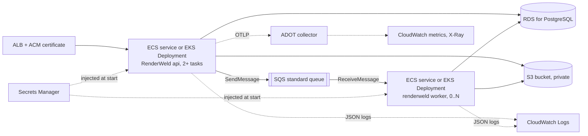

# Deploy on AWS

**Status: documented, not tested on AWS.** The pieces are tested elsewhere:
the S3 driver against MinIO, the SQS driver against LocalStack 4.11.1,
PostgreSQL 17, the Kubernetes manifests on kind
([overview](overview.md#what-is-tested-and-where)). AWS service names and IAM
actions were checked against AWS documentation on 2026-11-24
(research/SOURCES.md). Steps to check on a real account are marked **VERIFY**.

## Reference architecture



| Part | AWS service | RenderWeld settings |
| --- | --- | --- |
| api | ECS service (Fargate) or EKS Deployment behind an ALB | `RENDERWELD_ROLE=api`, `RENDERWELD_PUBLIC_URL`, `RENDERWELD_TRUST_PROXY=true` |
| workers | ECS service (Fargate or EC2 capacity provider) or EKS Deployment / KEDA | `RENDERWELD_ROLE=worker`, `RENDERWELD_WORKER_CONCURRENCY=1` |
| database | RDS for PostgreSQL 13+ (or Aurora PostgreSQL; RDS for MySQL 8.0+ also works) | `DATABASE_URL` (secret) |
| files | S3, one private bucket (Block Public Access on), optional SSE-KMS | `RENDERWELD_STORAGE_DRIVER=s3`, `RENDERWELD_S3_BUCKET`, `RENDERWELD_S3_REGION`, optional `RENDERWELD_S3_PREFIX`, `RENDERWELD_S3_SSE=aws:kms`, `RENDERWELD_S3_KMS_KEY_ID` |
| identity | ECS task role; EKS IRSA or EKS Pod Identity | leave every `*_ACCESS_KEY_ID` unset: the AWS SDK's default chain finds the role |
| job wake-up (optional) | SQS **standard** queue, one per deployment | `RENDERWELD_QUEUE_DISPATCH=sqs`, `RENDERWELD_QUEUE_SQS_QUEUE_URL` |
| secrets | Secrets Manager | ECS `secrets`, or the Secrets Store CSI driver on EKS (`_FILE`) |
| email (optional) | Amazon SES (API v2) | `RENDERWELD_EMAIL_FROM`, `RENDERWELD_SES_REGION` |
| logs, metrics, traces | CloudWatch Logs (`awslogs`), AWS Distro for OpenTelemetry (ADOT) collector | `RENDERWELD_OTLP_ENDPOINT=http://localhost:4318` (sidecar) |

One instance is also fine on AWS: an EC2 instance with Docker and the
[VPS recipe](../DEPLOY.md#3-vps-with-caddy-automatic-https), SQLite and local
storage on an EBS volume. Everything below is for api and workers.

## Settings

Shared by api and workers (ECS `environment`, or the ConfigMap in
`deployment/kubernetes/base/configmap.yaml`):

```bash
RENDERWELD_PUBLIC_URL=https://studio.example.com
RENDERWELD_TRUST_PROXY=true
RENDERWELD_STORAGE_DRIVER=s3
RENDERWELD_S3_BUCKET=acme-reelforge
RENDERWELD_S3_REGION=eu-west-1
RENDERWELD_S3_PREFIX=studio
RENDERWELD_QUEUE_DISPATCH=sqs                     # optional; default poll
RENDERWELD_QUEUE_SQS_QUEUE_URL=https://sqs.eu-west-1.amazonaws.com/111122223333/reelforge-jobs
RENDERWELD_RATE_LIMIT_STORE=database
# secrets (Secrets Manager, below): DATABASE_URL, RENDERWELD_SECRET_KEY, RENDERWELD_BOOTSTRAP_KEY, RENDERWELD_LICENCE_KEY
```

`DATABASE_URL` for RDS:
`postgresql://reelforge:<url-encoded password>@<instance>.<id>.eu-west-1.rds.amazonaws.com:5432/reelforge?sslmode=require`
(TLS to PostgreSQL is untested here: VERIFY). Migrations run on start and take
a lock, so several instances starting together are safe; or run
`--migrate-only` once as an ECS task with a DDL-capable user and set
`RENDERWELD_MIGRATE_ON_START=0` (DEPLOY.md, "Database").

## IAM (least privilege)

Replace the account id `111122223333`, the region, the bucket `acme-reelforge`,
the prefix `studio`, the queue and the key ARNs. Every action below is one the
code calls (`packages/core/src/storage/s3.ts`, `dispatch-sqs.ts`,
`webhooks/providers.ts`); nothing creates buckets, queues or policies.

**api task role** (or the api's IRSA / Pod Identity role):

```json
{
  "Version": "2012-10-17",
  "Statement": [
    {
      "Sid": "ListOwnPrefix",
      "Effect": "Allow",
      "Action": "s3:ListBucket",
      "Resource": "arn:aws:s3:::acme-reelforge",
      "Condition": { "StringLike": { "s3:prefix": ["studio/*", "studio/"] } }
    },
    {
      "Sid": "ObjectsInOwnPrefix",
      "Effect": "Allow",
      "Action": ["s3:GetObject", "s3:PutObject", "s3:DeleteObject", "s3:AbortMultipartUpload"],
      "Resource": "arn:aws:s3:::acme-reelforge/studio/*"
    },
    {
      "Sid": "PublishJobIds",
      "Effect": "Allow",
      "Action": "sqs:SendMessage",
      "Resource": "arn:aws:sqs:eu-west-1:111122223333:reelforge-jobs"
    },
    {
      "Sid": "OptionalSesEmail",
      "Effect": "Allow",
      "Action": "ses:SendEmail",
      "Resource": "arn:aws:ses:eu-west-1:111122223333:identity/example.com"
    }
  ]
}
```

**worker task role**: the same S3 statements, plus:

```json
{
  "Version": "2012-10-17",
  "Statement": [
    {
      "Sid": "WakeOnJobs",
      "Effect": "Allow",
      "Action": [
        "sqs:SendMessage",
        "sqs:ReceiveMessage",
        "sqs:DeleteMessage",
        "sqs:ChangeMessageVisibility",
        "sqs:GetQueueAttributes"
      ],
      "Resource": "arn:aws:sqs:eu-west-1:111122223333:reelforge-jobs"
    }
  ]
}
```

Workers send too: they put jobs back after a lost lease or on shutdown. Workers
also deliver webhooks and email (the delivery worker runs on every instance
that is not `worker --once`), so give them `ses:SendEmail` as well if you use
SES. With SSE-KMS add to both roles:

```json
{
  "Version": "2012-10-17",
  "Statement": [
    {
      "Sid": "BucketKey",
      "Effect": "Allow",
      "Action": ["kms:GenerateDataKey", "kms:Decrypt"],
      "Resource": "arn:aws:kms:eu-west-1:111122223333:key/1234abcd-12ab-34cd-56ef-1234567890ab"
    }
  ]
}
```

What each action is for: `s3:ListBucket` covers `ListObjectsV2` (usage,
retention, migration) and `HeadBucket` (`/readyz`); `s3:GetObject` covers
`GetObject` and `HeadObject`; `s3:PutObject` covers uploads, multipart parts and
the destination of `CopyObject` (render commit); `s3:DeleteObject` retention and
project deletion. The SQS driver uses `SendMessageBatch` (authorised by
`sqs:SendMessage`), and `GetQueueAttributes` only as its connect check.

**ECS task execution role** (pulls the image, writes logs, reads the secrets
for injection; the containers never get it): the AWS managed policy
`AmazonECSTaskExecutionRolePolicy` plus

```json
{
  "Version": "2012-10-17",
  "Statement": [
    {
      "Sid": "InjectSecrets",
      "Effect": "Allow",
      "Action": "secretsmanager:GetSecretValue",
      "Resource": [
        "arn:aws:secretsmanager:eu-west-1:111122223333:secret:reelforge/database-url-*",
        "arn:aws:secretsmanager:eu-west-1:111122223333:secret:reelforge/secret-key-*",
        "arn:aws:secretsmanager:eu-west-1:111122223333:secret:reelforge/bootstrap-key-*",
        "arn:aws:secretsmanager:eu-west-1:111122223333:secret:reelforge/licence-key-*"
      ]
    }
  ]
}
```

(add `kms:Decrypt` on the key if the secrets use a customer managed key).

**EKS with IRSA**: the role's trust policy (one role for the `reelforge`
service account, or two roles and two service accounts to keep the api and
worker permissions apart):

```json
{
  "Version": "2012-10-17",
  "Statement": [
    {
      "Effect": "Allow",
      "Principal": { "Federated": "arn:aws:iam::111122223333:oidc-provider/oidc.eks.eu-west-1.amazonaws.com/id/EXAMPLED539D4633E53DE1B71EXAMPLE" },
      "Action": "sts:AssumeRoleWithWebIdentity",
      "Condition": {
        "StringEquals": {
          "oidc.eks.eu-west-1.amazonaws.com/id/EXAMPLED539D4633E53DE1B71EXAMPLE:sub": "system:serviceaccount:reelforge:reelforge",
          "oidc.eks.eu-west-1.amazonaws.com/id/EXAMPLED539D4633E53DE1B71EXAMPLE:aud": "sts.amazonaws.com"
        }
      }
    }
  ]
}
```

and annotate the service account in
`deployment/kubernetes/base/serviceaccount.yaml` with
`eks.amazonaws.com/role-arn: arn:aws:iam::111122223333:role/reelforge`. With
**EKS Pod Identity** the trust policy is instead:

```json
{
  "Version": "2012-10-17",
  "Statement": [
    {
      "Effect": "Allow",
      "Principal": { "Service": "pods.eks.amazonaws.com" },
      "Action": ["sts:AssumeRole", "sts:TagSession"]
    }
  ]
}
```

plus a Pod Identity association for `reelforge/reelforge`. Then remove the
`RENDERWELD_S3_ACCESS_KEY_ID_FILE` / `..._SECRET_ACCESS_KEY_FILE` entries from
`api.yaml` and `worker.yaml` and the keys from the secret. The base sets
`automountServiceAccountToken: false`; IRSA and Pod Identity inject their own
projected token volume (VERIFY on your cluster that the token file named by
`AWS_WEB_IDENTITY_TOKEN_FILE` or `AWS_CONTAINER_AUTHORIZATION_TOKEN_FILE` is
present in the pod).

**Database user**: `SELECT, INSERT, UPDATE, DELETE` on the RenderWeld tables;
DDL only for the user that runs migrations. No AWS IAM permission is needed for
password authentication (RDS IAM database authentication is not supported).

## Network egress

Security groups: ALB → api on TCP 4321; api and workers → RDS on 5432 (or the
RDS Proxy); nothing inbound to workers except your Prometheus on 4321. Outbound:

| From | To | Port | Why | Avoid the internet path |
| --- | --- | --- | --- | --- |
| api, workers | `s3.<region>.amazonaws.com` / `<bucket>.s3.<region>.amazonaws.com` | 443 | files | S3 gateway VPC endpoint (no NAT charge) |
| api, workers | `sqs.<region>.amazonaws.com` | 443 | `queue.dispatch: sqs` | SQS interface endpoint; set `RENDERWELD_QUEUE_SQS_ENDPOINT` to its URL if you do not use private DNS |
| api, workers on EKS with IRSA | `sts.<region>.amazonaws.com` (or `sts.amazonaws.com`) | 443 | exchange the web identity token | STS interface endpoint |
| api, workers on EKS Pod Identity | `169.254.170.23` | 80 | the node's Pod Identity agent | — (link-local) |
| api, workers on ECS | `169.254.170.2` | 80 | task role credentials from the ECS agent | — (link-local) |
| api (and workers if they send email) | `email.<region>.amazonaws.com` | 443 | SES, only with an SES email channel | SES interface endpoint |
| api only | `api.console.buildbase.app` | 443 | licence activation, then once a day | none: allow it through NAT or a proxy (`HTTPS_PROXY` + `NODE_USE_ENV_PROXY=1`) |
| api, workers | the hosts of providers you configured (`api.elevenlabs.io`, webhook URLs, Slack, OTLP) | 443 | only when configured | — |
| ECS agent (not the containers) | ECR, Secrets Manager, CloudWatch Logs | 443 | image pull, secret injection, logs | ECR (`api` and `dkr`), Secrets Manager and Logs interface endpoints |

On EKS, the shipped NetworkPolicy (`deployment/kubernetes/base/networkpolicy.yaml`)
allows HTTPS to public addresses and **denies `169.254.0.0/16`**, which blocks
the Pod Identity agent. With Pod Identity add this to the api and worker
policies (IRSA needs nothing extra while the HTTPS rule is not narrowed):

```yaml
    - to:
        - ipBlock: { cidr: 169.254.170.23/32 }
      ports:
        - { protocol: TCP, port: 80 }
```

If you narrow the HTTPS rule, keep the S3 prefix list CIDRs (or the VPC endpoint
addresses), the STS endpoint and, for the api, the licence server's addresses.

## ECS on Fargate

Two services from one task definition family each (api, worker). The worker:

```json
{
  "family": "reelforge-worker",
  "requiresCompatibilities": ["FARGATE"],
  "networkMode": "awsvpc",
  "cpu": "4096",
  "memory": "8192",
  "ephemeralStorage": { "sizeInGiB": 50 },
  "runtimePlatform": { "cpuArchitecture": "X86_64", "operatingSystemFamily": "LINUX" },
  "taskRoleArn": "arn:aws:iam::111122223333:role/reelforge-worker",
  "executionRoleArn": "arn:aws:iam::111122223333:role/reelforge-execution",
  "volumes": [{ "name": "data" }, { "name": "tmp" }],
  "containerDefinitions": [
    {
      "name": "reelforge",
      "image": "ghcr.io/buildbase-app/reelforge-studio:0.1.0",
      "essential": true,
      "user": "10001:10001",
      "readonlyRootFilesystem": true,
      "stopTimeout": 120,
      "portMappings": [{ "containerPort": 4321, "protocol": "tcp" }],
      "mountPoints": [
        { "sourceVolume": "data", "containerPath": "/data" },
        { "sourceVolume": "tmp", "containerPath": "/tmp" }
      ],
      "environment": [
        { "name": "RENDERWELD_ROLE", "value": "worker" },
        { "name": "RENDERWELD_WORKER_CONCURRENCY", "value": "1" },
        { "name": "RENDERWELD_QUEUE_SHUTDOWN_GRACE_SECONDS", "value": "100" },
        { "name": "RENDERWELD_CHROMIUM_NO_SANDBOX", "value": "1" },
        { "name": "RENDERWELD_STORAGE_DRIVER", "value": "s3" },
        { "name": "RENDERWELD_S3_BUCKET", "value": "acme-reelforge" },
        { "name": "RENDERWELD_S3_REGION", "value": "eu-west-1" },
        { "name": "RENDERWELD_S3_PREFIX", "value": "studio" }
      ],
      "secrets": [
        { "name": "DATABASE_URL", "valueFrom": "arn:aws:secretsmanager:eu-west-1:111122223333:secret:reelforge/database-url" },
        { "name": "RENDERWELD_SECRET_KEY", "valueFrom": "arn:aws:secretsmanager:eu-west-1:111122223333:secret:reelforge/secret-key" }
      ],
      "healthCheck": {
        "command": ["CMD-SHELL", "node -e \"fetch('http://127.0.0.1:4321/healthz').then(r=>process.exit(r.ok?0:1),()=>process.exit(1))\""],
        "interval": 30,
        "timeout": 5,
        "retries": 3,
        "startPeriod": 30
      },
      "logConfiguration": {
        "logDriver": "awslogs",
        "options": { "awslogs-group": "/reelforge", "awslogs-region": "eu-west-1", "awslogs-stream-prefix": "worker" }
      }
    }
  ]
}
```

The api is the same with `RENDERWELD_ROLE=api`, `cpu` 1024 / `memory` 2048 (it
never renders), `RENDERWELD_PUBLIC_URL`, `RENDERWELD_TRUST_PROXY=true`, the
bootstrap and licence key secrets, and the ALB target group on port 4321 with
health check path `/healthz` and an idle timeout of 120 s or more.

Fargate limits that matter (AWS task definition reference, read 2026-11-24):

- **No `sharedMemorySize`.** `/dev/shm` cannot be sized on Fargate. The html and
  Motion Canvas engines start Chromium with `--disable-dev-shm-usage`; Remotion
  manages its own flags. VERIFY a render of every engine.
- **No custom seccomp profile**, so Chromium's own sandbox probably cannot
  start: the task above sets the explicit opt-out
  `RENDERWELD_CHROMIUM_NO_SANDBOX=1`, and the Fargate microVM is the isolation
  boundary. VERIFY whether the sandbox starts without the opt-out (then remove
  it). Prefer EKS on EC2 nodes with the Localhost profile if you render
  untrusted agent HTML at scale.
- **Ephemeral storage** is 20 GiB by default, up to 200 GiB with
  `ephemeralStorage`; the image (about 1.9 GB) is stored there too. `/data`
  holds render staging and caches only (files live in S3); 50 GiB leaves room
  for long renders.
- `stopTimeout` is at most 120 s on Fargate: keep
  `RENDERWELD_QUEUE_SHUTDOWN_GRACE_SECONDS` below it (100 above). A render that
  runs longer is handed back to the queue and restarted by another worker.
- **Fargate Spot** for workers: an interruption is a SIGTERM with a two-minute
  warning, handled like a scale-in (finish or hand back). The api should run on
  regular Fargate.

**Scaling on ECS** (VERIFY): Application Auto Scaling on the worker service.
With SQS dispatch, step scaling on the queue's
`ApproximateNumberOfMessagesVisible` plus `ApproximateNumberOfMessagesNotVisible`
works as a backlog signal, but running renders are not in the queue: keep the
minimum task count at the pool you need under load, and scale in slowly. Without
SQS, publish `renderweld_jobs_queued` + `renderweld_jobs_running` to CloudWatch
(ADOT, below) and target-track it. ECS RunTask per job (`worker --once` started
by a launcher) is not built yet (issue #28).

## EKS

Use the manifests in `deployment/kubernetes/` as they are (kustomize; there is
no Helm chart). For EKS:

1. Nodes: managed node groups on EC2 (not Fargate profiles, for the same
   seccomp reason). Put `deployment/seccomp/chrome.json` on every node as
   `/var/lib/kubelet/seccomp/reelforge-chrome.json` (a DaemonSet that copies it,
   or the launch template's user data). Without it html, hyperframes and
   motion-canvas renders fail; the opt-out is `RENDERWELD_CHROMIUM_NO_SANDBOX=1`.
2. Identity: IRSA or Pod Identity (above); delete the S3 key entries.
3. Secrets: the base reads them as files from the `reelforge` Secret. To keep
   them in Secrets Manager, use the Secrets Store CSI driver with the AWS
   provider (mount at `/run/secrets/reelforge`) or External Secrets Operator to
   sync the `reelforge` Secret. The file names must stay `database-url`,
   `secret-key`, `bootstrap-key` (or change the `*_FILE` paths).
4. NetworkPolicy: needs a policy engine (the VPC CNI's network policy support,
   or Calico / Cilium). Edit the CIDRs (above).
5. Ingress: the AWS Load Balancer Controller with an ALB Ingress, idle timeout
   above 120 s; allow its namespace in the api policy's ingress rule.
6. Scaling: `kubectl apply -k deployment/kubernetes/keda/` (KEDA's PostgreSQL
   scaler on the `Job` table, scales workers to zero; tested on kind). Or the
   KEDA `aws-sqs-queue` trigger with pod identity, documented in
   [queue-and-scaling.md](../providers/queue-and-scaling.md#autoscaling-on-the-broker-keda)
   (untested). KEDA's PostgreSQL scaler connects to RDS: allow the KEDA operator
   namespace in the RDS security group.

## Secrets

- `RENDERWELD_SECRET_KEY` (`openssl rand -base64 32`): one Secrets Manager
  secret, the same for every task. It decrypts settings stored in the database
  and signs download links across instances. **Losing it loses every secret
  stored over the API**; Secrets Manager keeps it, and its deletion has a
  recovery window. Rotating it means re-entering the runtime secrets.
- `DATABASE_URL`: generated from the RDS master secret or a dedicated user.
  RDS-managed master passwords rotate automatically; if the app uses that user,
  the injected value goes stale until the next deployment. Prefer a dedicated
  application user you rotate together with a redeploy.
- On ECS the secrets arrive as environment variables (ECS `secrets`). That is
  fine: RenderWeld redacts them from logs and the API. On EKS, files.

## Observability

- **Logs:** JSON lines on stdout go to CloudWatch Logs through `awslogs` (ECS) or
  Fluent Bit / the CloudWatch Observability add-on (EKS). CloudWatch Logs
  Insights parses the JSON fields.
- **Metrics and traces:** RenderWeld speaks OTLP/HTTP without AWS SigV4 signing,
  so send it to the ADOT collector (an ECS sidecar or an EKS DaemonSet /
  Deployment) at `RENDERWELD_OTLP_ENDPOINT=http://localhost:4318` (sidecar) and
  let the collector export to CloudWatch (EMF) and X-Ray, or to Amazon Managed
  Service for Prometheus. Or scrape `/metrics` (set `RENDERWELD_METRICS_TOKEN`).
  Exporter names: the ADOT documentation for your collector version.
- Alerts: `deployment/observability/alerts.yml` (Prometheus rules) translates to
  CloudWatch alarms on the same metrics.

## Backups

- **RDS:** automated backups with point-in-time recovery (the retention you
  need), plus a manual snapshot before every RenderWeld upgrade (a newer schema is
  refused by an older server; a failed MySQL migration cannot roll back).
- **S3:** renders are never overwritten. Versioning plus a lifecycle rule for
  noncurrent versions protects against deletes; cross-region replication if you
  need it. Retention inside RenderWeld: `storage.retention.*`.
- **Secrets Manager:** keep `RENDERWELD_SECRET_KEY` with the database backups'
  access policy; a database restored without it has unreadable stored secrets.
- **SQS** holds only job ids; nothing to back up (the database is the record).

## Cost notes

No prices here (they change; use the AWS pricing calculator). What drives the
bill:

- **Worker compute** dominates: renders are CPU-bound. Scale workers to zero
  between bursts (KEDA on EKS) or use Fargate Spot / EC2 Spot. The api is small
  (1 vCPU).
- **NAT gateway data processing:** every byte to S3 through NAT is charged.
  The S3 gateway endpoint is free and removes it; interface endpoints for SQS,
  STS, ECR and Secrets Manager have an hourly charge, weigh them against NAT
  traffic.
- **SQS:** idle workers long-poll for 20 s, about 3 requests per idle worker per
  minute, plus one send, one receive and one delete per job. `poll` dispatch
  costs nothing on AWS but database queries.
- **RDS:** the queue, quotas and leases are small writes; a small instance class
  carries many workers. Budget connections: api × 10 + workers × 3 (DEPLOY.md,
  "Database"). RDS Proxy notes: [queue-and-scaling.md](../providers/queue-and-scaling.md#rds-proxy-aws).
- **S3:** renders are 10 to 30 MB for 15 s at 1080x1920; set
  `storage.retention.renderDays` or a lifecycle rule.
