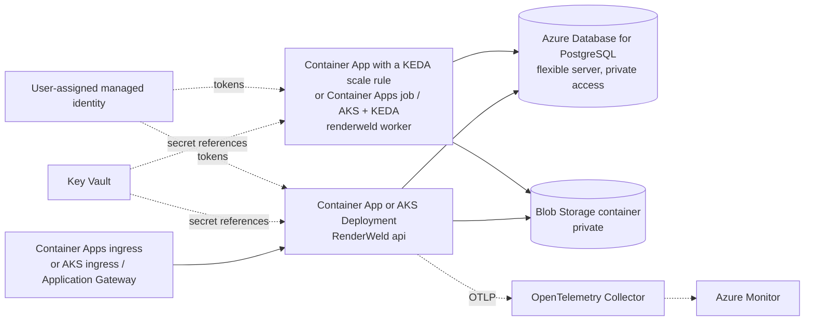

# Deploy on Azure

**Status: documented, not tested on Azure.** The `azure` storage driver passes
its contract suite on the Azurite emulator; managed identity, user delegation SAS
and encryption scopes are unit-tested with mocked clients; PostgreSQL 17 and the
Kubernetes manifests (kind) are tested. Azure facts below were checked against
Microsoft Learn on 2026-11-24 (research/SOURCES.md). Steps to check are marked
**VERIFY**.

## Reference architecture



| Part | Azure service | RenderWeld settings |
| --- | --- | --- |
| api | Container App with external ingress (target port 4321), or an AKS Deployment | `RENDERWELD_ROLE=api`, `RENDERWELD_PUBLIC_URL`, `RENDERWELD_TRUST_PROXY=true` |
| workers | Container App without ingress and a custom scale rule; or a Container Apps **event-driven job** running `worker --once`; or AKS with the KEDA overlay | `RENDERWELD_ROLE=worker`; for a job also `RENDERWELD_WORKER_ONCE=1` |
| database | Azure Database for PostgreSQL flexible server 13+ (or for MySQL flexible server 8.0+) | `DATABASE_URL` (secret) |
| files | Blob Storage, one private container | `RENDERWELD_STORAGE_DRIVER=azure`, `RENDERWELD_AZURE_STORAGE_ACCOUNT_URL`, `RENDERWELD_AZURE_STORAGE_CONTAINER`, optional `RENDERWELD_AZURE_STORAGE_PREFIX`, `RENDERWELD_AZURE_STORAGE_ENCRYPTION_SCOPE` |
| identity | user-assigned managed identity (Container Apps), Microsoft Entra Workload ID (AKS) | `RENDERWELD_AZURE_MANAGED_IDENTITY_CLIENT_ID` for a user-assigned identity on Container Apps; nothing on AKS Workload ID |
| job wake-up (optional) | Azure Cache for Redis, or PostgreSQL `notify` | `RENDERWELD_QUEUE_DISPATCH=redis` or `notify` |
| secrets | Key Vault | Container Apps Key Vault references; the Key Vault provider for the Secrets Store CSI driver on AKS |
| logs, metrics, traces | Log Analytics (stdout), an OpenTelemetry Collector to Azure Monitor | `RENDERWELD_OTLP_ENDPOINT` |

One small instance is a Linux VM with Docker and the
[VPS recipe](../DEPLOY.md#3-vps-with-caddy-automatic-https).

## Settings

```bash
RENDERWELD_PUBLIC_URL=https://studio.example.com
RENDERWELD_TRUST_PROXY=true
RENDERWELD_STORAGE_DRIVER=azure
RENDERWELD_AZURE_STORAGE_ACCOUNT_URL=https://acmereelforge.blob.core.windows.net
RENDERWELD_AZURE_STORAGE_CONTAINER=reelforge
RENDERWELD_AZURE_STORAGE_PREFIX=studio
RENDERWELD_AZURE_MANAGED_IDENTITY_CLIENT_ID=00000000-0000-0000-0000-000000000000   # user-assigned identity (Container Apps, VMs)
RENDERWELD_RATE_LIMIT_STORE=database
# secrets: DATABASE_URL, RENDERWELD_SECRET_KEY, RENDERWELD_BOOTSTRAP_KEY, RENDERWELD_LICENCE_KEY
```

Without a connection string the driver uses `DefaultAzureCredential`: managed
identity, workload identity or `AZURE_*` environment variables
(`packages/core/src/storage/azure.ts`). A connection string
(`RENDERWELD_AZURE_STORAGE_CONNECTION_STRING_FILE`) also works; it needs the
account key for bucket-signed links.

`DATABASE_URL` for the flexible server:
`postgresql://reelforge:<password>@acme-pg.postgres.database.azure.com:5432/reelforge?sslmode=require`.
The server requires TLS by default; TLS to PostgreSQL is untested here (VERIFY).
The flexible server's built-in PgBouncer listens on 6432 in transaction mode:
use it for `DATABASE_URL` if you like, run migrations on 5432, and with `notify`
dispatch set `RENDERWELD_DATABASE_DIRECT_URL` to the 5432 URL
([queue-and-scaling.md](../providers/queue-and-scaling.md#pgbouncer-transaction-mode)).
Microsoft Entra authentication to PostgreSQL is not supported (password only).

## Roles (least privilege)

| Identity | Role | Scope | Why |
| --- | --- | --- | --- |
| the app's managed identity | **Storage Blob Data Contributor** | the container | read, write, list and delete blobs |
| the app's managed identity | **Storage Blob Delegator** | the storage account | `generateUserDelegationKey`, for bucket-signed download links (user delegation SAS). Without it `downloadUrl` goes through the server |
| the app's managed identity | **Key Vault Secrets User** | the Key Vault (or each secret) | Key Vault references in Container Apps; the CSI provider on AKS |
| KEDA / Container Apps scale rule | none in Azure | — | the PostgreSQL scaler authenticates with a database URL secret |

Storage Blob Data Contributor includes the user delegation key action, but
that call acts on the storage account; assigned only on a container it may be
refused, hence Storage Blob Delegator on the account (VERIFY on a real account;
the emulator does not check roles). A custom role with only what the driver
calls (upload, block upload, download, properties, list, delete, container
properties, user delegation key) is:

```json
{
  "Name": "RenderWeld blob storage",
  "IsCustom": true,
  "Description": "Blobs in the RenderWeld container: read, write, list, delete; user delegation keys for signed links.",
  "Actions": [
    "Microsoft.Storage/storageAccounts/blobServices/containers/read",
    "Microsoft.Storage/storageAccounts/blobServices/generateUserDelegationKey/action"
  ],
  "NotActions": [],
  "DataActions": [
    "Microsoft.Storage/storageAccounts/blobServices/containers/blobs/read",
    "Microsoft.Storage/storageAccounts/blobServices/containers/blobs/write",
    "Microsoft.Storage/storageAccounts/blobServices/containers/blobs/delete"
  ],
  "NotDataActions": [],
  "AssignableScopes": ["/subscriptions/00000000-0000-0000-0000-000000000000/resourceGroups/reelforge"]
}
```

`az role definition create --role-definition @role.json`. VERIFY it against a
real account before you replace the built-in roles with it.

**Encryption.** Blob Storage encrypts at rest; `storage.azure.encryptionScope`
selects a customer-managed key scope on every write.

## Network egress

| From | To | Port | Why |
| --- | --- | --- | --- |
| api, workers | `<account>.blob.core.windows.net` (or a private endpoint) | 443 | files |
| api, workers | `login.microsoftonline.com` | 443 | Microsoft Entra tokens (workload identity; managed identity token exchange) |
| api, workers on a VM or a node identity | `169.254.169.254` | 80 | the Instance Metadata Service (not used by Container Apps' identity endpoint or AKS Workload ID) |
| api, workers | the flexible server's private address | 5432 / 6432 | database |
| api, workers | Azure Cache for Redis | 6380 (TLS) | only with `queue.dispatch: redis` |
| api only | `api.console.buildbase.app` | 443 | licence activation, then once a day (NAT gateway or a firewall rule) |
| api, workers | the providers, webhook and OTLP endpoints you configured | 443 | only when configured |

With Azure Firewall or a user-defined route, allow the storage account, Entra
ID (`login.microsoftonline.com`), Key Vault (for Container Apps' secret
references), the container registry and the licence server.

On AKS the shipped NetworkPolicy allows HTTPS to public addresses (so Entra ID
and Blob Storage over public endpoints work) and the Redis ports 6379/6380 on
private ranges. A Blob **private endpoint** is on a private range on 443:
add an egress rule for its address. Azure Managed Redis listens on another port
(10000): add it to the Redis rule.

## Container Apps

1. A Container Apps environment in your VNet (workload profiles), a
   user-assigned managed identity with the roles above, a Key Vault with the
   secrets.
2. **api** app: external ingress, target port 4321, min replicas 1 (it runs
   background work), 1 vCPU / 2 GiB, secrets as Key Vault references:

   ```bash
   az containerapp create -n reelforge-api -g reelforge --environment reelforge-env \
     --image ghcr.io/buildbase-app/reelforge-studio:0.1.0 \
     --user-assigned $IDENTITY_ID --ingress external --target-port 4321 \
     --min-replicas 1 --max-replicas 5 --cpu 1 --memory 2Gi \
     --secrets "database-url=keyvaultref:https://acme-kv.vault.azure.net/secrets/database-url,identityref:$IDENTITY_ID" \
               "secret-key=keyvaultref:https://acme-kv.vault.azure.net/secrets/secret-key,identityref:$IDENTITY_ID" \
     --env-vars RENDERWELD_ROLE=api DATABASE_URL=secretref:database-url RENDERWELD_SECRET_KEY=secretref:secret-key \
                RENDERWELD_STORAGE_DRIVER=azure RENDERWELD_AZURE_STORAGE_ACCOUNT_URL=https://acmereelforge.blob.core.windows.net \
                RENDERWELD_AZURE_STORAGE_CONTAINER=reelforge RENDERWELD_AZURE_MANAGED_IDENTITY_CLIENT_ID=$IDENTITY_CLIENT_ID
   ```

   Or mount the secrets as a volume (`--secret-volume-mount /run/secrets/reelforge`,
   each secret a file named after it) and use the `*_FILE` variables. A newer
   Key Vault version is picked up within 30 minutes and restarts revisions that
   use it as an environment variable.
3. **workers**, one of:
   - an app without ingress, `RENDERWELD_ROLE=worker`, 2 to 4 vCPU, and a
     **custom scale rule** of type `postgresql` (Container Apps runs any
     ScaledObject-based KEDA scaler): metadata `query` = the query in
     `deployment/kubernetes/keda/scaledobject.yaml`, `targetQueryValue: "1"`,
     `activationTargetQueryValue: "0"`, auth `connection` = a secret holding a
     plain PostgreSQL URL (no Prisma-only parameters). Min replicas 0 scales to
     zero; Container Apps' defaults are a 30 s polling interval and a 300 s
     cooldown. Set `activeRevisionsMode` to `single` for non-HTTP scale rules.
   - an **event-driven job** (ScaledJob-based KEDA scalers) with the same
     `postgresql` rule and `RENDERWELD_ROLE=worker`, `RENDERWELD_WORKER_ONCE=1`:
     one execution per queued render, the shape of
     `deployment/kubernetes/keda/scaledjob/` (tested on kind as a Kubernetes
     Job; untested on Container Apps).
   - with `queue.dispatch: redis`, the `redis-streams` scaler instead
     ([queue-and-scaling.md](../providers/queue-and-scaling.md#autoscaling-on-the-broker-keda)).
4. Storage for `/data`: the replica's ephemeral storage holds render staging
   and caches (files live in Blob Storage). Do not put SQLite or `/data` on an
   Azure Files SMB share (locking, rename).

Container Apps limits that matter (VERIFY each): `/dev/shm` and seccomp cannot
be set, so set `RENDERWELD_CHROMIUM_NO_SANDBOX=1` if html, hyperframes or
motion-canvas renders fail with the sandbox message; the replica's termination
grace period caps `queue.shutdownGraceSeconds`; ephemeral storage size depends on
the CPU allocation.

## AKS

1. Enable the OIDC issuer and Microsoft Entra Workload ID; create a federated
   credential for `system:serviceaccount:reelforge:reelforge`; annotate the
   service account with `azure.workload.identity/client-id: <client id>` and add
   the pod label `azure.workload.identity/use: "true"` to the api and worker pod
   templates (only labelled pods get the token and the `AZURE_*` variables).
   `@azure/identity` 3.2.0 or later supports it; the image ships 4.14.1.
2. Put `deployment/seccomp/chrome.json` on every node as
   `/var/lib/kubelet/seccomp/reelforge-chrome.json` (a DaemonSet).
3. Secrets: the Azure Key Vault provider for the Secrets Store CSI driver,
   mounted at `/run/secrets/reelforge` with the file names the manifests use.
4. Switch the ConfigMap to the `azure` settings and remove the S3 key entries;
   `kubectl apply -k deployment/kubernetes/keda/` for KEDA scaling (tested on
   kind). NetworkPolicy needs Azure Network Policy Manager, Calico or Cilium.

## Observability

Container Apps and AKS (Container Insights) send stdout to Log Analytics; the
JSON fields are queryable with KQL. For metrics and traces run an OpenTelemetry
Collector with the Azure Monitor exporter (or the Azure Monitor managed
Prometheus scraping `/metrics`) and set `RENDERWELD_OTLP_ENDPOINT` to it.

## Backups

- **Azure Database for PostgreSQL:** automated backups with point-in-time
  restore (7 to 35 days), geo-redundant backup if you need it; an on-demand
  backup before each RenderWeld upgrade.
- **Blob Storage:** soft delete for blobs and containers, optionally versioning
  and point-in-time restore for block blobs.
- **Key Vault:** soft delete and purge protection on, so
  `RENDERWELD_SECRET_KEY` cannot be lost by accident.

## Cost notes

No prices here (use the Azure pricing calculator). What drives the bill: worker
vCPU-seconds (Container Apps bills active replicas; scale to zero with the
scale rule); the api's minimum replica, which is always active; the PostgreSQL
compute tier and connections (api × 10 + workers × 3); NAT gateway or firewall
for the licence check and providers; stored renders (`storage.retention.*` or a
lifecycle management rule).
