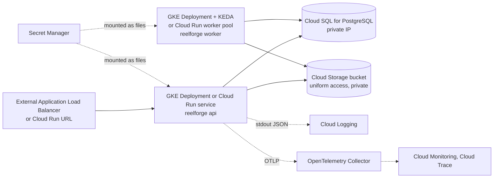

# Deploy on Google Cloud

**Status: documented, not tested on Google Cloud.** The native `gcs` storage
driver passes its contract suite on the fake-gcs-server emulator (which accepts
any credentials, so permission errors are untested); workload identity, CMEK and
V4 signing are unit-tested with a mocked SDK; PostgreSQL 17 and the Kubernetes
manifests (kind) are tested. Google Cloud facts below were checked against
Google's documentation on 2026-11-24 (research/SOURCES.md). Steps to check are
marked **VERIFY**.

**Pub/Sub is not supported** as a queue dispatch driver. The drivers are
`poll`, `notify` (PostgreSQL `LISTEN/NOTIFY`), `sqs` and `redis`
(`queue.dispatch`). On Google Cloud use `notify` with Cloud SQL for PostgreSQL
(with a direct connection, see below), `redis` with Memorystore for Redis 6.2 or
later, or the default `poll`. The database is the queue of record with every
driver, so nothing is lost without a broker.

## Reference architecture



| Part | Google Cloud service | ReelForge settings |
| --- | --- | --- |
| api | GKE Deployment behind a Gateway / Ingress, or a Cloud Run service | `REELFORGE_ROLE=api`, `REELFORGE_PUBLIC_URL`, `REELFORGE_TRUST_PROXY=true` |
| workers | GKE Deployment (KEDA overlay), or a Cloud Run worker pool | `REELFORGE_ROLE=worker`, `REELFORGE_WORKER_CONCURRENCY=1` |
| database | Cloud SQL for PostgreSQL 13+ (or MySQL 8.0+) | `DATABASE_URL` (secret) |
| files | Cloud Storage, uniform bucket-level access, public access prevention on | `REELFORGE_STORAGE_DRIVER=gcs`, `REELFORGE_GCS_BUCKET`, optional `REELFORGE_GCS_PREFIX`, `REELFORGE_GCS_KMS_KEY_NAME` |
| identity | Workload Identity Federation for GKE; Cloud Run's service identity | leave `storage.gcs.credentialsJson` unset: Application Default Credentials |
| job wake-up (optional) | Memorystore for Redis, or PostgreSQL `notify` | `REELFORGE_QUEUE_DISPATCH=redis` or `notify` |
| secrets | Secret Manager | files (`_FILE`) through the Secret Manager add-on (GKE) or Cloud Run secret volumes |
| logs, metrics, traces | Cloud Logging (stdout), an OpenTelemetry Collector to Cloud Monitoring and Cloud Trace | `REELFORGE_OTLP_ENDPOINT` |

One small instance is a Compute Engine VM with Docker and the
[VPS recipe](../DEPLOY.md#3-vps-with-caddy-automatic-https) (SQLite and local
files on a persistent disk). Cloud Run has no persistent block disk, so on Cloud
Run use Cloud SQL and Cloud Storage even for one instance.

## Settings

```bash
REELFORGE_PUBLIC_URL=https://studio.example.com
REELFORGE_TRUST_PROXY=true
REELFORGE_STORAGE_DRIVER=gcs
REELFORGE_GCS_BUCKET=acme-reelforge
REELFORGE_GCS_PREFIX=studio
REELFORGE_RATE_LIMIT_STORE=database
# optional: REELFORGE_QUEUE_DISPATCH=notify (Cloud SQL PostgreSQL) or redis + REELFORGE_QUEUE_REDIS_URL_FILE
# secrets as files: DATABASE_URL_FILE, REELFORGE_SECRET_KEY_FILE, REELFORGE_BOOTSTRAP_KEY_FILE, REELFORGE_LICENCE_KEY_FILE
```

`DATABASE_URL`: connect to the instance's **private IP**
(`postgresql://reelforge:<password>@10.20.0.3:5432/reelforge?sslmode=require`;
TLS untested here, VERIFY), or run the Cloud SQL Auth Proxy as a sidecar (GKE
native sidecar, or a second container on Cloud Run) and use
`postgresql://reelforge:<password>@127.0.0.1:5432/reelforge`. With `notify`
dispatch, `LISTEN` needs a session connection: direct, or the Auth Proxy; not
Cloud SQL Managed Connection Pooling in transaction mode (then set
`REELFORGE_DATABASE_DIRECT_URL` to a direct URL). Pooling notes:
[queue-and-scaling.md](../providers/queue-and-scaling.md#cloud-sql-google-cloud).

## IAM (least privilege)

One Google service account per role keeps the api and workers apart; one for
both is simpler. Grant on the **bucket**, not the project.

Files: the predefined role `roles/storage.objectUser` on the bucket is enough
(storage.md). The minimum the driver calls (`packages/core/src/storage/gcs.ts`:
upload, resumable upload, read, metadata, list, copy, delete) as a custom role:

```json
{
  "title": "ReelForge storage",
  "description": "Objects in the ReelForge bucket: read, write, list, delete.",
  "stage": "GA",
  "includedPermissions": [
    "storage.objects.create",
    "storage.objects.delete",
    "storage.objects.get",
    "storage.objects.list"
  ]
}
```

`gcloud iam roles create reelforgeStorage --project=PROJECT_ID --file=role.json`,
then bind it on the bucket. VERIFY that this custom role covers every call on a
real bucket (the emulator does not check permissions); fall back to
`roles/storage.objectUser` if a call is refused.

Signed download links: the driver signs V4 URLs through the IAM signBlob API,
so the service account needs `iam.serviceAccounts.signBlob` **on itself**
(`roles/iam.serviceAccountTokenCreator` granted on its own account). Without it
`downloadUrl` goes through the server (`downloadVia: "server"`), which works
but moves the bytes through the api. With GKE's direct workload identity
principal (no Google service account) there is no service account to sign with:
either link the Kubernetes service account to a Google service account (the
`iam.gke.io/gcp-service-account` annotation) or set
`REELFORGE_STORAGE_DOWNLOADS=proxy`. VERIFY.

Other grants:

| Who | Role | On | When |
| --- | --- | --- | --- |
| the workload | `roles/secretmanager.secretAccessor` | each ReelForge secret | always (or grant it to the Secret Manager add-on's identity, per its docs) |
| the workload | `roles/cloudsql.client` | the project | only with the Cloud SQL Auth Proxy or a connector |
| the Cloud Storage service agent | `roles/cloudkms.cryptoKeyEncrypterDecrypter` | the CMEK key | only with `storage.gcs.kmsKeyName` |
| the workload | `roles/logging.logWriter`, `roles/monitoring.metricWriter`, `roles/cloudtrace.agent` | the project | for the OpenTelemetry Collector's identity, if it runs as the workload |

**Workload Identity Federation for GKE.** Grant roles to the Kubernetes service
account directly, with the principal identifier

```
principal://iam.googleapis.com/projects/PROJECT_NUMBER/locations/global/workloadIdentityPools/PROJECT_ID.svc.id.goog/subject/ns/reelforge/sa/reelforge
```

for example
`gcloud storage buckets add-iam-policy-binding gs://acme-reelforge --member=principal://iam.googleapis.com/projects/PROJECT_NUMBER/locations/global/workloadIdentityPools/PROJECT_ID.svc.id.goog/subject/ns/reelforge/sa/reelforge --role=roles/storage.objectUser`.
No key file is created. Remove the S3 key entries from `api.yaml` and
`worker.yaml` (the base is written for S3; switch the ConfigMap to the `gcs`
settings above).

## Network egress

| From | To | Port | Why |
| --- | --- | --- | --- |
| api, workers | `storage.googleapis.com` | 443 | files (Private Google Access for nodes without external IPs) |
| api, workers | `iamcredentials.googleapis.com` | 443 | signBlob for signed download links (only with bucket-signed links) |
| api, workers | the GKE metadata server (below) or Cloud Run's metadata server | 80 / 988 | access tokens for the workload identity |
| api, workers | Cloud SQL private IP | 5432 (3307 through the Auth Proxy, plus `sqladmin.googleapis.com` 443) | database |
| api, workers | Memorystore IP | 6379 (6378 with in-transit encryption) | only with `queue.dispatch: redis` |
| api only | `api.console.buildbase.app` | 443 | licence activation, then once a day (Cloud NAT or a proxy for private nodes) |
| api, workers | the providers, webhook and OTLP endpoints you configured | 443 | only when configured |

**GKE NetworkPolicy and workload identity.** The shipped policy
(`deployment/kubernetes/base/networkpolicy.yaml`) denies `169.254.0.0/16`,
which blocks the GKE metadata server, so workload identity fails until you allow
it. Google's network policy page (read 2026-11-24): on GKE 1.21.0-gke.1000 and
later allow `169.254.169.252/32` on ports 988 and 987; with GKE Dataplane V2
allow `169.254.169.254/32` on ports 80 and 8080. Add to the api and worker
policies:

```yaml
    - to:
        - ipBlock: { cidr: 169.254.169.252/32 }
      ports:
        - { protocol: TCP, port: 988 }
        - { protocol: TCP, port: 987 }
    - to:
        - ipBlock: { cidr: 169.254.169.254/32 }   # Dataplane V2
      ports:
        - { protocol: TCP, port: 80 }
        - { protocol: TCP, port: 8080 }
```

Also add your Cloud SQL and Memorystore addresses to the database and Redis
rules (they are on private ranges, which the base already allows on those
ports).

## GKE

1. **GKE Standard** with node pools on Container-Optimized OS or Ubuntu. Put
   `deployment/seccomp/chrome.json` on every node as
   `/var/lib/kubelet/seccomp/reelforge-chrome.json` (a DaemonSet that copies it).
   **Autopilot** does not let you place node files, so use
   `REELFORGE_CHROMIUM_NO_SANDBOX=1` there (VERIFY what Autopilot allows).
2. Enable Workload Identity Federation for GKE on the cluster and node pools;
   grant roles as above.
3. Secrets: the Secret Manager add-on for GKE (CSI) mounting files at
   `/run/secrets/reelforge`, or External Secrets Operator syncing the
   `reelforge` Secret.
4. `kubectl apply -k deployment/kubernetes/` (HPA on CPU and
   `reelforge_jobs_queued`) or `-k deployment/kubernetes/keda/` (KEDA on the `Job`
   table, scale to zero; tested on kind). KEDA's PostgreSQL scaler needs a
   route to Cloud SQL (private IP, or the Auth Proxy as its own Deployment).
5. Ingress: a GKE Gateway or Ingress with a BackendConfig / policy timeout of
   120 s or more; the health check path `/healthz`. Allow the load balancer's
   health check ranges (or the ingress namespace) in the api policy.
6. Spot VMs for a worker node pool: a preemption gives a short notice; a render
   in flight is handed back after `queue.shutdownGraceSeconds` or retried after
   its lease (`queue.leaseSeconds`).

## Cloud Run

Cloud Run fits the api well and the workers with care.

**api** (a Cloud Run service):

```bash
gcloud run deploy reelforge-api \
  --image=ghcr.io/buildbase-app/reelforge-studio:0.1.0 \
  --execution-environment=gen2 --no-cpu-throttling \
  --min-instances=1 --max-instances=5 --cpu=1 --memory=2Gi --timeout=3600 \
  --port=4321 --service-account=reelforge@PROJECT_ID.iam.gserviceaccount.com \
  --network=VPC --subnet=SUBNET --vpc-egress=private-ranges-only \
  --update-secrets=/run/secrets/db/url=reelforge-database-url:latest,/run/secrets/key/value=reelforge-secret-key:latest \
  --set-env-vars=REELFORGE_ROLE=api,REELFORGE_STORAGE_DRIVER=gcs,REELFORGE_GCS_BUCKET=acme-reelforge,REELFORGE_TRUST_PROXY=true,DATABASE_URL_FILE=/run/secrets/db/url,REELFORGE_SECRET_KEY_FILE=/run/secrets/key/value
```

- `--no-cpu-throttling` (instance-based billing) is required: with request-based
  billing CPU is only allocated while a request is processed, and the api runs
  webhook deliveries, the outbox relay, retention sweeps and the licence check
  in the background.
- Each secret gets its own directory (Cloud Run does not mount two secrets at
  one path).
- `REELFORGE_PUBLIC_URL` is the service URL or your domain mapping.

**workers**, two options (both VERIFY):

- A **Cloud Run worker pool** (`gcloud run worker-pools deploy`): no load
  balanced URL, which suits a worker, but it does **not autoscale**: you set the
  instance count. Fine for a steady pool.
- A Cloud Run service with `--no-cpu-throttling --min-instances=N
  --max-instances=N` (a fixed pool; request-based autoscaling does not see the
  job queue, because workers serve no requests).

For a pool that scales with the queue, use GKE with KEDA. Cloud Run Jobs could
run `reelforge worker --once` per job, but the launcher that starts an execution
per queued job is not built (issue #28).

Cloud Run limits that matter: the container filesystem is in memory, so render
staging in `/data` uses the instance's memory (give workers 8 GiB or more, or
mount an in-memory volume with a size limit); `/dev/shm` cannot be sized; you
cannot set a seccomp profile. If html, hyperframes or motion-canvas renders fail
with the sandbox message, set `REELFORGE_CHROMIUM_NO_SANDBOX=1` (the gen2
microVM is then the boundary). Do not use a Cloud Storage FUSE volume for
`/data` (no atomic rename).

## Observability

- Cloud Logging collects stdout from GKE and Cloud Run. ReelForge's JSON lines
  name the level `level`, not `severity`, so Cloud Logging shows them at the
  default severity unless your log router or collector maps the field.
- Metrics and traces: run an OpenTelemetry Collector (GKE Deployment, or a Cloud
  Run sidecar) with Google Cloud exporters, and set
  `REELFORGE_OTLP_ENDPOINT=http://<collector>:4318`. ReelForge does not sign
  requests with Google credentials itself. Or scrape `/metrics` with Google
  Cloud Managed Service for Prometheus (`REELFORGE_METRICS_TOKEN`, or
  `REELFORGE_METRICS_ALLOW_ANONYMOUS=true` on a private network).

## Backups

- **Cloud SQL:** automated backups and point-in-time recovery; an on-demand
  backup before each ReelForge upgrade.
- **Cloud Storage:** soft delete (on by default for new buckets, VERIFY the
  retention on yours) and optionally Object Versioning; renders are never
  overwritten by ReelForge.
- **Secret Manager:** keep `REELFORGE_SECRET_KEY` versions; destroying the
  version in use makes the stored secrets of a restored database unreadable.

## Cost notes

No prices here (use the Google Cloud pricing calculator). What drives the bill:
worker vCPU-hours (Spot VMs on GKE; scale to zero with KEDA); Cloud Run
instance-based billing for every instance that is up (a worker pool or fixed
service bills around the clock); Cloud SQL instance size and connections
(api × 10 + workers × 3); Cloud NAT for private nodes (only the licence check
and your providers need the internet; Private Google Access keeps Cloud Storage
traffic off NAT); and stored renders (`storage.retention.*` or a lifecycle rule).
