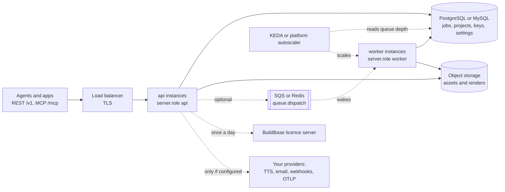

# Deploy on any cloud

ReelForge Studio is **one container image** that you run on your own
infrastructure. It needs a place to run the container, somewhere to keep files,
and (for more than one instance) a database. Everything in the studio comes from
this repository; the only outside service it ever needs is the BuildBase licence
server, once to activate and then once a day ([Isolation](../ISOLATION.md)).
Every other connection goes to a service **you** configure.

Guides per platform:

| Platform | Guide |
| --- | --- |
| AWS: ECS on Fargate or EKS, RDS for PostgreSQL, S3, SQS, Secrets Manager | [aws.md](aws.md) |
| Google Cloud: Cloud Run or GKE, Cloud SQL, Cloud Storage, Secret Manager | [google-cloud.md](google-cloud.md) |
| Azure: Container Apps or AKS, Azure Database for PostgreSQL, Blob Storage, Key Vault | [azure.md](azure.md) |
| DigitalOcean, Hetzner, Fly.io, Railway, bare metal with docker compose, any Kubernetes, S3-compatible stores (R2, MinIO, B2, Wasabi) | [other-platforms.md](other-platforms.md) |

Settings: [CONFIG.md](../CONFIG.md). Every provider and how to switch it:
[PROVIDERS.md](../PROVIDERS.md). What happens to a request:
[HOW_IT_WORKS.md](../HOW_IT_WORKS.md). Image, hardening, database and backups in
detail: [DEPLOY.md](../DEPLOY.md).

## Two shapes

**One server** (`server.role: all`, the default). One container renders and
serves REST and MCP. SQLite on a block volume, files on the same volume. Fits
one VM on any cloud, a Fly Machine, a Railway service or a server in your rack.
Back up one volume.

**API and workers** (`server.role: api` and `worker`). The same image twice:
`api` instances behind a load balancer take requests and queue jobs; `worker`
instances claim jobs from the database and render. This needs a shared
PostgreSQL or MySQL database, shared object storage (or one shared volume with
`storage.localShared`), and the same `REELFORGE_SECRET_KEY` on every instance.
The roles refuse to start without them and say what is missing
([queue-and-scaling.md](../providers/queue-and-scaling.md)).

## Which service fills each part

| Part | Setting | AWS | Google Cloud | Azure | Elsewhere |
| --- | --- | --- | --- | --- | --- |
| Container runtime | the image `ghcr.io/buildbase-app/reelforge-studio` | ECS on Fargate or EC2, EKS | Cloud Run, GKE, Compute Engine | Container Apps, AKS, a VM | any Docker host, any Kubernetes, Fly.io, Railway |
| Database (more than one instance) | `database.url` (`DATABASE_URL`) | RDS or Aurora for PostgreSQL, RDS for MySQL | Cloud SQL for PostgreSQL or MySQL | Azure Database for PostgreSQL or MySQL flexible server | any PostgreSQL 13+ or MySQL 8.0+ |
| Files | `storage.driver` | `s3` | `gcs` (native) or `s3` (HMAC interop) | `azure` | `s3` with an endpoint (MinIO, R2, B2, Wasabi, Spaces, Hetzner, Tigris), or `local` |
| Cloud identity instead of keys | leave the key settings unset | ECS task role, EKS IRSA or Pod Identity | the attached service account, GKE workload identity | managed identity, AKS workload identity | keys as `_FILE` secrets |
| Job wake-up (optional) | `queue.dispatch` | `sqs`, or `notify` on PostgreSQL | `notify` on PostgreSQL, `redis` (Memorystore). **Pub/Sub is not supported** | `notify` on PostgreSQL, `redis` (Azure Cache for Redis) | `poll` (default), `notify`, `redis` |
| Secrets | `<NAME>_FILE` or environment | Secrets Manager into the task | Secret Manager mounted as files | Key Vault references | Docker or Kubernetes secrets |
| Autoscaling workers | the `Job` table, or the broker | KEDA on EKS; ECS target tracking on a metric | KEDA on GKE; Cloud Run worker pools are sized by hand | Container Apps custom scale rule (KEDA scalers); KEDA on AKS | KEDA (`deployment/kubernetes/keda/`) |
| Metrics, traces, logs | `observability.*` | CloudWatch through the ADOT collector, or any OTLP backend | Cloud Monitoring and Trace through an OpenTelemetry Collector | Azure Monitor through an OpenTelemetry Collector | Prometheus `/metrics`, any OTLP endpoint |
| Email (optional) | `notifications.email.*` | SES | SMTP relay of your choice | SMTP (Azure Communication Services) | SMTP, Resend, Postmark, SendGrid |

## What is tested, and where

Read every guide with this table in mind. "In CI" runs on every pull request to
`main`. "By hand" was run by a maintainer or agent and recorded with its date
and result on the page that names the test case. "Documented only" is written
from the vendor's documentation and has not run.

| Area | In CI | By hand (recorded) | Documented only |
| --- | --- | --- | --- |
| Image | release image built for amd64 and arm64, contents and size, no secrets, Trivy, SBOM; Docker e2e with the hardened flags on SQLite, PostgreSQL 17 and MySQL 8.4 (amd64) and SQLite (arm64) | — | publish and cosign signing run only on `main` and tags |
| Databases | contract and server e2e on PostgreSQL 17 and MySQL 8.4 | PgBouncer 1.26.1 transaction mode | MariaDB, PostgreSQL over TLS, RDS, Aurora, Cloud SQL, Azure Database |
| Storage | local disk | MinIO (contract, Docker e2e `STORAGE=s3`), Azurite (Azure emulator), fake-gcs-server (GCS emulator) | AWS S3, Google Cloud Storage, Azure Blob, R2, B2, Wasabi, Spaces, Hetzner, Tigris |
| Queue dispatch | `poll` | `notify` on PostgreSQL 17, `sqs` on LocalStack 4.11.1, `redis` on Redis 8.4 | Amazon SQS, Memorystore, Azure Cache for Redis |
| Scaling | — | api + workers on PostgreSQL and MinIO (Docker, `SCALE=1`); KEDA on a kind cluster (`e2e/k8s/keda.sh`); kubeconform of every manifest (`e2e/k8s/kubeconform.sh`, passed 2026-11-24) | EKS, GKE, AKS, ECS, Container Apps, Cloud Run, Fly, Railway |
| Notifications | signed webhooks, SMTP to Mailpit, Resend, Postmark, SendGrid and SES against local stubs (Docker e2e) | — | the real Slack, Discord, Teams, Resend, Postmark, SendGrid and SES services |
| Observability | OTLP to an OpenTelemetry Collector, Prometheus scrape format (Docker e2e) | — | CloudWatch, Cloud Monitoring, Azure Monitor, Grafana Cloud, Honeycomb, Datadog |

Nothing in the cloud guides has run on a real cloud account yet. Each guide
marks the steps to check with **VERIFY**. If you run one, please report what
worked (SUPPORT.md) so the page can say "tested".

## Things every platform must provide

- **CPU and memory.** A render uses several cores and 1 to 2 GB; give a worker
  (or a one-server instance) 2 to 4 vCPU and 4 GB or more, and set
  `server.workerConcurrency` (or `limits.renderConcurrency`) to the renders it
  can run at once (`deployment/kubernetes/base/worker.yaml` uses 1 per pod).
- **CPU after the response.** Renders, webhook deliveries, the outbox relay and
  the licence check run in the background. Platforms that throttle CPU between
  requests (Cloud Run's request-based billing, scale-to-zero web services) must
  keep CPU allocated for every ReelForge instance.
- **A writable data directory** (`/data`): caches, render staging and the URL
  signing key with remote storage; everything with local storage. Atomic rename
  is needed, so use a local disk or block volume, not an object-storage FUSE
  mount (DEPLOY.md, "Persistent volume notes").
- **Shared memory.** Chromium wants a large `/dev/shm`
  (`--shm-size=1g`, or a memory `emptyDir` on Kubernetes). Platforms that do not
  let you size it (Fargate, Cloud Run, Container Apps) get the engines'
  `--disable-dev-shm-usage` where ReelForge controls the flags. VERIFY a render
  of every engine on such a platform.
- **Chromium's sandbox.** The image keeps it on and needs the seccomp profile
  `deployment/seccomp/chrome.json` (Docker, Kubernetes with a Localhost
  profile). Managed platforms where you cannot set a seccomp profile may refuse
  the user namespaces it needs; html, hyperframes and motion-canvas renders then
  fail with a message naming the profile. The opt-out is
  `REELFORGE_CHROMIUM_NO_SANDBOX=1` (logged, shown in `get_capabilities`); the
  platform's VM or microVM is then the isolation boundary
  ([HARDENING.md](../security/HARDENING.md)).
- **Long requests.** Keep the load balancer idle timeout above 120 s for
  `GET /v1/jobs/:id/events` (server-sent events) and `get_job waitSeconds`.
- **Outbound HTTPS to `api.console.buildbase.app`** from `api` (or `all`)
  instances, at least once every 14 days ([Isolation](../ISOLATION.md#offline)).
- **Stop grace longer than `queue.shutdownGraceSeconds`** for workers, so a
  render finishes or is handed back before the platform kills the container.

## Secrets on every platform

The secrets ReelForge reads: `REELFORGE_SECRET_KEY` (required by the release
image; the same on every instance; back it up), `DATABASE_URL`,
`REELFORGE_BOOTSTRAP_KEY` (first admin key), `REELFORGE_LICENCE_KEY`, storage,
broker and email credentials, `REELFORGE_METRICS_TOKEN`, `REELFORGE_OTLP_HEADERS`.
Each one can be given three ways:

1. `<NAME>_FILE=/run/secrets/...`: a file the platform mounts (Kubernetes and
   Docker secrets, Cloud Run secret volumes, Container Apps secret volumes). The
   file must be readable by UID 10001. Preferred: the value never appears in the
   environment or in `docker inspect`.
2. The environment variable itself, injected by the platform from its secret
   store (ECS `secrets`, Container Apps `secretref:`, Cloud Run `--update-secrets
   NAME=secret:version`).
3. For runtime settings only (provider keys, email credentials, storage keys,
   the licence key): set by an admin agent with `update_config` /
   `PATCH /v1/config`, stored AES-256-GCM encrypted with `REELFORGE_SECRET_KEY`.

`get_config` shows only `set` / `not set` and where a secret came from, never
the value.
