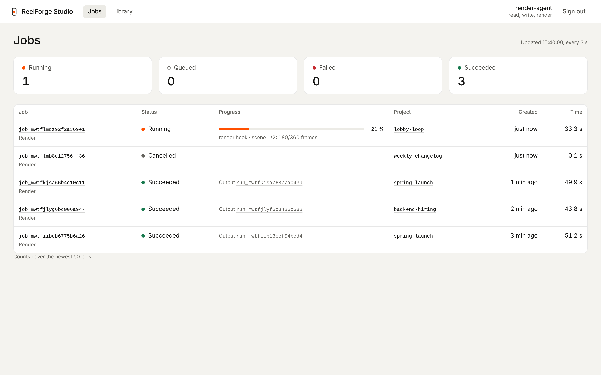
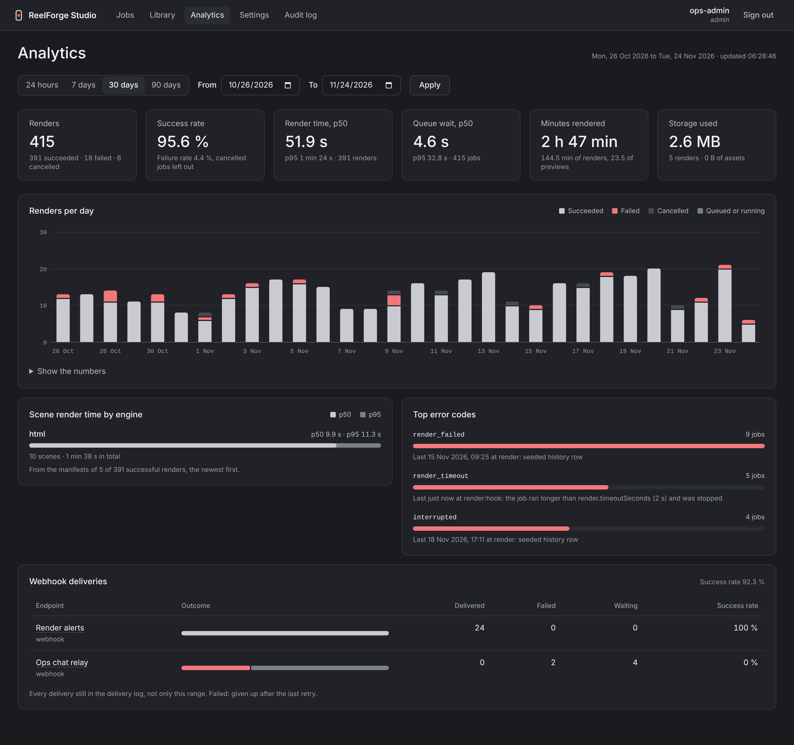

# Web dashboard

ReelForge Studio can serve a small web dashboard from the same server and the
same Docker image. It runs on your machine, like the rest of the studio, and
it uses the same REST API as your agents, with an API key you choose.



What it shows today:

| Page | What you see | What you can do |
| --- | --- | --- |
| **Jobs** | The newest 50 jobs: status, progress with the current scene and frame, project, age and run time; counts of running, queued, failed and succeeded | Open a job |
| **Job** | Live progress over the job's event stream, queue position, attempts, worker, the error of a failed job, each fan-out unit with its scene and progress, the log | **Cancel** a queued or running job, **retry** a failed or cancelled one (keys with the `render` scope) |
| **Library** | Every project with its scene count and length; the renders and previews of a project with their poster and format | Open a render |
| **Render** | The player, size, frame rate, length, render time, quality checks, scenes with engine, template and time, versions, files, storage driver and path; caption tracks with their first cues, and the loudness results on servers that record them | **Download** the MP4 (signed link), the render manifest and the caption files |
| **Analytics** | Renders per day (or hour) by outcome, success and failure rates, render time and queue wait (p50, p95), scene render time per engine, minutes rendered, storage used, top error codes, webhook deliveries per endpoint | Choose the last 24 hours, 7, 30 or 90 days, or dates; show the numbers behind the chart as a table |
| **Settings** | Every setting with its value and where it comes from (default, file, environment, set here), grouped; secrets only as set or not set. API keys, webhooks with their delivery log, providers and the licence | Admin keys: change runtime settings (checked against the setting's type first), create, rotate and revoke keys (the secret is shown once), send a test event, resend a delivery, rotate a webhook secret |
| **Audit log** | Who did what, when, to what, with which result and from which address | Filter by action prefix, result, key and time; page back; export CSV or JSON lines (admin keys) |



A read key sees jobs, renders and analytics, and an endpoint's delivery log.
Key management, webhook actions and the audit log need the `admin` scope; the
configuration and provider settings need the instance-level `owner` scope
(D-124 in [DECISIONS.md](../../DECISIONS.md)). The page shows no edit control
to other keys, and the server refuses the call anyway. Every figure is the
key's own workspace's.

## Turn it on

The dashboard is **off by default**. Turn it on with any of these (see the
[configuration reference](../../CONFIG.md#dashboard)):

```bash
# environment
docker run ... -e REELFORGE_DASHBOARD_ENABLED=true reelforge-studio

# config file (REELFORGE_CONFIG)
dashboard:
  enabled: true

# at runtime, no restart (owner key)
curl -X PATCH https://studio.example.com/v1/config \
  -H "Authorization: Bearer $OWNER_KEY" -H 'Content-Type: application/json' \
  -d '{"settings": {"dashboard.enabled": true}}'
```

Then open `https://<your studio>/dashboard`. While it is off, every
`/dashboard` path answers `404`.

The dashboard answers only on the studio's own host names, the same check as
`/mcp`: `localhost`, the host of `REELFORGE_PUBLIC_URL`, and
`REELFORGE_ALLOWED_HOSTS`. If you reach the studio by another name, set one of
those, or you get `403 forbidden_host`.

## Sign in

Sign in with an API key. Give the dashboard its own key, with only the scopes
the people using it need:

```bash
reelforge keys create --name dashboard --scopes read          # watch jobs, browse and download
reelforge keys create --name dashboard-ops --scopes read,render   # also cancel and retry
```

| Key scopes | Jobs and library | Cancel and retry |
| --- | --- | --- |
| `read` | yes | no (buttons disabled; the server refuses them too) |
| `read`, `render` | yes | yes |
| `admin` | yes | yes |
| `owner` | yes | yes, and the render page also shows the bucket or folder |

The key stays in the browser tab. By default it is kept in memory only, so a
reload asks for it again; tick **Keep me signed in until this tab closes** to
keep it in the tab's `sessionStorage`. It is never put in a cookie or a URL,
and it is sent only to the studio, in the `Authorization` header. Every call
the page makes goes through the normal key checks: scopes, expiry, IP
allowlist, rate limit and the audit log. A key that is revoked or expires signs
the page out.

## Security

- **Same origin, no third party.** The page, its script and stylesheet are
  served by the studio. It loads no fonts, scripts or images from anywhere
  else and makes no request to another host.
- **Strict Content-Security-Policy** on every dashboard response:
  `default-src 'none'; script-src 'self'; style-src 'self'; img-src 'self' blob:; media-src 'self' blob:; connect-src 'self'; font-src 'self'; manifest-src 'none'; object-src 'none'; base-uri 'none'; form-action 'none'; frame-ancestors 'none'`.
  No inline script or style. Also `X-Frame-Options: DENY`,
  `Referrer-Policy: no-referrer`, `Cross-Origin-Opener-Policy: same-origin`.
- **No session of its own.** There is no login cookie and no server-side
  session; the API key is the only credential.
- **Only the public API.** The dashboard has no private endpoint. What it can
  read, any client with the same key can read.
- **Not on workers.** Instances with `server.role` `worker` never serve it.

Put the studio behind TLS (a reverse proxy) before you open it to a network:
the key travels in a header on every request.

## Live updates

The jobs list refreshes every 3 seconds while the tab is visible. A job's page
follows the job's event stream (`GET /v1/jobs/:id/events`) for progress and log
lines, and refreshes its fan-out units every 3 seconds while it runs. One open
page makes about 20 requests a minute, which counts towards the key's rate
limit (`limits.rateLimitPerMinute`, 300 by default).

## API used

Everything the dashboard shows comes from these endpoints
([REST reference](../api/endpoints.md)):

| Endpoint | Used for |
| --- | --- |
| `GET /v1/me` | Check the key at sign-in; its name and scopes |
| `GET /v1/jobs`, `GET /v1/jobs?parentId=` | The jobs list; fan-out units |
| `GET /v1/jobs/:id`, `GET /v1/jobs/:id/events`, `GET /v1/jobs/:id/logs` | One job, live |
| `POST /v1/jobs/:id/cancel`, `POST /v1/jobs/:id/retry` | Cancel and retry |
| `GET /v1/projects`, `GET /v1/projects/:id/renders` | The library |
| `GET /v1/renders/:id`, `GET /v1/renders/:id/output` | A render, its poster, video and manifest |
| `GET /v1/storage` | The bucket or folder, for owner keys |
| `GET /v1/renders/:id/captions` | Caption tracks of a render |
| `GET /v1/analytics/summary` | Analytics |
| `GET /v1/config`, `PATCH /v1/config` | Settings (owner) |
| `GET /v1/keys`, `POST /v1/keys`, `POST /v1/keys/:id/rotate`, `POST /v1/keys/:id/revoke` | API keys (admin) |
| `GET /v1/webhooks`, `GET /v1/webhooks/:id/log`, `POST /v1/webhooks/:id/test`, `POST /v1/webhooks/:id/resend`, `POST /v1/webhooks/:id/rotate-secret` | Webhooks (the log with the read scope, the rest admin) |
| `GET /v1/providers`, `GET /v1/licence` | Providers and licence |
| `GET /v1/audit`, `GET /v1/audit?format=csv\|jsonl` | The audit log and its exports (admin) |

`GET /v1/me` (MCP `get_me`), the `storage` field of a render (`driver` and
the render's `prefix` in storage) and `GET /v1/analytics/summary` (MCP
`get_analytics_summary`) were added for the dashboard; they work for any
client.

### Analytics

`GET /v1/analytics/summary?from=&to=&bucket=day|hour` reads the job table, the
render manifests, storage usage and the webhook outbox (D-126). `from` and `to`
take an ISO time or a UTC date (a `to` date includes its day); the default is
the last 30 days. A range is at most 90 days by day and 7 days by hour, and one
call reads at most 20 000 jobs: past that, `scan.truncated` is true and
`scan.coveredFrom` says where the figures start. The success rate is
`succeeded / (succeeded + failed)`; cancelled jobs count in neither.
Scene times per engine come from the newest 200 successful renders of the range.
Storage used is measured at most every 5 minutes. Webhook figures cover every
delivery still in the delivery log, not only the range.

## Build from source

The Docker image builds the dashboard for you. From a checkout:

```bash
pnpm --filter @reelforge/dashboard build   # writes apps/dashboard/dist
REELFORGE_DASHBOARD_ENABLED=true pnpm dev
```

The build fails if the JavaScript and CSS together are over 150 KB gzipped.

## Screenshots

Light and dark, desktop (1440 px) and phone (390 px), made with
`pnpm --filter @reelforge/dashboard screenshots` (jobs and library) and
`screenshots:admin` (analytics, settings, audit log, captions; the days before
today in the analytics shots are seeded job rows, today's are real renders):
[docs/proofs/dashboard](https://github.com/buildbase-app/reelforge-studio/tree/main/docs/proofs/dashboard).
