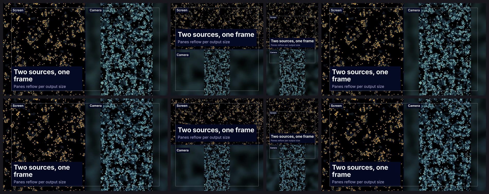
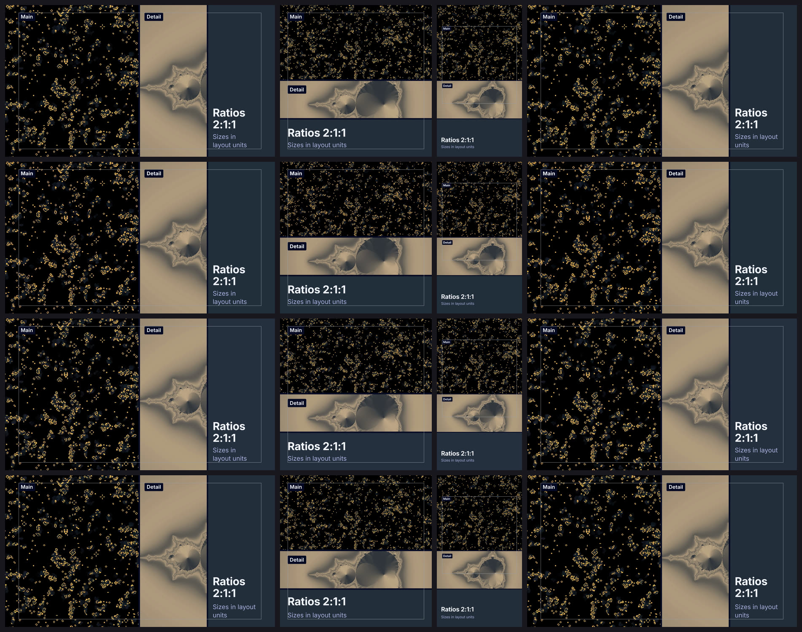
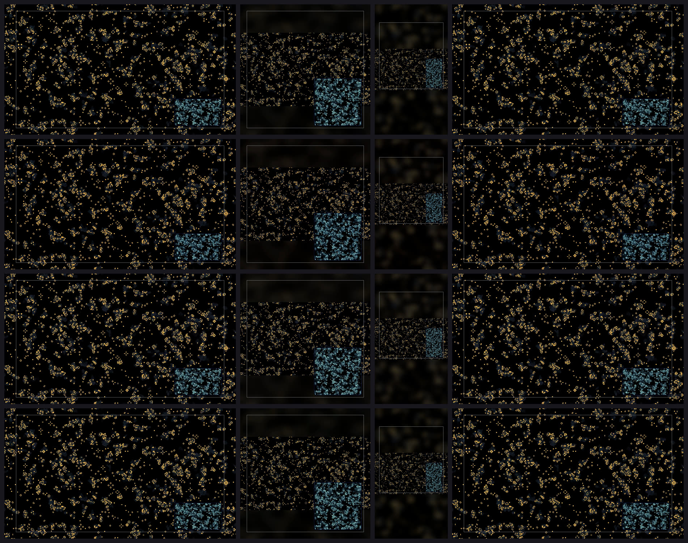
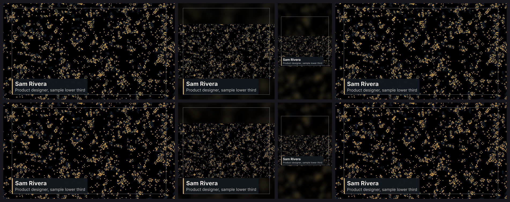
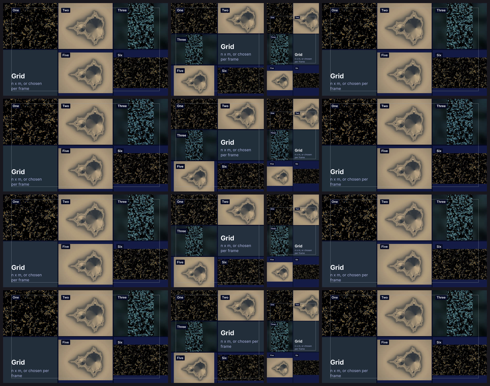
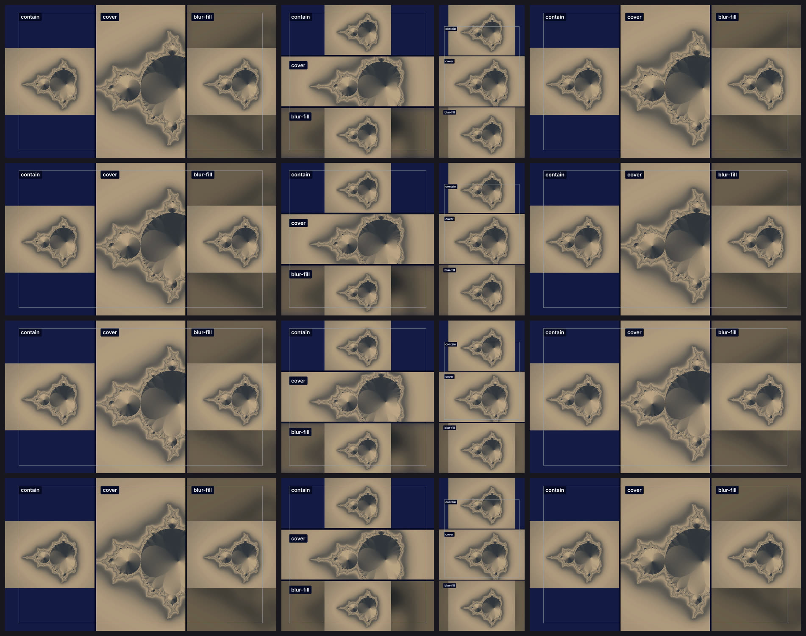
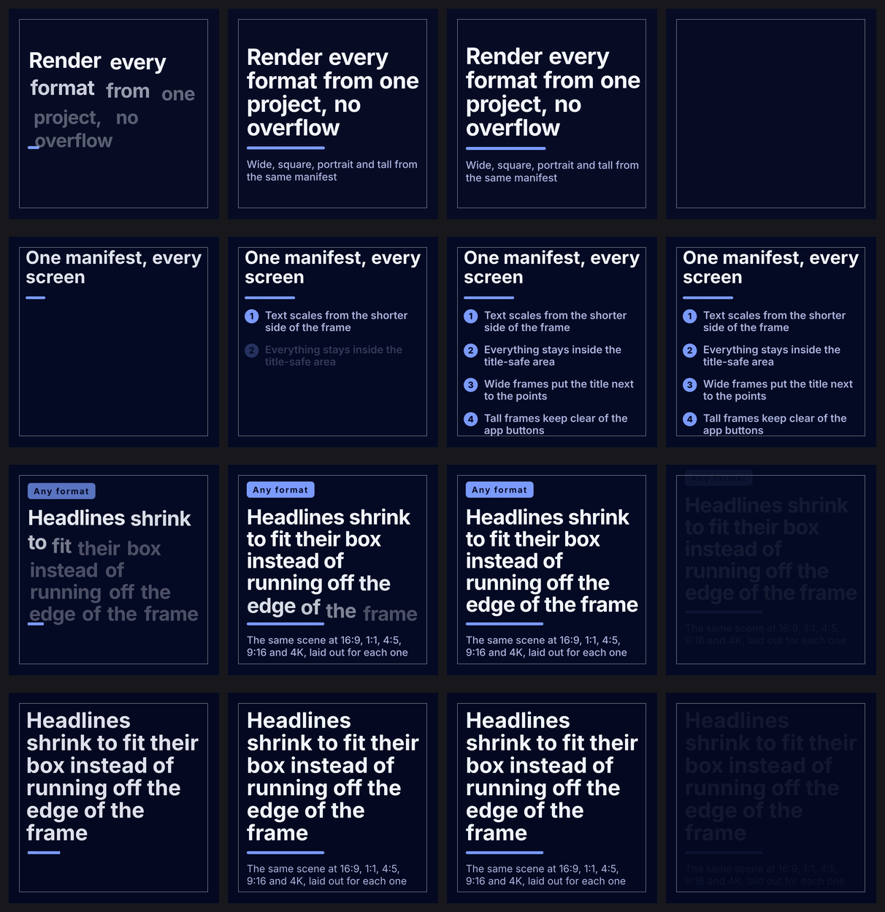
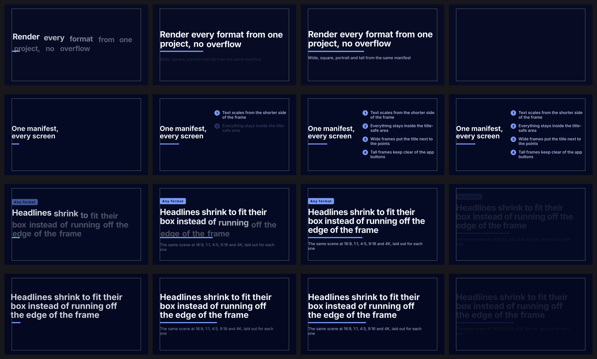

# Formats and layouts

A project renders at the size in its `output`: any even width and height from
16 to 4096 pixels. Vertical 1080x1920 is the default in the examples, not a
limit. Every built-in template lays itself out for the frame it is given, so
the same scenes work at 16:9, 1:1, 4:5, 9:16, 21:9 and 4K.

| Where the video goes | `output` |
| --- | --- |
| Instagram Reels, TikTok, YouTube Shorts | 1080x1920 (9:16) |
| YouTube, websites, presentations | 1920x1080 (16:9) or 3840x2160 (4K) |
| Square feed posts | 1080x1080 (1:1) |
| Portrait feed posts | 1080x1350 (4:5) |
| Cinema-style banners | 2560x1080 (21:9) |

Width and height must be even (H.264 and ProRes 4:2:2 need it), and a server can
set lower limits (`limits.maxRenderDimension`, see `get_capabilities`). The
frame rate is any of 23.976, 24, 25, 29.97, 30, 48, 50, 59.94 and 60
([Frame rates](#frame-rates)).

To render several of these sizes from one project in one call, list them as
`variants` in the manifest: `render_project` then starts one render per
variant, laid out again for each size ([Output variants](/docs/manifest/v0-2#output-variants)).

## Output formats

`output.format` picks the file a render delivers, `output.codec` the codec
inside it (omit it for the format's default) and `output.alpha: true` a
transparent background where the codec can carry one:

```json
"output": { "width": 1920, "height": 1080, "fps": 30, "format": "mov", "codec": "prores-4444", "alpha": true }
```

| `format` | `codec` (default first) | File | What it is for | Alpha | Audio | Captions | Size notes |
| --- | --- | --- | --- | --- | --- | --- | --- |
| `mp4` | `h264` | `final.mp4` | Social apps, websites, players everywhere | No | AAC 192 kbit/s | Burned and sidecar | Smallest video; the default |
| `mov` | `prores-422-hq`, `prores-4444` | `final.mov` | Hand-off to editors and NLEs (Premiere, Resolve, Final Cut) | `prores-4444` only (`alpha: true` picks it) | PCM 24-bit 48 kHz | Burned and sidecar | Very large: ProRes is an intermediate codec (Apple quotes about 220 Mbit/s for 422 HQ and 330 Mbit/s for 4444 at 1920x1080, 29.97 fps) |
| `webm` | `vp9`, `av1` | `final.webm` | The web: `<video>` in browsers, overlays with transparency | `vp9` only | Opus 128 kbit/s | Burned and sidecar | Quality and speed: `render.formats.vp9*` / `av1*`. AV1 encodes more slowly and needs an FFmpeg with SVT-AV1 or libaom |
| `gif` | `gif` | `final.gif` | Docs, pull requests, chat | No | None | Burned and sidecar | Two-pass palette; at most `render.formats.gifFps` (15) fps, `gifMaxSide` (480 px), `gifMaxSeconds` (30 s) and `gifMaxBytes` (50 MiB) |
| `png-sequence` | `png` | `frames.zip` | Compositing (After Effects, Nuke, Fusion), frame-exact review | Yes (RGBA PNGs) | None | Burned and sidecar | One `frame_000001.png` per frame in a stored zip; at most 65,535 frames |
| `m4a` | `aac` | `final.m4a` | The soundtrack alone (music, voice, sound effects) | - | AAC, `render.formats.aacKbps` (192) | Sidecar only | No scene is rendered; needs project audio |
| `wav` | `pcm-s16le` | `final.wav` | The soundtrack, uncompressed, for audio editors | - | PCM 16-bit 48 kHz | Sidecar only | About 11.5 MB a minute (48 kHz stereo) |

Every format gets the same captions sidecars (SRT, WebVTT and ASS per
language) next to its file. Burned captions are drawn into the pictures,
also into the alpha channel of transparent renders, so they show over a
transparent background. GIF and PNG sequences have no sound, and audio-only
formats have no pictures, so burned captions are refused for `m4a` and `wav`.

**Transparency.** The `html` and `hyperframes` engines can render a
transparent background (`get_capabilities` lists `alpha: true` per engine):
the page paints no background, so whatever your scene leaves unpainted stays
transparent. Built-in templates and scenes that paint a full-frame background
stay opaque. Remotion and Motion Canvas scenes are refused in a render with
`alpha: true`.

**What is refused, and when.** A combination that can never work (a codec of
another format, alpha on a codec without it, alpha on audio only) is an
`invalid_manifest` error on the field when you save the project. What depends
on the server (an engine without transparency, an encoder its FFmpeg lacks,
audio only without audio, a GIF over its length limit) is a
`422 unsupported_output` from `render_project` before anything is queued, with
`details.issues` naming the path, the variant and the engine; `validate_project`
lists the same problems. `get_capabilities` shows which formats and codecs
this server can encode (`outputFormats`).

**Variants.** A variant may set its own `format`, `codec` and `alpha`: one
project can render a transparent ProRes for the editor, a WebM for the site
and a GIF for the docs in one `render_project` call. A variant that sets
`format` takes neither `codec` nor `alpha` from `output`; one that does not,
inherits them unless it sets them.

**Audio.** Every format with sound gets the same audio as an MP4
([Audio](/docs/manifest/audio)): one mix of the whole timeline, normalised to
the loudness preset, then checked on the delivered file (loudness, and A/V
sync within one frame). MOV carries it as 24-bit PCM and WebM as Opus, muxed in
a second pass after the video. A muted render carries a silent track, or no
audio stream with `render.audio.mutedTrack: "none"`. GIF and PNG sequences
have no sound: nothing is mixed, and `get_render_output` reports
`audio.track: "none"`, the reason (`"gif has no audio"`) and the A/V-sync and
loudness checks as `skipped`. `m4a` and `wav` are the normalised mix with no
pictures (no video is rendered): their loudness is checked, A/V sync is
`skipped`.

**Frame rates.** MOV and WebM have exactly the project's rate (`r_frame_rate`
`30000/1001` at 29.97). A GIF keeps the project's exact rate when it is not
above `render.formats.gifFps`, else it is made at `gifFps` (its frame delays are
whole hundredths of a second, so players show 29.97 as close to it). A PNG
sequence is one file per timeline frame; `get_render_output` gives the rate as
`frameRate`.

**Posters.** An MP4's poster is its first frame, as before. Other formats take the middle frame (540 px wide, transparent where the render keeps alpha), because a first frame is often still empty and the dashboard shows MOV and PNG sequences as that still: browsers do not play ProRes.

**Previews** (`preview_scene`) are always H.264 MP4, whatever the format.
Renders in other formats run on one worker (render fan-out joins MP4 only).

**Not offered: HEVC/H.265.** The FFmpeg in the image could encode it (x265),
but HEVC's patent pools license encoders in products that are sold, and
RenderWeld is sold. Until that is cleared, RenderWeld leaves HEVC out. AV1 and
VP9 are royalty-free alternatives for small files.

Quality settings per format are runtime settings (`render.formats.*`; change
them with `update_config` / `PATCH /v1/config`, no restart): VP9 and AV1 quality and speed,
GIF frame rate, size, dithering and limits, AAC and Opus bitrates. The H.264
settings are unchanged.

## Frame rates

`output.fps` takes these rates. Every engine renders each of them, and the
final MP4 has exactly that rate: ffprobe reports `r_frame_rate` as
`30000/1001`, not a rounded `2997/100`.

| Rate | Give it as | Stored as | Typical use |
| --- | --- | --- | --- |
| 23.976 | `"24000/1001"`, `{ "num": 24000, "den": 1001 }` or `23.976` | `"24000/1001"` | Film transferred to NTSC video |
| 24 | `24` | `24` | Film, cinematic web video |
| 25 | `25` | `25` | PAL broadcast (Europe, much of Asia and Africa) |
| 29.97 | `"30000/1001"`, `{ "num": 30000, "den": 1001 }` or `29.97` | `"30000/1001"` | NTSC broadcast (Americas, Japan) |
| 30 | `30` | `30` | Social and web video (the default) |
| 48 | `48` | `48` | High-frame-rate film |
| 50 | `50` | `50` | PAL broadcast at full motion, sport |
| 59.94 | `"60000/1001"`, `{ "num": 60000, "den": 1001 }` or `59.94` | `"60000/1001"` | NTSC broadcast at full motion |
| 60 | `60` | `60` | Screen recordings, gaming, smooth motion |

The decimals `23.976` (or `23.98`), `29.97` and `59.94` are read as the NTSC
fractions; a fraction you write out is never rounded (`"2997/100"` is
refused). Integer rates stay plain numbers, so manifests that say `"fps": 30`
are unchanged. Any other rate is refused with the list above.

At NTSC rates a second is not a whole number of frames, so durations are
counted in frames: `durationSeconds: 10` at 29.97 is 299.7 frames, rounded to
300, which last 10.01 s. Scene starts, captions, voice and sound effects use
the same exact timeline (frame `n` starts at `n x 1001 / 30000` s).
`validate_project` warns when `durationSeconds` does not land on a frame.

`get_capabilities` lists the rates under `limits.supportedFps` and, per
engine, `frameRates`; `limits.maxRenderFps` (default 60) can lower the highest
rate a server renders.

## Sizes and rates each engine renders

Before a render or preview is queued, its size and frame rate are checked
against every engine the project uses, for `output` and for each variant:

- **Every engine** writes H.264 with 4:2:0 chroma (yuv420p): width and height
  must be even, a frame may have at most 139,264 macroblocks (about 35.6
  megapixels, H.264 level 6.2) and a side at most 16,880 pixels;
- **an engine plugin** can declare its own frame rates and largest size
  (`EngineCapabilities.output`). The four built-in engines render every rate
  above at every size the manifest allows (up to 4096 pixels on a side).

A render outside them is refused with `422 unsupported_output`, naming the
engine, the variant and the reason, and nothing is queued;
`validate_project` reports the same problems as errors. The manifest itself
already requires even sizes from 16 to 4096 pixels, and a server can set lower
limits (`limits.maxRenderDimension`).

## The layout unit

Templates size everything in **units of 1 % of the shorter side**
(`min(width, height) / 100`). A headline is therefore the same number of pixels
tall at 1080x1920, 1080x1080 and 1920x1080, and it does not grow with the long
side of a wide frame. At 4K every size doubles with the frame.

| Token | Size |
| --- | --- |
| Display (largest headline) | 10.5 units |
| Smallest headline after fitting | 4.5 units |
| Title | 9.5 units |
| Body | 5.6 units |
| Caption (sublines) | 4.8 units |
| Label (kickers) | 4 units |

### Readable text

`validate_project` (and `create_project` / `update_project`) warns before a
render when text would be hard to read:

- **Too small.** If any scene uses a built-in template and that template would
  set body text under 12 px at the output size or at a variant's size, you get a
  warning on `output` or `variants.<n>`. Body text is 5.6 units, so this happens
  on frames whose shorter side is under about 214 px, such as a 728x90 banner or
  320x180. Use a larger frame, keep that size for a picture with few words, or
  set the text size yourself in an html scene. Html scenes are not checked: their
  author sets the size.
- **Low contrast.** A pane with its own `color` is checked against the theme's
  text colours, under the WCAG 2.2 contrast minimum (SC 1.4.3):
  - its headline against `text` must reach 3:1, because headlines are large text;
  - its body against `mutedText` must reach 4.5:1.

  A lower third's `text` is checked against its `background` (4.5:1). For
  example, white theme text on a `#f1faee` pane is about 1.07:1, and the warning
  says which colour to change. Themes stored with `create_theme` are not resolved
  here, so only built-in themes and inline tokens are checked.

These are warnings, not errors: a deliberate design can keep them.

## Safe areas

Built-in templates keep all text inside the **content safe area**. It is, per
side, the larger of the title-safe margin and, on tall frames, the app-overlay
zone.

| Area | Inset per side | Source |
| --- | --- | --- |
| Action safe | 3.5 % of width (left, right) and height (top, bottom): 93 % of the frame | EBU R 95 v1.1 (June 2017), ITU-R BT.1848-1 (2015) |
| Title (graphics) safe | 5 %: 90 % of the frame | EBU R 95 v1.1, ITU-R BT.1848-1 |
| App overlay zone, tall frames only (height / width of 1.6 or more, such as 9:16) | 14 % top, 35 % bottom, 6 % left and right | Conservative values that clear the buttons, captions and progress bars of the common social apps. **Platforms differ and change their UI;** these are not any platform's published numbers |

At 1080x1920 the content box is 950x979 pixels starting at (65, 269). At
1920x1080 it is 1728x972 starting at (96, 54).

`brief.platform` in the manifest decides the app overlay zone: tall frames get
it unless the platform is `none`, `broadcast`, `web` or `presentation`.

Code that runs outside a template can read the same numbers from
`@renderweld/project-schema`:

```ts
import { safeAreaInsets, frameLayout } from '@renderweld/project-schema';

safeAreaInsets(1080, 1920, 'tiktok');
// { action: {...}, title: {...}, ui: { top: 269, right: 65, bottom: 672, left: 65 }, content: {...} }
frameLayout(1920, 1080).box; // { x: 96, y: 54, width: 1728, height: 972 }
```

## How the built-in templates reflow

- **Wide frames** (4:3 and wider) lay out side by side where a scene has two
  groups: `animated-explainer` puts its title in a left column and the points
  in a right one. Title cards cap their line length at 150 units, so a headline
  does not run across the whole width.
- **Square, portrait and tall frames** stack: title above points, headline
  above subline.
- **Headlines fit their box.** The largest size from 10.5 down to 4.5 units at
  which the headline fits its box is used, so long headlines and long words
  shrink instead of running off the frame. `kinetic-title` (Remotion) measures
  the text with the browser's text metrics; `html-title` and
  `hyperframes-title` shrink the element in the page; `animated-explainer`
  (Motion Canvas) scales its laid-out block down when it is larger than the
  safe area.

## In your own HTML scenes

`html` and `hyperframes` scenes get the layout as CSS variables:

| Variable | Meaning |
| --- | --- |
| `--rf-unit` | 1 % of the shorter side |
| `--rf-unit-w`, `--rf-unit-h` | 1 % of the width, of the height |
| `--rf-safe-top`, `--rf-safe-right`, `--rf-safe-bottom`, `--rf-safe-left` | The content safe area insets |
| `--rf-title-safe-*`, `--rf-action-safe-*` | The broadcast safe areas |
| `--rf-content-w`, `--rf-content-h` | Size of the content box |

In `html` scenes the root element also carries
`data-rf-orientation="portrait|square|landscape"` and
`data-rf-direction="row|column"`, so CSS can switch layouts with
`[data-rf-direction=row] .my-card { ... }`. Media queries such as
`@media (min-aspect-ratio: 4/3)` work too, because the page is exactly the
size of the frame.

Add `data-rf-fit` to a headline (with a `max-height`, or as a shrinking flex
item) and the html engine lowers its font size until it fits. It never goes
below `data-rf-fit-min` pixels (default: 40 % of its CSS size).

```html
<div class="card">
  <h1 data-rf-fit>Your headline</h1>
</div>
```

```css
.card { position: absolute; inset: var(--rf-safe-top) var(--rf-safe-right) var(--rf-safe-bottom) var(--rf-safe-left); }
.card h1 { font-size: calc(var(--rf-unit) * 10.5); max-height: 60%; }
```

## Layouts: split screen, picture-in-picture, lower thirds, grids

The templates `html-layout` (html engine), `hyperframes-layout`
(HyperFrames), `remotion-layout` (Remotion) and `motion-canvas-layout` (Motion
Canvas) arrange **panes**. All four take the same props and put every pane,
text block and lower third in the same place, so a scene moves to another
engine by changing only its `engine` and `template`. Each pane can hold an image or
video asset, a colour, a short label, a headline and body text. Sizes are in
layout units and positions follow the safe areas, so one scene reflows for
every output size and every variant.

```json
{
  "id": "interview",
  "engine": "html",
  "template": "html-layout",
  "durationSeconds": 6,
  "props": {
    "layout": { "type": "pip", "corner": "bottom-right", "width": 36 },
    "panes": [
      { "media": { "asset": "screen", "fit": "blur-fill" } },
      { "media": { "asset": "camera", "fit": "cover", "focus": { "x": 50, "y": 30 } } }
    ],
    "lowerThird": { "name": "Sam Rivera", "title": "Product designer", "accent": "#e8b04a" }
  }
}
```

Media are assets in the manifest (`upload_asset`, `add_asset_from_url`, or REST
`POST /v1/assets`) with `mediaType` `image` or `video`. The manifest is
refused if a pane names an asset that is missing or is not an image or a video.

| `layout.type` | Panes | Options |
| --- | --- | --- |
| `full` | 1 | `inset` |
| `split` | 2 to 4 | `direction`: `horizontal` (side by side), `vertical` (stacked) or `auto` (default: side by side from 4:3 and wider, stacked on square and tall frames); `ratios`, one per pane, such as `[2, 1]`; `gap` in units (default 0.6); `inset` |
| `pip` | 2: the main picture, then the inset | `corner` (`top-left`, `top-right`, `bottom-left`, `bottom-right`; default `bottom-right`); `width` of the inset in units (default 36); `aspect` as a number or `"W:H"` (default: the frame's); `margin` from the safe area in units (default 2); `inset`, the safe area it is placed in (default `content`) |
| `grid` | 1 to 16 | `columns` and `rows` (1 to 4 each), or leave them out to get the cells closest to square for each frame (6 panes: 3x2 at 16:9, 2x3 at 9:16); `gap` in units (default 1); `inset` |

`inset` is the safe area the panes stay inside: `none` (default, edge to
edge), `action`, `title` or `content`.

The inset of a picture-in-picture always stays inside its safe area. At the
default width it is also never taller than 45 % of it, so a frame-shaped inset
on a 9:16 frame does not cover half the picture. On a 9:16 frame the default
`content` area keeps it above the app-overlay zone.

### Panes

| Field | Meaning |
| --- | --- |
| `media.asset` | Id of an image or video asset |
| `media.fit` | `contain`, `cover` (default) or `blur-fill` |
| `media.focus` | `{ "x": 0-100, "y": 0-100 }`: the point kept in view when the picture is cropped (CSS `object-position` in percent) |
| `media.startSeconds` | Video only: where in the video the scene starts. A video shorter than the scene holds its last frame |
| `media.blur` | `blur-fill` only: blur radius in units (default 3) |
| `color` | Pane colour, behind `contain` media or the whole pane without media (default: the theme surface) |
| `label` | Up to 40 characters, in the pane's top corner |
| `headline`, `body` | Up to 80 and 160 characters. On media they sit on a solid card in the theme background colour |

Pane text stays inside the pane and inside the content safe area, and shrinks
to fit (headline, body and padding together). A pane that lies wholly in a
tall frame's app-overlay zone, such as the bottom row of a 2x3 grid at 9:16,
keeps its text inside title safe instead, because the content safe area does
not reach it.

### Fit modes

| `fit` | What happens when the media's aspect ratio differs from the box |
| --- | --- |
| `contain` | The whole picture is shown; the rest of the box shows the pane colour (letterbox or pillarbox) |
| `cover` | The box is filled and the picture is cropped around `focus` |
| `blur-fill` | The whole picture is shown over a blurred, darkened copy of itself that fills the box: the usual way to put a 16:9 clip in a 9:16 frame without black bars |

### Lower third

`lowerThird` is a name (up to 60 characters) and an optional title (up to 80)
in the bottom corner of the content safe area, `align` `left` (default) or
`right`. `accent` (the bar), `background` and `text` take brand colours and
default to the theme's accent, surface and text colours. It fits a band 22 units
tall, shrinking its text when the name or title is long. Pane text moves above
that band, or below it when there is no room above.

### Engines

| Engine | Template | How it draws | Images | Video |
| --- | --- | --- | --- | --- |
| `html` | `html-layout` | The shared HTML/CSS builder | Inlined as `data:` URLs (PNG, JPEG, WebP, GIF, SVG; the type is read from the bytes) | Decoded by FFmpeg into one picture per output frame and shown frame by frame, so any format FFmpeg reads works |
| `hyperframes` | `hyperframes-layout` | The shared HTML/CSS builder | Linked into the scene folder | A timed, muted `<video>` clip that HyperFrames seeks frame by frame |
| `remotion` | `remotion-layout` | The shared HTML/CSS builder inside a Remotion composition; each frame seeks the CSS animations to its time | Staged and served on a loopback origin for the length of the render ([assets](assets.md)) | One picture per output frame, picture k at frame k, also in a frame-range chunk |
| `motion-canvas` | `motion-canvas-layout` | Motion Canvas nodes placed by the same geometry functions, type sizes and timing; text wraps in Motion Canvas's layout (the browser's line breaking) and shrinks to fit the same way | Staged and served on the bundle server under a per-render token ([assets](assets.md)) | One picture per output frame, picture k at frame k |

Every engine renders offline: pictures come only from the render's own staged
files, and nothing is fetched from the network. Motion Canvas draws on a
canvas, so its text can break lines differently where the DOM engines balance
the last lines of a paragraph (`text-wrap: pretty`); boxes, panes and the lower
third are in the same place.

### Proof: layout contact sheets

Each sheet shows one primitive at 16:9 (1920x1080), 1:1 (1080x1080), 9:16
(1080x1920) and 4K (3840x2160), left to right, one row per engine from the top:
html, HyperFrames, Remotion and Motion Canvas. The frames are rendered at full size and scaled down; the
thin grey outline is the content safe area. The media are made with FFmpeg's
own sources (a toned Mandelbrot still at 4:3 and two Game of Life clips at
16:9 and 9:16), so the sheets show the layout and no third-party pictures.

Split screen, two panes (a 16:9 clip with `cover` and a 9:16 clip with
`blur-fill`):



Split screen, three panes with ratios 2:1:1:



Picture-in-picture, inset in the bottom-right corner:



Lower third:



Grid, six panes with columns and rows chosen per frame:



Fit modes, the same 4:3 picture as `contain`, `cover` and `blur-fill`:



Render times and probe results are in `docs/proofs/layouts/report.json`.
`docs/proofs/layouts/geometry.json` compares the engines: every sample (and the
longest-text samples) with flat pane colours, rendered on html, Remotion and
Motion Canvas at the four sizes, with each pane and the lower third found by
colour on the frame and its distance from the geometry and from the html
engine's, in pixels. To make them again:

```bash
export RENDERWELD_CHROMIUM_PATH=/path/to/chrome-headless-shell
pnpm formats:prove-layouts
pnpm formats:prove-layouts --geometry
```

## Picture checks

Every finished render and preview is decoded once more, frame by frame. The
pass finds pictures that freeze or go black, and flashes that can trigger
seizures (#294). A check of single stills can't see
either. The results are in the render manifest and in `get_render_output` /
`GET /v1/renders/:id`:

- `checks.freeze`, `checks.black` and `checks.flash`: `pass`, `warn`, or
  `skipped` (when the check is off, the output is audio only, or, for black,
  the output is transparent).
- `videoQa`: the thresholds, every stretch measured (`freezes`, `blacks`,
  `flashes`, in seconds) and one issue per stretch. Each issue names the scenes it overlaps
  and what to change. A black opening also says that platforms will show a
  black thumbnail.

| Setting | Default | What it does |
| --- | --- | --- |
| `render.qa.video` | `warn` | `warn` records the issues; `fail` fails the render with them; `off` skips the pass |
| `render.qa.freezeSeconds` | `3` | A picture that doesn't change for this long is reported (0.5 to 3600). Raise it for slides or other deliberate holds |
| `render.qa.blackSeconds` | `0.5` | Black lasting this long is reported (0.1 to 3600); a fade through black is shorter |

Near-black counts as black. An empty frame on a dark theme background (the
default `#0b0b14`) is what a viewer sees as a gap, so a scene whose first
element arrives a second late is reported.

How it measures: FFmpeg `freezedetect` (noise tolerance −60 dB, so only truly
unchanged pictures count) and `blackdetect` (a pixel is black at 10 % luma or
below, a picture when 98 % of it is). They run in one pass over the assembled
picture: the MP4, or the master the other formats are packaged from. The
settings are runtime settings (`update_config`, `PATCH /v1/config`) and apply to
the next render. Tests: `packages/core/test/videoqa.test.ts` and
`packages/media-pipeline/test/flashes.test.ts`, which covers a 5 Hz strobe, a red
strobe, a small flashing box, a gentle pulse, and exactly three flashes a second. They cover a black
opening and a frozen stretch measured to the second, a still scene named with
its times, a preview checked on its own, and `fail` and `off`.

**Flashes (WCAG 2.2 SC 2.3.1).** More than three flashes in any one second
fails. A flash is a pair of opposing changes of at least 0.1 in relative
luminance, with the darker side below 0.80. For saturated red (R/(R+G+B) ≥ 0.8),
it's a change of more than 20 in (R − G − B) × 320, WCAG 2.0's working
definition. WCAG 2.1 and 2.2 replaced it with a CIE 1976 u′v′ change above 0.2,
which the studio doesn't measure yet.
ITU-R BT.1702-3 and Ofcom use the same SDR numbers (20 cd/m² below 160 cd/m²
at a 200 cd/m² white). Only flashing that covers a quarter of the picture or
more counts. Each frame is measured as an 8 × 8
grid of area-averaged cells (relative luminance from linearised sRGB), so a
small flashing element passes and a full-frame strobe doesn't. The thresholds
are fixed by the standard, not settings. Sustained flashing, two to three
flashes a second held for 5 s or more (EA IRIS's "extended failure"), is reported
too, as a `video.flash` issue with `extended: true`. Not yet covered: stripe
patterns. Video for broadcast should still go through a dedicated analyser such
as EA IRIS.

Not yet measured (#294): motion energy, loop seams, seek determinism, and text
overflow in the final file.

## Proof: contact sheets

Every built-in template is rendered on its engine at 16:9, 1:1, 4:5, 9:16 and
4K, and each clip is checked for overflow. The contact sheets show four frames
per template: entry, middle, settled and exit. Rows from top to bottom:
`kinetic-title` (Remotion), `animated-explainer` (Motion Canvas), `html-title`
(HTML) and `hyperframes-title` (HyperFrames). The thin grey outline is the
content safe area.

| 16:9 (1920x1080) | 1:1 (1080x1080) |
| --- | --- |
|  |  |

| 4:5 (1080x1350) | 9:16 (1080x1920) |
| --- | --- |
|  |  |

4K (3840x2160), a shorter smoke render:



The measurements behind them, including render times on the machine that made
them, are in `docs/proofs/formats/report.json`. To make them again:

```bash
export RENDERWELD_CHROMIUM_PATH=/path/to/chrome-headless-shell
pnpm formats:prove
```

## Tests

`apps/server/test/formats.test.ts` runs with the server tests:

- every built-in template renders at 16:9, 1:1, 4:5 and 9:16 (at a fifth of
  the real size, proportional) and passes the **overflow check**: at the
  settled frame, every pixel that is not background lies inside the content
  safe area (with a tolerance of 1.5 units), nothing touches the frame edge,
  and the text block is not shrunk to nothing. The check fails on the layout
  before this change (10 of 17 renders), and a test makes sure it fails on a
  scene whose text runs off the frame;
- `html-title` and `hyperframes-title` are measured in the browser at the real
  sizes (and 21:9 and 4K), with the longest props the schema allows and with a
  single long word: every text box is inside the safe area and none overflows;
- one 3840x2160 smoke render.

- every layout sample, plus the longest text the schema allows in a 6-pane
  grid and in a lower third over a split, is measured in the browser on html
  and HyperFrames at 16:9, 1:1, 4:5, 9:16, 21:9 and 4K: each pane is where the geometry
  puts it (within a pixel), the inset is inside the safe area, no text
  overflows, pane text is inside its pane and the safe area, the lower third is
  inside the content safe area and no pane text is under it;
- on rendered pixels, on all four engines: `contain` shows the pane colour in
  the letterbox, `cover` fills it, `blur-fill` fills it with the blurred
  picture, the gap between panes shows the background, and a video pane plays
  frame by frame from `startSeconds` and holds its last frame.

`apps/server/test/layouts-engines.test.ts` compares Remotion and Motion Canvas
with the html engine on rendered pixels, at full size at 16:9, 1:1, 9:16 and
4K, for every layout sample and the longest-text samples, with flat pane
colours: each pane, found by its colour, is within 1 layout unit of the
geometry and of the html engine's; the lower third is within 1 unit of the html
engine's and inside the content safe area; every text pixel in a pane is inside
that pane's text box (so inside the safe area, never clipped). It also renders a
clip that shows its own frame number in two panes with different in-points and
checks the number at each frame, on a whole render and on a frame range.

`apps/server/test/fps.test.ts` renders each engine at 23.976, 29.97, 48, 50
and 59.94 fps (exact frame counts, and the exact rate and one-frame timestamp
steps after normalisation) and a four-engine project at 29.97 end to end
(`r_frame_rate` 30000/1001, frames and duration). The fan-out test renders a
29.97 project on three workers and on one: the stream-copy join and the
single render have the same exact rate, frames, timestamps and caption times.

`pnpm formats:prove` renders the template matrix at the real sizes, and
`pnpm formats:prove-layouts` the layout sheets.
