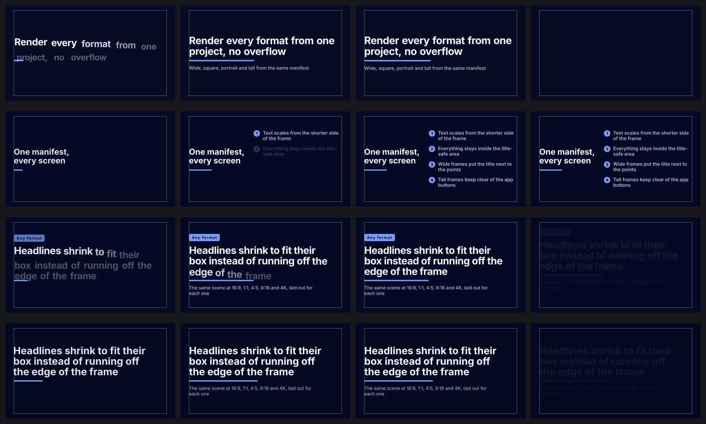
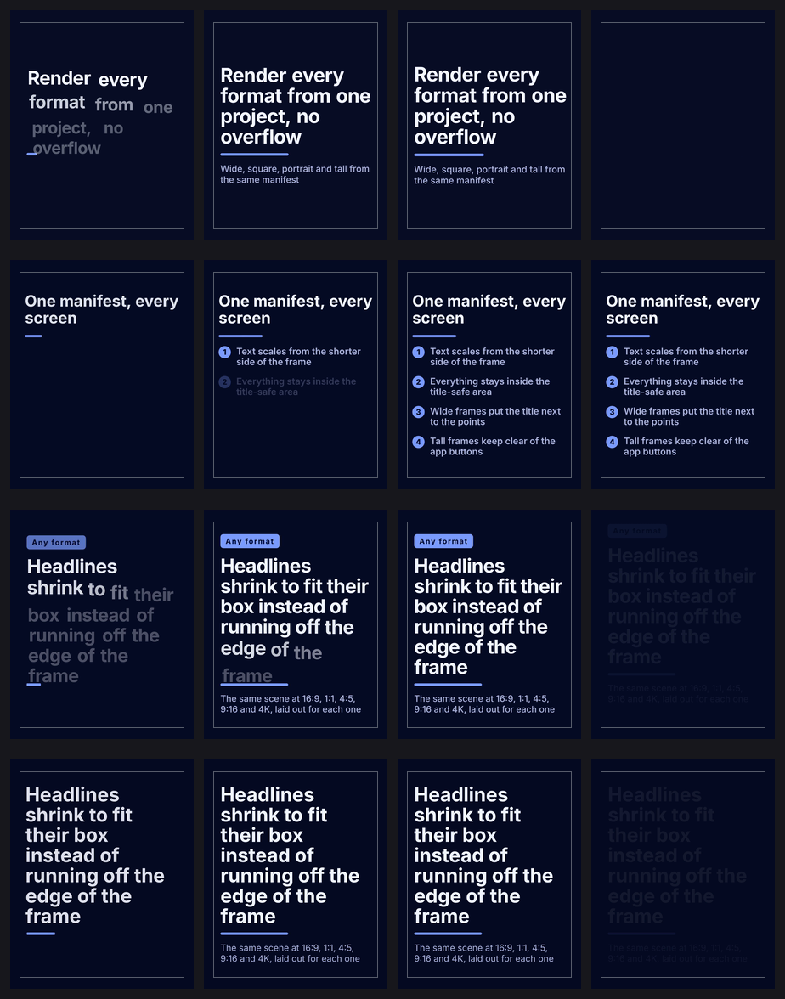
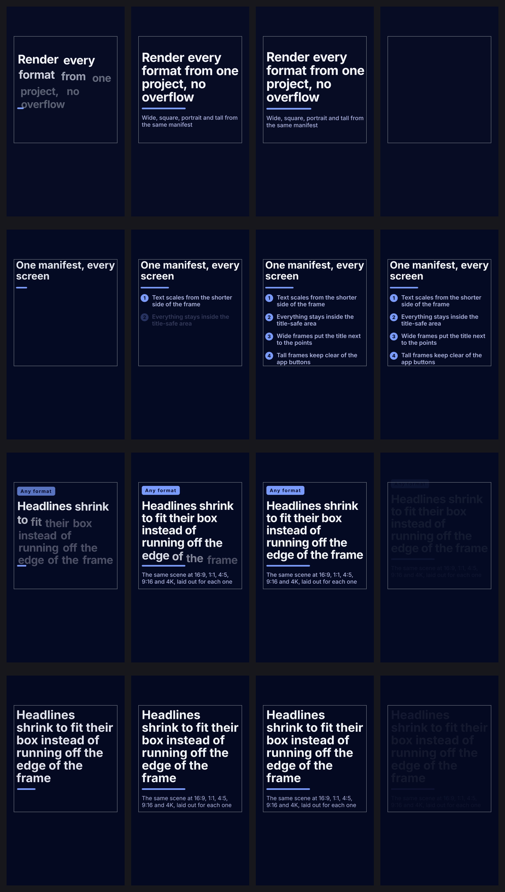

# Formats and layouts

A project renders at the size in its `output`: any even width and height from
16 to 4096 pixels. Vertical 1080x1920 is the default in the examples, not a
limit. Every built-in template lays itself out for the frame it is given, so
the same scenes work at 16:9, 1:1, 4:5, 9:16, 21:9 and 4K.

| Where the video goes | `output` |
| --- | --- |
| Instagram Reels, TikTok, YouTube Shorts | 1080x1920 (9:16) |
| YouTube, websites, presentations | 1920x1080 (16:9) or 3840x2160 (4K) |
| Square feed posts | 1080x1080 (1:1) |
| Portrait feed posts | 1080x1350 (4:5) |
| Cinema-style banners | 2560x1080 (21:9) |

Width and height must be even (H.264 with yuv420p needs it), and a server can
set lower limits (`limits.maxRenderDimension`, see `get_capabilities`).

To render several of these sizes from one project in one call, list them as
`variants` in the manifest: `render_project` then starts one render per
variant, laid out again for each size ([Output variants](/docs/manifest/v0-2#output-variants)).

## The layout unit

Templates size everything in **units of 1 % of the shorter side**
(`min(width, height) / 100`). A headline is therefore the same number of pixels
tall at 1080x1920, 1080x1080 and 1920x1080, and it does not grow with the long
side of a wide frame. At 4K every size doubles with the frame.

| Token | Size |
| --- | --- |
| Display (largest headline) | 10.5 units |
| Smallest headline after fitting | 4.5 units |
| Title | 9.5 units |
| Body | 5.6 units |
| Caption (sublines) | 4.8 units |
| Label (kickers) | 4 units |

## Safe areas

Built-in templates keep all text inside the **content safe area**. It is, per
side, the larger of the title-safe margin and, on tall frames, the app-overlay
zone.

| Area | Inset per side | Source |
| --- | --- | --- |
| Action safe | 3.5 % of width (left, right) and height (top, bottom): 93 % of the frame | EBU R 95 v1.1 (June 2017), ITU-R BT.1848-1 (2015) |
| Title (graphics) safe | 5 %: 90 % of the frame | EBU R 95 v1.1, ITU-R BT.1848-1 |
| App overlay zone, tall frames only (height / width of 1.6 or more, such as 9:16) | 14 % top, 35 % bottom, 6 % left and right | Conservative values that clear the buttons, captions and progress bars of the common social apps. **Platforms differ and change their UI;** these are not any platform's published numbers |

At 1080x1920 the content box is 950x979 pixels starting at (65, 269). At
1920x1080 it is 1728x972 starting at (96, 54).

`brief.platform` in the manifest decides the app overlay zone: tall frames get
it unless the platform is `none`, `broadcast`, `web` or `presentation`.

Code that runs outside a template can read the same numbers from
`@reelforge/project-schema`:

```ts
import { safeAreaInsets, frameLayout } from '@reelforge/project-schema';

safeAreaInsets(1080, 1920, 'tiktok');
// { action: {...}, title: {...}, ui: { top: 269, right: 65, bottom: 672, left: 65 }, content: {...} }
frameLayout(1920, 1080).box; // { x: 96, y: 54, width: 1728, height: 972 }
```

## How the built-in templates reflow

- **Wide frames** (4:3 and wider) lay out side by side where a scene has two
  groups: `animated-explainer` puts its title in a left column and the points
  in a right one. Title cards cap their line length at 150 units, so a headline
  does not run across the whole width.
- **Square, portrait and tall frames** stack: title above points, headline
  above subline.
- **Headlines fit their box.** The largest size from 10.5 down to 4.5 units at
  which the headline fits its box is used, so long headlines and long words
  shrink instead of running off the frame. `kinetic-title` (Remotion) measures
  the text with the browser's text metrics; `html-title` and
  `hyperframes-title` shrink the element in the page; `animated-explainer`
  (Motion Canvas) scales its laid-out block down when it is larger than the
  safe area.

## In your own HTML scenes

`html` and `hyperframes` scenes get the layout as CSS variables:

| Variable | Meaning |
| --- | --- |
| `--rf-unit` | 1 % of the shorter side |
| `--rf-unit-w`, `--rf-unit-h` | 1 % of the width, of the height |
| `--rf-safe-top`, `--rf-safe-right`, `--rf-safe-bottom`, `--rf-safe-left` | The content safe area insets |
| `--rf-title-safe-*`, `--rf-action-safe-*` | The broadcast safe areas |
| `--rf-content-w`, `--rf-content-h` | Size of the content box |

In `html` scenes the root element also carries
`data-rf-orientation="portrait|square|landscape"` and
`data-rf-direction="row|column"`, so CSS can switch layouts with
`[data-rf-direction=row] .my-card { ... }`. Media queries such as
`@media (min-aspect-ratio: 4/3)` work too, because the page is exactly the
size of the frame.

Add `data-rf-fit` to a headline (with a `max-height`, or as a shrinking flex
item) and the html engine lowers its font size until it fits. It never goes
below `data-rf-fit-min` pixels (default: 40 % of its CSS size).

```html
<div class="card">
  <h1 data-rf-fit>Your headline</h1>
</div>
```

```css
.card { position: absolute; inset: var(--rf-safe-top) var(--rf-safe-right) var(--rf-safe-bottom) var(--rf-safe-left); }
.card h1 { font-size: calc(var(--rf-unit) * 10.5); max-height: 60%; }
```

## Proof: contact sheets

Every built-in template is rendered on its engine at 16:9, 1:1, 4:5, 9:16 and
4K, and each clip is checked for overflow. The contact sheets show four frames
per template: entry, middle, settled and exit. Rows from top to bottom:
`kinetic-title` (Remotion), `animated-explainer` (Motion Canvas), `html-title`
(HTML) and `hyperframes-title` (HyperFrames). The thin grey outline is the
content safe area.

| 16:9 (1920x1080) | 1:1 (1080x1080) |
| --- | --- |
|  |  |

| 4:5 (1080x1350) | 9:16 (1080x1920) |
| --- | --- |
|  |  |

4K (3840x2160), a shorter smoke render:


The measurements behind them, including render times on the machine that made
them, are in `docs/proofs/formats/report.json`. To make them again:

```bash
export REELFORGE_CHROMIUM_PATH=/path/to/chrome-headless-shell
pnpm formats:prove
```

## Tests

`apps/server/test/formats.test.ts` runs with the server tests:

- every built-in template renders at 16:9, 1:1, 4:5 and 9:16 (at a fifth of
  the real size, proportional) and passes the **overflow check**: at the
  settled frame, every pixel that is not background lies inside the content
  safe area (with a tolerance of 1.5 units), nothing touches the frame edge,
  and the text block is not shrunk to nothing. The check fails on the layout
  before this change (10 of 17 renders), and a test makes sure it fails on a
  scene whose text runs off the frame;
- `html-title` and `hyperframes-title` are measured in the browser at the real
  sizes (and 21:9 and 4K), with the longest props the schema allows and with a
  single long word: every text box is inside the safe area and none overflows;
- one 3840x2160 smoke render.

`pnpm formats:prove` renders the same matrix at the real sizes.
