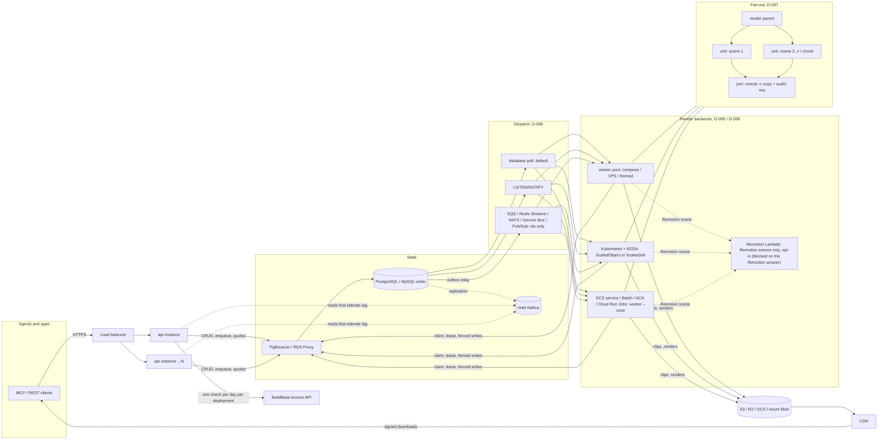

# Render at any scale: self-hosted render backends, fan-out, pluggable queues, licence model

Research and target architecture for the founder request of 2026-11-22: rendering and
the CRUD path must scale on the buyer's own infrastructure "without limit", the way
Remotion Lambda / Cloud Run do, with one organisation licence covering any number of
workers and nothing pausing or overloading when many videos render at once.

- Issues: epic #149 (child of #17) with #150..#159, #28 and #34; related #36, #107, #125, #10, #91.
- Decisions: D-095..D-099 in [docs/DECISIONS.md](../DECISIONS.md) section T.
- Every external fact below has a source and the date it was read (all **2026-11-22**
  unless noted). Estimates are marked **ESTIMATE** with their assumptions. "Not fetched"
  means the page could not be read; nothing was filled in from memory.
- ReelForge is **source-available**, not open source.

Contents: [1 Summary](#1-summary) · [2 What exists today](#2-what-exists-today) ·
[3 Remotion's scale-out and licence](#3-remotions-scale-out-and-licence) ·
[4 Self-hostable render backends](#4-self-hostable-render-backends) ·
[5 Splitting one render](#5-splitting-one-render-across-machines) ·
[6 The CRUD and queue path](#6-the-crud-and-queue-path) ·
[7 Licence at scale](#7-licence-at-scale) · [8 Overload protection](#8-overload-protection) ·
[9 Target architecture](#9-target-architecture) · [10 Capacity math](#10-capacity-math-and-what-infinite-means) ·
[11 Phased plan](#11-phased-plan) · [12 Spike results](#12-spike-results) · [13 Sources](#13-sources)

## 1. Summary

**Already possible today (main @ 20833e8, #36):** one image in three roles (`all`, `api`,
`worker`); a database job queue on PostgreSQL/MySQL (`SKIP LOCKED`, leases, fenced writes,
crash recovery, graceful hand-back); shared object storage (S3/R2/MinIO, Azure, GCS);
stateless `api` instances behind any load balancer; a Kustomize base with HPAs and a
cluster-wide `reelforge_jobs_queued` metric for queue-depth autoscaling; shared rate limits
and render quotas. So "1 api tier + N workers on any container platform" works now, and the
number of workers is limited by the buyer's database and cloud quotas, not by ReelForge.

**Licence today (measured, §12):** the licence activation follows the **shared database**.
1 api + 3, 19 or 49 workers on one PostgreSQL took **exactly one activation** (one instance
id, `activations 1/1`). A second deployment with its own database is a second activation
(`limit_reached` at limit 1). Unlimited workers per deployment are therefore already covered
by one activation; what does not scale is that **every process calls the licence server**
at start and daily (50 processes = 50 licence calls), which collides with scale-to-zero
churn and BuildBase rate limits. Fix proposed in D-098.

**What is missing for "any scale":**

1. **No scale-to-zero / event-driven recipe tested** (the HPA External metric path is
   untested, D-079). KEDA's PostgreSQL scaler can read the queue directly (§4.2).
2. **One render = one worker.** Scenes render one after another inside one job, and the
   final assembly re-encodes the whole timeline (`assemble()` uses the `concat` filter plus
   libx264). A long reel cannot use more than one machine, and very long renders do not
   fit time-capped platforms (Lambda). Fan-out per scene with a stream-copy join (D-097).
3. **No backend plugin for one-off container jobs** (Kubernetes Job, ECS RunTask, Cloud Run
   Jobs, Azure Container Apps Jobs, AWS Batch); `remotion-lambda` is a skeleton (#28).
4. **DB-only dispatch:** every idle worker polls the database every second. Fine up to a few
   hundred workers; beyond that, a wake-up/dispatch driver (LISTEN/NOTIFY, SQS, Redis
   Streams, NATS JetStream, Pub/Sub, Service Bus) carrying job ids while the database stays
   the system of record (D-096).
5. **Overload controls:** global FIFO claim (one key with 10 000 queued jobs starves every
   other key), no queue caps or admission control (#107), no queue-wait histogram for an SLO.
6. **Connection math:** each process opens up to 10 connections by default (node-postgres
   `max` 10); 1 000 workers would ask for 10 000 connections. Needs `connection_limit` on
   workers and a pooler recipe (PgBouncer/RDS Proxy).

**Blocked on Remotion (#10):** Remotion Lambda and `@remotion/cloudrun` are self-hosted in the
buyer's own cloud account, but every programmatic render (including `renderMediaOnLambda()`)
is an "automation" under the Remotion licence; companies of 4+ people need a Company
License ("Remotion for Automators", $0.01 per render, $100/month minimum). ReelForge only
renders its built-in Remotion templates with agent-set props, which matches the accepted
"abstraction layer" pattern, but whether a source-available product sold to companies may
ship this, and who holds the licence, must be answered in writing (§3.3).

**Recommendation (D-095..D-099):** keep the database queue as the default and as the system
of record; make "the worker pool on any orchestrator" the default backend (local, compose,
Kubernetes + KEDA, ECS service, Azure Container Apps, VPS fleets); add a `worker --once`
mode so event-driven job platforms (KEDA ScaledJob, ACA event jobs, Cloud Run Jobs, Batch)
run one unit per container; add scene fan-out with a stream-copy join; make dispatch
pluggable; keep one activation per deployment (shared database) with only the api tier
talking to the licence server. Remotion Lambda stays opt-in and blocked on #10.

## 2. What exists today

Read from the repository on 2026-11-22.

| Area | Today | Where |
| --- | --- | --- |
| Roles | `all`, `api` (never renders), `worker` (claims and renders) | D-076, `docs/providers/queue-and-scaling.md` |
| Queue | `Job` rows; claim `SELECT ... ORDER BY createdAt, id LIMIT 1 FOR UPDATE SKIP LOCKED`; lease 60 s renewed every 15 s; `maxAttempts` 3; fenced progress/final writes; idle poll every `queue.pollIntervalMs` (1 s) | D-075, `packages/db/src/prisma-repositories.ts`, `packages/core/src/jobs.ts` |
| Per-instance background load | claim poll 1/s (workers), heartbeat + `recoverExpired` + `COUNT(*)` of queued every 15 s (every instance), settings re-read every 15 s, progress writes throttled to 2/s per running job | `jobs.ts` (`heartbeat`, 500 ms progress throttle), `service.ts` (`SETTINGS_REFRESH_MS`) |
| Autoscaling | HPA: api on CPU, workers on CPU + External `reelforge_jobs_queued` (cluster-wide gauge, use `max`); KEDA Prometheus scaler documented, untested | D-079, `deployment/kubernetes/hpa.yaml` |
| Render pipeline | one job renders every scene **sequentially** (`for (const [i, scene] of scenes.entries())`), probes each clip, then `assemble()` scales/pads/fps-normalises every clip in one filter graph, `concat` filter, libx264 `-preset medium -crf 18`, AAC; output committed to storage last | `packages/core/src/render.ts`, `packages/media-pipeline/src/assemble.ts`, `ffmpeg.ts` (`H264_ARGS`) |
| Engines | Remotion (`@remotion/renderer` 4.0.545, supports `frameRange`/`concurrency`), Motion Canvas, html, HyperFrames: all headless Chromium + FFmpeg; only built-in Remotion templates (no agent Remotion code) | `packages/engine-*`, D-086 |
| Backends | `RenderBackend { configured, implemented, submit, cancel }`; `local` (in-process) and `remotion-lambda` skeleton (`implemented: false`, 501) | `packages/core/src/plugins.ts`, `backends/` |
| Storage | S3-compatible, Azure, GCS, local (+`localShared`); renders staged locally, uploaded to temporary keys, manifest committed last; downloads signed by the bucket | D-065..D-069 |
| DB pool | Prisma 7 driver adapters; `?connection_limit=` sets the pool, otherwise the driver default (pg `max` 10) | `packages/db/src/database.ts`, `url.ts` |
| Licence | `LicenceState` row per workspace in the database: one `instanceId` (atomic insert); every process runs a `LicenceManager` that activates or validates at start and every 24 h; the render gate is at enqueue | D-036, D-037, `packages/core/src/licence.ts`, `service.ts` (`enqueueRender`) |
| Limits | per-key rate limit (DB fixed window, one row per key per minute), render quotas per key (row lock), per-scene timeout 900 s default | D-078, D-087 |

## 3. Remotion's scale-out and licence

### 3.1 Remotion Lambda

- **What runs where:** "A Lambda function and a S3 bucket is created on AWS"; the Remotion
  project "gets deployed to a S3 bucket as a website"; renders and metadata live in that
  bucket. The Chromium layer is "currently hosted by Remotion" (remotion.dev/docs/lambda).
  Everything else runs in the buyer's AWS account: Remotion is "not a hosted service"
  (licence FAQ).
- **How it splits a render** (remotion.dev/docs/lambda/how-lambda-works): a *main* function
  opens the serve URL in headless Chromium, resolves the composition and its duration,
  splits the frames into chunks, invokes one *renderer* function per chunk; renderers
  stream progress and binary chunks back with Lambda response streaming (since 4.0.165;
  before that via S3); the main function "seamlessly" concatenates the chunks ("not a public
  API") and uploads the result to S3. For DIY distributed rendering, Remotion suggests audio
  as `pcm-16` per chunk joined with FFmpeg.
- **Chunk sizing** (remotion.dev/docs/lambda/concurrency): `concurrency = frameCount /
  framesPerLambda`; defaults interpolate concurrency from 75 to 150 over 0 to 18 000 frames,
  every Lambda renders at least 20 frames; minimum `framesPerLambda` 5; **maximum
  concurrency 200** per render.
- **Limits** (remotion.dev/docs/lambda/limits): timeout "at most 15 minutes", memory and disk
  up to 10 GB, default 1 000 concurrent executions per region per account. Note: the AWS
  quota page now states a function timeout of **1 800 s (30 min)**, 10 GB container images,
  `/tmp` up to 10 240 MB, one vCPU at 1 769 MB, and per-function scaling of 1 000 execution
  environments every 10 s (docs.aws.amazon.com/lambda/latest/dg/gettingstarted-limits.html).
  Remotion's page may lag AWS; VERIFY against the installed Remotion version before relying
  on more than 15 minutes.
- **Cost:** Remotion's own measurements (4.0.381, 2 048 MB, us-east-1): a 1-minute video
  rendered in 18.9 s for **$0.017**; a 10-minute HD video in 56 s for **$0.103**; compute only,
  excluding bandwidth, storage, logs and licensing (remotion.dev/docs/lambda/cost-example).
  AWS Lambda x86 compute is **$0.0000166667 per GB-second** plus $0.20 per million requests
  (aws.amazon.com/lambda/pricing).
- Each chunk downloads every asset it references, so asset hosts can be rate-limited and
  S3 egress is paid per chunk (how-lambda-works).

### 3.2 `@remotion/cloudrun`

"Cloud Run is in Alpha status and not actively being developed" (remotion.dev/docs/cloudrun).
Limits: up to 32 GB memory, 8 vCPU, 60-minute timeout, 100 instances by default (raisable);
each request renders one video on its own instance; distributed rendering across instances is
not described (remotion.dev/docs/cloudrun/limits). **Not recommended** as a ReelForge backend
while it is unmaintained; a generic Cloud Run Jobs backend (§4) covers GCP for every engine.

### 3.3 Remotion licensing, applied to ReelForge

Facts (remotion.dev/docs/license/pricing, /faq.md, /terms.md, github.com/remotion-dev/remotion LICENSE.md):

- Free licence: individuals, for-profit organisations with up to 3 employees, non-profits,
  evaluation. Everyone else needs a **Company License**.
- Company License options: **Remotion for Automators** "$0.01 per render", billed in 1 000s,
  **$100 monthly minimum**, "for batch rendering and automated video products, such as video
  editors"; Remotion for Creators $25/seat/month; Enterprise from $500/month.
- An **automation** is "owning code that programmatically calls" APIs including
  `renderMedia()`, `renderMediaOnLambda()`, `renderMediaOnCloudrun()` and `npx remotion
  render`. One render = one successful video/still/sequence; previews do not count.
- Building and selling products is allowed "as long as you are not selling Remotion as a
  product itself or allowing people to circumvent cases where they would have to buy a
  license themselves". Accepted: users render personalised videos from **your** templates;
  not accepted: users submit **their own Remotion projects/code** for rendering. "Your
  customers can be other companies and they don't need to have a Company License" (for a
  rendering service). "The responsibility for purchasing the license falls upon the entity
  that ultimately owns the IP of the Remotion project."
- Terms v5.0 ("take effect upon the release of Remotion 5.0"; current terms are v4.0):
  Company/Enterprise users on Automators must put a **licence key** in the render
  configuration, which sends a telemetry event per render; a native app bundling Remotion
  may be distributed with "an abstraction layer between the end-user and the Remotion
  Software" while the distributor keeps an active Company License for a year after the last
  published version; services may let third parties change parameters of hosted Remotion code
  but not upload their own (prior written approval needed for such services).
- Lambda and Cloud Run are covered by the same licence (they are automations); there is no
  separate "cloud rendering unit".

What this means (our reading, **not legal advice**; to be confirmed by Remotion under #10):

- ReelForge's Remotion engine renders only built-in templates with props (D-086), which is
  the "abstraction layer / your template" pattern, not "bring your own Remotion code".
- ReelForge is **sold to companies who run it themselves**. The buyer's server makes the
  `renderMedia()` call, so under the FAQ the buyer is the user doing automation; a buyer with
  4+ people would need Remotion for Automators ($0.01/render, $100/month minimum) whether
  rendering locally or on Lambda. At small scale the Remotion fee can exceed the compute
  cost (§10).
- Remotion 5's mandatory per-render telemetry for Automators conflicts with ReelForge's
  "no telemetry by default" rule; a buyer opting into Remotion rendering would accept
  Remotion's telemetry, and docs/PRIVACY.md would have to say so.
- Motion Canvas, html and HyperFrames carry no per-render fee, so the fan-out and container
  backends below are engine-neutral and do not depend on #10.

**Questions to add to the founder's Remotion email (#10):**

1. ReelForge is a source-available studio sold to companies that self-host it; it ships
   Remotion compositions as fixed templates with an agent-facing props API (no user Remotion
   code). Does ReelForge (the seller) need a Company License to build and distribute it, and
   under the v5 terms, does the "native app distribution" clause (Company License for one
   year after each published version) apply to a server image?
2. Does each buyer company with 4+ people need its own Remotion for Automators licence, and
   does that cover rendering on its own machines **and** on Remotion Lambda in its own AWS
   account under one licence?
3. Is a buyer's end customer (e.g. an agency's client) a User?
4. Under Remotion 5, may ReelForge pass the buyer's own licence key through
   (`licenseKey` in the render config) so the buyer's telemetry goes to the buyer's account?
5. May ReelForge document Remotion Lambda as an optional backend, and what wording do they
   want on our pricing page?
6. Is splitting one Remotion render into per-scene renders (each a separate `renderMedia()`
   call) counted as one render or several?

## 4. Self-hostable render backends

All four engines need headless Chromium + FFmpeg, about 2 GB of image (D-042 budget 2 000 MB),
`/dev/shm` or `--disable-dev-shm-usage`, and CPU (libx264 and Chromium rasterisation are CPU
bound; GPUs bring no gain unless an NVENC encoder path is added, which we do not have).

### 4.1 Matrix

Prices: list prices read 2026-11-22, us-east-1 / Tier 1 / Helsinki as stated; vCPU-hour
figures are derived (price × 3 600, memory at 2 GB per vCPU unless the product fixes it).
"Cost per video-minute" is an **ESTIMATE** with assumption **S = 4 vCPU-minutes of compute per
minute of finished 1 080×1 920 30 fps video** (i.e. a 2-vCPU worker renders a 1-minute reel in
2 minutes). S is **not measured** yet (#125 publishes it); scale every figure linearly with the
real S. Idle and cold-start time is excluded.

| Backend | Self-hosted in buyer's account | Max duration per task | Scale to zero | Cold start | Compute price → $/vCPU-h | ESTIMATE $/video-min (S=4) | Ops complexity | Fit |
| --- | --- | --- | --- | --- | --- | --- | --- | --- |
| **Local worker pool** (compose / VPS / bare metal) | yes | none | no | none (always on) | Hetzner CCX33 8 dedicated vCPU / 32 GB €0.1891/h → **€0.024/vCPU-h** | €0.0016 at 100 % use | low | default; every engine |
| **Kubernetes + KEDA** (any cluster: EKS, GKE, AKS, k3s) | yes | none (Deployment) or Job | yes (`minReplicaCount` 0 default) | pod start + image pull | node price (e.g. Hetzner/EC2) | as nodes | medium | recommended at scale; every engine |
| **AWS ECS on Fargate** | yes | no task time limit stated | service to 0 with custom-metric scaling | image pull (SOCI lazy loading helps for images > 250 MiB) | $0.040478/vCPU-h + $0.004446/GB-h → **$0.049** (x86), $0.040 (ARM); Spot up to 70 % off; per second, 1-min minimum | $0.0033 | medium | good; no `sharedMemorySize`/`tmpfs`, so Chromium needs `--disable-dev-shm-usage` |
| **AWS Batch** | yes | job timeout settable | yes | instance/task start | "no additional charge"; pay EC2/Fargate/Spot | as compute | medium | good for bursts, Spot |
| **AWS Lambda (container image)** | yes | 30 min (AWS page) / 15 min (Remotion page) | yes | seconds; 1 000 envs per 10 s per function | $0.0000166667/GB-s; 1 vCPU at 1 769 MB → **$0.106/vCPU-h** | $0.0071 | medium-high (10 GB image, `/tmp` ≤ 10 GB, 1 024 processes) | only with fan-out (chunks under the cap) |
| **Remotion Lambda** | yes (function + bucket + site; Chromium layer hosted by Remotion) | as Lambda | yes | seconds | Lambda price + Remotion licence $0.01/render (companies 4+) | Remotion's figure: $0.017 per 1-min video, compute only | low for Remotion; Remotion scenes only | opt-in, blocked on #10 |
| **Google Cloud Run Jobs** | yes | **168 h** per task (12 h with GPU); default 10 min | yes | instance start | $0.000018/vCPU-s (search snippet of the pricing page; page not fetched) → ≈ $0.065/vCPU-h + memory (not verified) | ≈ $0.005 (CPU only) | low-medium; 8 vCPU / 32 GiB max; 10 000 tasks per execution; 100 instances per region default | good for job-per-render |
| **Cloud Run services** | yes | 60 min per request | yes | instance start | same family (instance-based billing) | as above | low | worker pool behind an HTTP trigger; prefer Jobs |
| **Azure Container Apps (apps + event jobs)** | yes | `replicaTimeout` per replica (settable) | yes (`minExecutions` 0) | replica start | per vCPU-s / GiB-s (rates not shown on the page: not fetched); free 180 000 vCPU-s + 360 000 GiB-s per month | n/a | low-medium; event jobs use KEDA scalers, polling default 30 s | good; KEDA PostgreSQL scaler works natively |
| **Fly.io Machines** | yes (buyer's Fly org) | none | stop/start per second | machine start | performance-2x 4 GB $66/month → **$0.046/vCPU-h**; stopped: $0.15/GB-month rootfs | $0.0031 | low-medium | small fleets |
| **Modal** | buyer's Modal account (not their cloud) | per function setting | yes | container start | $0.0000131/physical core-s (= 2 vCPU) + $0.00000222/GiB-s → **$0.040/vCPU-h** at 2 GiB/vCPU | $0.0026 | low; Python-first SDK | possible later; needs a Python launcher |
| **HashiCorp Nomad** (self-run) | yes | none | via autoscaler | allocation start | node price | as nodes | medium-high | for Nomad shops; same as worker pool |

Sources: §13 S1–S14. Cloud Run's pricing page and Azure Container Apps' rate table could not
be read (truncated / placeholders); their $ figures stay unverified.

### 4.2 How each one is driven by our queue

- **Worker pool (no new code):** every orchestrator runs N `worker` containers that claim from
  the database; scaling rule on queue depth:
  - Kubernetes: **KEDA PostgreSQL / MySQL scaler** runs a SQL query that "must return a
    numeric value"; `targetQueryValue` and `activationTargetQueryValue` drive the HPA
    (keda.sh/docs/latest/scalers/postgresql, KEDA 2.21). Query:
    `SELECT COUNT(*) FROM "Job" WHERE queue='database' AND status IN ('queued','running')`
    divided by `workerConcurrency`. KEDA handles 0↔1 (polling every 30 s by default), the HPA
    1↔N (15 s sync); `cooldownPeriod` 300 s before scaling to 0; `maxReplicaCount` 100 by
    default (keda.sh scaledobject-spec). The KEDA docs note to point it at PostgreSQL's port,
    not PgBouncer's, for the Azure workload identity case. The existing Prometheus path
    (`max(reelforge_jobs_queued)`) also works.
  - ACA: container app with a custom KEDA `postgresql` scale rule (ACA apps and event jobs
    "use KEDA scalers", learn.microsoft.com container-apps/jobs).
  - ECS: Application Auto Scaling target tracking on a custom CloudWatch metric; ReelForge
    would need to publish `reelforge_jobs_queued` to CloudWatch (OTLP → ADOT collector, or a
    tiny metrics sidecar). Recipe item in #34.
- **One unit per container (`worker --once`, new, small):** the container claims one job,
  runs it, exits 0. Then platform job schedulers do the scaling: KEDA **ScaledJob** ("for
  each detected event a single Kubernetes Job is scheduled"; recommended for long-running
  executions, keda.sh concepts/scaling-jobs), ACA **event jobs**, AWS Batch array jobs,
  Cloud Run Jobs executions with `--tasks N`. Benefit: no scale-in kills a running render
  (the HPA can remove a busy pod; today it hands the job back and it restarts).
- **Launcher backends (new plugin kind):** for platforms without a queue-driven scaler
  (Cloud Run Jobs, ECS RunTask, Fly Machines, Modal) the api or a small dispatcher calls the
  platform API per queued unit ("run task", "execute job") and the started container runs
  `worker --once --job <id>` (claims exactly that job, fenced). Credentials: the container
  needs the database URL and storage credentials like any worker (or, later, a scoped
  internal API, D-095).
- **Managed renderer (Remotion Lambda):** the worker that claims a Remotion scene calls
  `renderMediaOnLambda()` in the buyer's AWS account and downloads the result into the
  pipeline. Only for Remotion scenes; blocked on #10.

## 5. Splitting one render across machines

Why: throughput (renders per day) scales with more workers alone; **latency of one long
render** and **time-capped platforms** need one render split across machines.

**Model (D-097): parent → children → join, all rows in the existing queue.**

1. `render` (parent) validates, resolves the timeline and inserts one `render_unit` child per
   scene (and, for engines that declare `frameRanges`, per chunk of a long scene: Remotion's
   `renderMedia` already supports frame ranges; html/Motion Canvas/HyperFrames would need a
   seek-to-frame start, not built), with `parentId`, `index`, `frames`, and sets
   `pendingChildren = n` on the parent. Parent status `running` (stage `fan-out`).
2. Each child is an ordinary queued job: any worker claims it (same lease/fencing/attempts),
   renders the scene and **normalises it in the same step** to the final encoding
   (`H264_ARGS`, same fps, size, SAR, pixel format, time base; one IDR at frame 0; video only),
   uploads it to `renders/.tmp-<runId>/clips/<index>.mp4` with a small JSON manifest (frames,
   engine version, ffprobe summary, attempt).
3. The child's final, fenced transition also runs `UPDATE parent SET pendingChildren =
   pendingChildren - 1 ... RETURNING pendingChildren` in the **same transaction**; the
   transaction that reaches 0 inserts the `render_join` job. Exactly one join, even with
   retries (a retried child whose earlier attempt already committed does not decrement again:
   the decrement is guarded by the child's own `succeeded` transition, which is fenced).
4. `render_join` downloads the clips, checks every manifest and frame count, joins video with
   the **concat demuxer and stream copy** (`-f concat -c:v copy`; the demuxer needs "the same
   streams (same codecs, same time base, etc.)", ffmpeg.org/ffmpeg-formats.html), mixes the
   audio once on the full timeline (music, voice, sfx: cheap), muxes, validates with ffprobe
   and the existing checks, commits the render as today (manifest last).
5. **Partial failure:** a child that fails after `maxAttempts` fails the parent
   (`failed`, `details.unit`), cancels its siblings (`requestCancel`) and deletes the temp
   prefix by the retention sweep. `cancel_job` on the parent cascades. `retry_job` on the parent
   reuses committed clips whose manifest matches the project version (idempotent units:
   key = runId + index + project version).
6. **Progress** = frames done across children / total frames; `get_job` on the parent stays the
   only thing agents watch.

**Join without re-encoding: conditions.** Every clip encoded by the same FFmpeg build with
identical `H264_ARGS`, same resolution/fps/pix_fmt/profile, each starting with an IDR frame
(each libx264 run starts with one), no B-frames across clip boundaries (each run is closed at
its end). Remotion's own encoder output (crf 18, yuv420p) is re-encoded during normalisation,
so the join never sees two encoders. Today's single-worker path keeps the filter-graph
assembly (it also handles odd inputs); the stream-copy join is used only for fanned-out
renders and must pass a frame-exact test (frame count, no duplicated/missing frames at
boundaries via `frameStats`, A/V duration equal).

**Compared with Remotion Lambda:** same shape (main → renderers → concatenation, audio handled
separately), but Lambda chunks by frame count inside one composition with up to 200 renderers,
while ReelForge's manifests are scene-based and engines differ, so scenes are the natural first
unit. A 6-scene reel on 6 workers: render latency ≈ slowest scene + normalise + join, instead of
the sum of all scenes (**ESTIMATE**, measure in the fan-out issue).

## 6. The CRUD and queue path

### 6.1 Thousands of CRUD requests per second

- **Stateless api instances** (`server.role api`) behind any L4/L7 load balancer already work:
  signed links verify on every instance (D-077), rate limits and quotas are shared (D-078),
  runtime settings converge in 15 s. Scale them on CPU.
- **What each request costs the database** (from the code): API-key lookup, one rate-limit
  write per request with the database store (`RateLimitWindow`, one row per key per minute:
  every request of the same key updates the **same row**, a hot row that serialises at high
  per-key rates), audit rows for mutating calls (D-055), idempotency rows when a key is sent
  (D-057), then the actual reads/writes (projects keep every version). **ESTIMATE:** 3-6
  statements, 1-3 of them writes, per CRUD request.
- **Connection pooling:** Prisma 7 uses the driver's pool; defaults are pg `max` **10**,
  mariadb `connectionLimit` **10**, and "the pool size cannot exceed what the underlying
  database can support"; keep per-instance pools small and use an external pooler for many
  instances (prisma.io connection-pool docs). node-postgres `connectionTimeoutMillis`
  defaults to 0 (we set 10 s) (node-postgres.com/apis/pool).
  - **PgBouncer** transaction mode assigns a server connection "only during a transaction";
    session `SET`, `LISTEN`, SQL `PREPARE`, session advisory locks do not work there;
    protocol-level prepared statements work if `max_prepared_statements` is non-zero
    (pgbouncer.org/features.html, release 1.26.1). ReelForge compatibility: claims and quotas
    are single transactions (fine), the migrator uses `pg_advisory_xact_lock`
    (transaction-scoped, fine), but a non-default schema is passed as a startup `options`
    parameter (`-c search_path=...`), which PgBouncer rejects unless configured
    (`ignore_startup_parameters` / per-database `search_path`): document, and run migrations
    against the direct port.
  - **RDS Proxy** pools and multiplexes, queues or sheds connections over the limit, and
    can be associated with the writer only, not a read replica; statements over 16 KB pin
    the session (docs.aws.amazon.com RDS Proxy). Project manifests can exceed 16 KB, so some
    sessions will pin: measure.
  - Sizing rule: `api instances × connection_limit + workers × 2 (+ headroom) ≤ pooler pool`,
    and the pooler's server pool ≈ 2-4 × database vCPUs (**ESTIMATE**, common practice; verify
    in the load test).
- **Read replicas:** reads that tolerate lag (list projects, get render, templates) can go to a
  replica; job state, quotas and rate limits must stay on the writer. Needs a read/write split in
  the repository layer (`createPrismaRepositories` with a second client); Prisma's replica
  extension with driver adapters is unverified (VERIFY).
- **Caching:** templates/themes/capabilities are static per release (cache in process); ETags on
  project GETs; downloads already go straight from the bucket (signed URLs, D-067), so video
  bytes never pass through the api. Put a CDN in front of the bucket for public/gallery media.
- **Idempotency:** idempotency keys already exist for create/render (D-057): retries from load
  balancers or agents do not double-enqueue.

### 6.2 When the database queue stops scaling

- Claim/finish cost per job is small (one transaction each, a few statements). At 100 000
  renders/day the queue sees ~1.2 claims/s on average (§10): three orders of magnitude below
  what PostgreSQL row-locking queues are reported to sustain: GoCardless' queue shootout
  measured Que (a `SKIP LOCKED`-style Ruby queue) at **7 690 jobs/s** average on a 32-core
  c3.8xlarge (github.com/gocardless/queue-shootout; date and PostgreSQL version not stated).
- The real limits are elsewhere:
  1. **Idle polling:** each idle worker runs one claim transaction per `pollIntervalMs` (1 s):
     1 000 idle workers ≈ 1 000 tx/s of pure polling, plus 1 000 × (recover + `COUNT(*)`) every
     15 s. Fix first by backoff on empty polls and LISTEN/NOTIFY wake-ups (PostgreSQL; needs a
     direct, session connection, not PgBouncer transaction mode), then by a dispatch driver.
  2. **Connections** (above).
  3. **Write volume** of progress (2/s per running render), logs and events: 1 000 concurrent
     renders ≈ 2 000 progress writes/s. Raise the throttle with scale (e.g. 1 per 2 s) or keep
     progress in memory and write on stage changes.
- **Pluggable dispatch drivers (D-096):** the job row stays the source of truth (state, lease,
  fencing, quotas, history); the driver only carries "job X is ready" (at-least-once). A worker
  that receives an id claims **that id** in the database (fenced compare-and-set); a duplicate or
  stale message is a no-op. Enqueue writes the job and an outbox row in one transaction; a relay
  publishes (the webhook outbox, D-071, is the pattern). Broker lock limits stop mattering
  because the DB lease is authoritative and the message is acknowledged right after the claim.
  Candidates and facts:
  - **SQS:** standard queues "support a very high, nearly unlimited number of API calls per
    second"; ~120 000 in-flight messages per queue; visibility timeout up to 12 h; long poll
    20 s; message ≤ 1 MiB (docs.aws.amazon.com SQS quotas). Emulator: LocalStack.
  - **Redis Streams / BullMQ:** BullMQ has priorities, rate limiting, stalled-job detection;
    groups (fair queues per tenant) are a BullMQ **Pro** feature (docs.bullmq.io). Test with the
    Redis container.
  - **NATS JetStream:** streams with `WorkQueue` retention delete messages once consumed;
    unacknowledged messages are redelivered (at-least-once) (docs.nats.io). Test with the NATS
    container.
  - **Azure Service Bus:** peek-lock, default lock 1 min, **maximum 5 min** (renewable),
    max delivery count then dead-letter (learn.microsoft.com Service Bus locks). Emulator exists
    (VERIFY which).
  - **Google Pub/Sub:** lease page redirected and was not read; ack deadline facts unverified.
  Order of value: LISTEN/NOTIFY (no new service) → SQS (AWS buyers, KEDA/ECS scalers) → Redis
  Streams (already common) → NATS → Service Bus / Pub/Sub on demand.

### 6.3 Storage and downloads

Renders already go to S3/R2/GCS/Azure with signed downloads (D-065..D-069); bytes never cross the
api. At scale: lifecycle rules for `.tmp-*` prefixes, retention per project (exists), a CDN in front
of the bucket (egress pricing differs per provider; not researched here), and per-chunk
asset reads in fan-out (cache assets on the worker by content hash; they are content-addressed).

## 7. Licence at scale

**What the code does** (D-036/D-037, `packages/core/src/licence.ts`, verified by the spike §12):

- One `LicenceState` row per workspace **in the shared database**; the instance id is created
  once with an atomic insert, so every process on that database uses the **same instance id**.
- BuildBase counts activations per (key, instance) and activation is idempotent per instance
  (research/SOURCES.md 28); `activationLimit` "caps the instances one key runs on at once (a
  machine, a site)" (docs.buildbase.app/billing/orders#license-keys).
- So **1 deployment = 1 shared database = 1 activation**, however many api and worker
  processes run. A second deployment (another region with its own database, a staging copy)
  is a second activation.
- **But every process runs its own LicenceManager**: activate/validate at start, then every
  24 h, with backoff. 50 processes → 50 licence calls at start (§12). With KEDA scale-to-zero,
  every worker start validates again. BuildBase's documented limits are 500 requests per 3 s
  per IP (`global`) plus route limits (docs.buildbase.app/http-api/rate-limits); the licence
  routes answer `429 LICENSE_CHECKS_LIMITED` (SOURCES 27/28), with no published per-key
  number (VERIFY with BuildBase). A large fleet behind one NAT address could hit it, and every
  worker would then show a warning, though renders keep working in grace.
- Workers do not need the licence: the gate is at enqueue (`enqueueRender`), on the api.

**Proposed model (D-098):**

1. **Per-deployment activation, keyed on the shared database** (unchanged): unlimited api and
   worker processes, regions that share one database, and autoscaling are covered by one
   activation. Separate databases = separate deployments = separate activations; the store's
   tiers set `activationLimit` = number of deployments (founder decision in #91).
2. **Only the api tier talks to the licence server**, single-flight per deployment: the check
   is claimed with a compare-and-set on `LicenceState.nextCheckAt` (or a short lease column), so
   one api instance validates per day; others read the stored, sealed state (D-089). Workers
   never call the licence server; they read the shared state and refuse to **claim** render
   jobs when it says renders are not allowed (defence in depth; the enqueue gate stays).
3. **No cluster-id override.** A configurable "cluster id" would let two companies share an
   activation by copying it; the database row is the natural, hard-to-share identity. An
   optional `licence.deploymentName` label (shown to the buyer in their BuildBase account, not
   used for counting) helps them free the right slot.
4. **Abuse signals** (BuildBase side, no new telemetry): activations per key, re-activation
   churn (the same key moving between instance ids often), validate rate per key. ReelForge
   sends nothing beyond `{ key, instance }`.
5. **Usage-based pricing later** would need render counts reported to the seller, which
   contradicts "no telemetry by default" (AGENTS.md). Only as an explicit, documented opt-in
   setting, and only if the founder decides it; not designed here.
6. Code under `packages/core/src/licence.ts` is licence-enforcement code (maintainer-only per
   AGENTS.md): the issue needs the maintainer's explicit go-ahead.

## 8. Overload protection

| Concern | Today | Proposal |
| --- | --- | --- |
| Backpressure on enqueue | per-key rate limit and daily/monthly render quotas (opt-in, D-056/D-078) | **Admission control:** refuse `render_project` with `429 queue_full` + `Retry-After` when the global queued count or the key's queued count exceeds a cap, or the estimated wait exceeds the SLO (#107 queue caps) |
| Fairness across keys | one global FIFO (`ORDER BY createdAt, id`) | **Fair claim:** pick the oldest job among keys under their running cap (per-key `maxRunning`), e.g. oldest-per-key then oldest overall; weighted by priority class |
| Priority classes | none | `priority` column (`interactive` previews > `standard` renders > `batch`), claim orders by priority then fairness then age; previews never wait behind batch renders |
| Worker overload | `workerConcurrency` slots; storage health pause; per-scene timeout 900 s | keep; add memory-based `workerConcurrency` guidance per engine from #125 |
| Dead letter | failed jobs keep error + attempts; `retry_job` | a `failed` filter with reasons in `list_jobs`, alert on `lease_expired` rate; fan-out units fail the parent |
| Autoscaler lag | HPA 15 s + KEDA 30 s polling + pod start + ~2 GB image pull | warm pool (`minReplicaCount` > 0 in business hours), pre-pulled images (DaemonSet), `worker --once` jobs for bursts, scale-down `stabilizationWindowSeconds` 600 (exists) |
| SLO | gauges only (`reelforge_jobs_queued`, `reelforge_jobs_running`) | new histogram **`reelforge_job_queue_wait_seconds`** (enqueue → claim, by job type and priority) and an SLO: p95 queue wait < 60 s for previews, < 5 min for renders at the configured max replicas; alert when breached for 10 min |

## 9. Target architecture



Defaults (D-099): `local` pool for one machine; for more, api + worker pool on the buyer's
orchestrator with the database queue; KEDA (Kubernetes) or ACA as the documented autoscaling
recipes; `worker --once` for job platforms; Remotion Lambda opt-in.

## 10. Capacity math and what "infinite" means

**ESTIMATE**, assumptions stated; replace S and the reel length with #125's measurements.
Assumptions: reel = 30 s of 1 080×1 920 30 fps video (900 frames); S = 4 vCPU-min per video-min,
so **2 vCPU-min per reel**; peak hour = 3 × the average hour (renders arrive in bursts);
~150 database writes per render (insert, claim, ~60 progress writes for a 30 s render at 2/s,
logs, events, finish, webhook outbox); workers have 2 vCPU and run 1 render at a time.

| Renders/day | vCPU-hours/day | Avg busy workers (2 vCPU) | Peak workers | Claims/s (avg / peak) | DB writes/s from renders (avg / peak) | Compute $/day (Fargate x86 $0.049/vCPU-h) | Remotion fee/day if every render uses Remotion (company) |
| --- | --- | --- | --- | --- | --- | --- | --- |
| 1 000 | 33 | 0.7 | ~3 | 0.01 / 0.03 | 1.7 / 5 | $1.6 | $10 ($100/month minimum) |
| 10 000 | 333 | 7 | ~21 | 0.12 / 0.35 | 17 / 52 | $16 | $100 |
| 100 000 | 3 333 | 69 | ~210 | 1.2 / 3.5 | 174 / 520 | $163 | $1 000 |

CRUD at **2 000 requests/s** (**ESTIMATE**): at ~4 statements and ~2 writes per request that is
~8 000 statements/s and ~4 000 writes/s on the writer, plus the rate-limit hot row per busy key.
That is within reach of one well-sized PostgreSQL primary (the shared 4-vCPU spike box did 1 186
pgbench write tx/s while overloaded; dedicated hardware does far more), but it is the first real
ceiling: measure it (load-test issue), then move the rate-limit counter off the hot row (per-
instance token bucket with a limit/N share, or Redis) and send lag-tolerant reads to a replica.

**What "infinite" really means.** No ReelForge component caps the number of workers, renders or
api instances. The limits that remain are the buyer's:

1. **Database write throughput** of one primary (CRUD + queue + progress): mitigated by pooling,
   replicas, progress throttling, dispatch drivers; beyond that, one deployment per region
   (separate databases, separate activations).
2. **Provider quotas:** Lambda 1 000 concurrent per region by default (raisable to "tens of
   thousands"); Cloud Run 100 instances per region default; KEDA `maxReplicaCount` 100 default;
   Remotion Lambda 200 functions per render; all raisable by the buyer.
3. **Cost:** compute grows linearly with renders; the Remotion per-render fee applies on top for
   Remotion scenes in companies of 4+.
4. **Storage and egress:** renders × size × retention, plus download egress at the buyer's provider's rates.
5. **Licence server calls:** constant per deployment after D-098 (one check a day), not per worker.

## 11. Phased plan

Dates against the hackathon window ending **2026-12-16 13:00 UTC**. Epic #149.

| Phase | Due | Scope | Acceptance tests |
| --- | --- | --- | --- |
| 0 | 2026-11-22 | this research, D-095..D-099, epic #149 and its issues | PR passes `pr-policy`; issues cross-linked both ways |
| 1 (P0) | 2026-12-05 | #154 licence at scale (api-only single-flight check, workers read state); #153 Kubernetes + KEDA recipe with e2e on kind/k3d (PostgreSQL scaler, scale 0→N→0); #151 load test with published numbers | 1 api + 50 workers → 1 activation and ≤ 2 licence calls per day (mock server counts); kind e2e: 20 queued renders scale workers 0→N, all succeed exactly once, back to 0 after cooldown; k6/autocannon report: sustained CRUD req/s at p95 < 200 ms on named hardware, N concurrent renders with zero lost jobs |
| 2 (P1) | 2026-12-15 | #150 render-backend interface v2 + `worker --once`; #156 scene fan-out with stream-copy join; #152 pooling recipe (`connection_limit`, PgBouncer transaction mode, search_path note) and read replicas; #155 fair claim, priorities, admission control, queue-wait histogram (with #107) | contract tests for the backend interface; e2e: a 6-scene reel fanned out on 3 workers equals the single-worker render frame for frame (count, boundaries, A/V duration), one join exactly once under injected child crashes; a key with 1 000 queued jobs does not delay another key's preview beyond the SLO |
| 3 (P2) | after 2026-12-16 | #28 container-job backends (K8s Job, ECS RunTask, Cloud Run Jobs, ACA Jobs, Batch); #158 dispatch drivers (LISTEN/NOTIFY, SQS, Redis Streams, NATS); #159 cost calculator; #157 Remotion Lambda when #10 allows; #34 deploy recipes | LocalStack (SQS, ECS/Lambda where feasible), Redis and NATS containers, kind for Jobs; each backend listed "tested" only with a passing e2e (standing rule on #17) |

## 12. Spike results

Run on 2026-11-22 in this worktree on a shared 4-vCPU / 15 GB machine that other agents were
loading at the same time (load average ~30): **absolute throughput numbers are lower bounds,
correctness results hold.** PostgreSQL 17 (`mirror.gcr.io/library/postgres:17`,
`max_connections=300`) in Docker. Scripts: `research/spikes/render-scale/`.

### 12.1 One licence activation for 1 api + N workers

`licence-instance.ts`: N separate OS processes, each with its own database connection and
`LicenceManager` (the real class and Prisma repositories), released at the same moment against
the mock BuildBase licence server (`e2e/mock-licence/server.mjs`, `activationLimit: 1`).

| Run | Processes | Distinct instance ids | Activations held | Licence calls |
| --- | --- | --- | --- | --- |
| fresh database | 1 api + 3 workers | 1 | 1 (1/1) | activate 1, validate 3 |
| same database, restarted | 1 api + 19 workers | 1 | 1 | activate 1, validate 20 |
| same database, restarted | 1 api + 49 workers | 1 | 1 | activate 1, validate 50 |
| fresh database | 1 api + 49 workers | 1 | 1 | **activate 2** (concurrent, idempotent), validate 48 |
| two databases (region 1: api + 2 workers; region 2: api) | 4 | 2 | 1; region 2 **`invalid` (`limit_reached`)** | activate 3, validate 1 |

Finding: activations follow the shared database (good); licence **calls** scale with process
count (to fix, D-098).

```bash
DB_URL=postgresql://postgres:<pw>@127.0.0.1:55499/postgres N=50 node --import tsx research/spikes/render-scale/licence-instance.ts
DB_URL=postgresql://.../region1 DB_URL2=postgresql://.../region2 N=3 node --import tsx research/spikes/render-scale/licence-instance.ts
```

### 12.2 Database queue claim throughput

`claim-throughput.ts`: enqueue with the real `insert`, then worker processes claim with the real
`claim` (`FOR UPDATE SKIP LOCKED`) and finish with the fenced `transition`, no rendering.

| Workers | Jobs | Claimed and finished | Distinct | Claims/s | Enqueue/s |
| --- | --- | --- | --- | --- | --- |
| 1 (1 process × 1) | 2 000 | 2 000 | 2 000 | 22 | 28 (1 inserter) |
| 50 (5 processes × 10) | 20 000 | 20 000 | 20 000 | 91 | 481 (20 inserters) |

Baseline on the same box at the same time: `pgbench -N -c 10 -T 15` = **1 186 tps**, 8.4 ms
average latency. Reading: every job was claimed **exactly once** with 50 competing workers; the
rate was bound by the overloaded host (claim + finish ≈ 45 ms per job for one worker, i.e. CPU
and fsync latency, not lock contention: 50 workers gave 4× one worker while the host was
saturated). Even these numbers are ~25× the peak claim rate of 100 000 renders/day (3.5/s, §10).
A clean measurement on dedicated hardware belongs in the load-test issue.

```bash
DB_URL=postgresql://... JOBS=20000 INSERTERS=20 PROCS=5 LOOPS=10 node --import tsx research/spikes/render-scale/claim-throughput.ts
```

## 13. Sources

All read 2026-11-22 unless noted.

| # | Source | Used for |
| --- | --- | --- |
| S1 | https://www.remotion.dev/docs/lambda | what Lambda deploys, limits overview, Chromium layer hosted by Remotion |
| S2 | https://www.remotion.dev/docs/lambda/how-lambda-works | main/renderer functions, streaming, concatenation, assets per chunk |
| S3 | https://www.remotion.dev/docs/lambda/concurrency | chunk sizing, max concurrency 200, min framesPerLambda 5 |
| S4 | https://www.remotion.dev/docs/lambda/limits | 15 min, 10 GB, 1 000 concurrent |
| S5 | https://www.remotion.dev/docs/lambda/cost-example | $0.017 per 1-min video, $0.103 per 10-min HD |
| S6 | https://www.remotion.dev/docs/cloudrun , /cloudrun/limits | Alpha, not actively developed; 60 min, 32 GB, 100 instances |
| S7 | https://www.remotion.dev/docs/license/pricing , /license/faq.md , /terms.md (v5.0, effective with Remotion 5), https://github.com/remotion-dev/remotion/blob/main/LICENSE.md | licence tiers, automation definition, products and customers, v5 licence key and telemetry |
| S8 | https://docs.aws.amazon.com/lambda/latest/dg/gettingstarted-limits.html ; https://aws.amazon.com/lambda/pricing/ | 30 min timeout, 10 GB image, /tmp, 1 vCPU at 1 769 MB, scaling rate; $0.0000166667/GB-s |
| S9 | https://aws.amazon.com/fargate/pricing/ ; https://docs.aws.amazon.com/AmazonECS/latest/developerguide/fargate-tasks-services.html ; https://aws.amazon.com/batch/pricing/ ; https://docs.aws.amazon.com/batch/latest/userguide/what-is-batch.html | Fargate prices, task sizes to 32 vCPU, no sharedMemorySize/tmpfs, SOCI; Batch no extra charge, compute options |
| S10 | https://docs.cloud.google.com/run/docs/configuring/task-timeout ; https://docs.cloud.google.com/run/quotas ; https://cloud.google.com/run/pricing (not readable: truncated; CPU rate from a search-result snippet only) | 168 h task timeout, 8 vCPU/32 GiB, 10 000 tasks, 100 instances |
| S11 | https://learn.microsoft.com/en-us/azure/container-apps/jobs (updated 2026-09-16); https://azure.microsoft.com/en-us/pricing/details/container-apps/ (rates not shown) | event jobs on KEDA scalers, replicaTimeout, polling 30 s; free grant |
| S12 | https://keda.sh/docs/latest/scalers/postgresql/ (KEDA 2.21); https://keda.sh/docs/latest/reference/scaledobject-spec/ ; https://keda.sh/docs/latest/concepts/scaling-jobs/ | PostgreSQL scaler, scale-to-zero defaults, ScaledJob |
| S13 | https://docs.fly.io/about/pricing ; https://modal.com/pricing ; https://www.hetzner.com/cloud/general-purpose/ | Fly, Modal, Hetzner prices |
| S14 | https://www.pgbouncer.org/features.html ; https://www.prisma.io/docs/orm/prisma-client/setup-and-configuration/databases-connections/connection-pool ; https://node-postgres.com/apis/pool ; https://docs.aws.amazon.com/AmazonRDS/latest/UserGuide/rds-proxy.html | pooling modes and limits, Prisma 7 pool defaults, RDS Proxy |
| S15 | https://docs.aws.amazon.com/AWSSimpleQueueService/latest/SQSDeveloperGuide/quotas-messages.html , /quotas-queues.html ; https://docs.bullmq.io/guide/workers/concurrency ; https://docs.nats.io/nats-concepts/jetstream , /jetstream/streams ; https://learn.microsoft.com/en-us/azure/service-bus-messaging/message-transfers-locks-settlement ; Pub/Sub lease page (redirect, not read) | queue driver facts |
| S16 | https://github.com/gocardless/queue-shootout | 7 690 jobs/s for a PostgreSQL row-locking queue (32 cores) |
| S17 | https://ffmpeg.org/ffmpeg-formats.html (concat demuxer); https://trac.ffmpeg.org/wiki/Concatenate (blocked by bot protection, not read) | stream-copy join conditions |
| S18 | https://docs.buildbase.app/http-api/rate-limits ; https://docs.buildbase.app/billing/orders#license-keys ; research/SOURCES.md 27, 28 | BuildBase rate limits, activationLimit semantics, idempotent activation |
