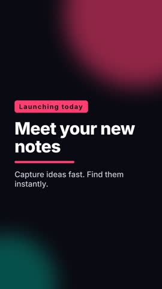

<!-- Generated by scripts/tutorials/docs.ts from cells.ts and proofs/claude-code-html.json. Edit those, then run pnpm tutorials:docs. -->

# Claude Code over MCP + HTML

> **Status: ✅ proven 2026-11-21.** The steps below were run end to end; the [Proof](#proof) section has the result.

Make a short vertical reel with the HTML engine, driven by Claude Code over MCP.
Matrix and other combinations: [tutorials README](../README.md).

## Prerequisites

- A running ReelForge Studio and an API key with the `read,write,render` scopes (step 1).
- A licence key for a real install (the Personal licence is free), or `REELFORGE_LICENCE_MODE=off` from a checkout for local development only.
- Claude Code CLI (the proof used 2.1.330), signed in the way Anthropic supports for your plan or API key.

## Steps

### 1. Start the studio

Pick one. Both serve REST on `http://127.0.0.1:4321/v1` and MCP on `http://127.0.0.1:4321/mcp`.

**A. Docker (release image, needs a licence key).** The Personal licence is
free (PolyForm Noncommercial 1.0.0, claimed with a BuildBase account on the
ReelForge store); commercial use needs a commercial licence.

```bash
git clone https://github.com/buildbase-app/reelforge-studio && cd reelforge-studio
export REELFORGE_SECRET_KEY=$(openssl rand -base64 32)       # keep a copy: it encrypts stored secrets
docker compose up -d --build                                 # 127.0.0.1:4321, hardened defaults
docker compose exec reelforge reelforge licence activate <YOUR-LICENCE-KEY>
docker compose exec reelforge reelforge keys create --name agent --scopes read,write,render
```

**B. From a checkout with pnpm (local development only).** `pnpm dev` sets
`REELFORGE_LICENCE_MODE=off`, which skips the licence check. That is for
developing on your own machine only, never for a real install; the release
image does not allow it.

```bash
pnpm install
export REELFORGE_CHROMIUM_PATH=/path/to/chrome-headless-shell   # Chrome Headless Shell for every engine
pnpm keys:create --name agent --scopes read,write,render       # prints rf_... once
pnpm dev
```

Keep the printed key in an environment variable, not in files you commit:

```bash
export RF=http://127.0.0.1:4321
export REELFORGE_API_KEY=rf_...      # the key printed above
export KEY=$REELFORGE_API_KEY
```

More: [DEPLOY.md](../../DEPLOY.md), [CONFIG.md](../../CONFIG.md), [licence](../../DEPLOY.md#licence).

### 2. Connect Claude Code to the studio

Interactive use: add the server once (it is stored in your Claude Code config).

```bash
claude mcp add --transport http reelforge http://127.0.0.1:4321/mcp \
  --header "Authorization: Bearer $REELFORGE_API_KEY"
claude mcp list        # reelforge: ... - ✔ connected
```

Headless use (what the proof runs): a config file passed with `--mcp-config`.
Create it with mode 600; it holds the key ([template](../../../examples/tutorials/claude-mcp.json)):

```bash
umask 077
printf '{"mcpServers":{"reelforge":{"type":"http","url":"%s/mcp","headers":{"Authorization":"Bearer %s"}}}}' "$RF" "$REELFORGE_API_KEY" > mcp.json
```

### 3. Ask for the reel

The exact prompt:

```text
You are connected to a ReelForge video studio through the "reelforge" MCP server. Make a vertical reel (1080x1920, 30 fps) about a launch announcement for a note-taking app: an 8-second reel made of two 4-second scenes, both using only the html engine (template html-title). Use the project id "tut-claude-code-html". Check list_templates for the props, create the project, validate it, render it, call get_job with waitSeconds 45 until the job succeeds, then call get_render_output. Reply with the project id, job id, render id, duration and frame count. Use only the reelforge tools.
```

Interactive: start `claude` and paste it. Headless, with only the studio's
tools and a bounded number of turns:

```bash
claude -p "$(cat prompt.txt)" --model sonnet \
  --mcp-config mcp.json --strict-mcp-config \
  --tools "" --allowedTools mcp__reelforge \
  --max-turns 25 --output-format stream-json --verbose > transcript.jsonl
```

- `--strict-mcp-config` ignores every other MCP server you have configured.
- `--tools ""` turns the built-in tools (shell, files, web) off; `--allowedTools mcp__reelforge` pre-approves the studio's tools so `-p` mode does not stop for permission.
- `--max-turns 25` bounds the cost; this task needs about 8 to 12 turns.

### 4. Download and check the reel

Claude replies with the job and render ids. Download with the key (or open the
signed `downloadUrl` from `get_render_output`, valid about an hour):

```bash
curl -fsS -H "Authorization: Bearer $KEY" -o reel.mp4 "$RF/v1/renders/<renderId>/output"
ffprobe -v error -count_frames -select_streams v:0 \
  -show_entries stream=width,height,r_frame_rate,nb_read_frames:format=duration -of compact reel.mp4
```

## What the agent does

Claude reads the tool list, looks up the template props, writes the manifest itself and works through the studio workflow:

1. `list_templates`
2. `create_project`
3. `validate_project`
4. `render_project`
5. `get_job (repeated)`
6. `get_render_output`

The proof run's actual calls are listed under [Proof](#proof).

## Expected output

- A job that ends `succeeded`, and a render with `final.mp4`, `poster.png` and `render-manifest.json`.
- `final.mp4`: H.264 1080x1920 at 30 fps, 6 to 12 s (the agent picks the timing within the brief; the frame count matches the duration), with an AAC track (silent: no music was set).
- Scenes: only the `html` engine (template `html-title`).
- Texts: written by the agent about the topic in the prompt, so they differ from run to run.

HTML (`html-title`): 1 to 12 s, headline up to 80 characters, optional kicker and subline. The html engine also takes raw `{ html, css }` instead of a template.

## Troubleshooting

| Symptom | Cause and fix |
| --- | --- |
| `401 unauthorized` | Missing or wrong key. Send `Authorization: Bearer rf_...`; check it with `curl -H "Authorization: Bearer $KEY" $RF/v1/capabilities`. |
| `403 forbidden_host` on `/mcp` | The Host header is not allowed (DNS-rebinding protection). Use `127.0.0.1`/`localhost`, or set `REELFORGE_PUBLIC_URL` / `REELFORGE_ALLOWED_HOSTS`. |
| `403 licence_required` / `licence_invalid` on a render | Activate a licence key (`reelforge licence activate <key>`; Personal is free). `REELFORGE_LICENCE_MODE=off` exists for local development from a checkout only. |
| `403 forbidden` (scope) | The key lacks a scope: rendering needs `render`, creating projects `write`. Create a key with `--scopes read,write,render`. |
| An engine shows `available: false` | `REELFORGE_CHROMIUM_PATH` is unset or wrong (checkout), or the image is not the release image. `get_capabilities` says how to fix it. |
| `invalid_manifest` | `details.issues` lists every problem with its path, e.g. `scenes.1.props.headline`. Fix all and send again. |
| The job stays `running` for minutes | Rendering is CPU-bound; one 8 s reel took 35 to 120 s on a shared 4-core machine. Wait with `get_job` `waitSeconds: 45` (or `?wait=50`); `get_job_logs` shows the stage. |
| `claude mcp list` shows the server as failed | The studio is not running, the URL is wrong or the header is missing. `curl -s $RF/healthz` should answer. |
| `-p` stops with a permission error for a tool | Add `--allowedTools mcp__reelforge` (all studio tools) or name the tools one by one. |
| `error_max_turns` | The task needed more turns; raise `--max-turns` or make the prompt more specific (name the engine and template). |
| The agent uses another server's tools | Add `--strict-mcp-config` so only `--mcp-config` servers load. |

## Proof

**Passed** (TUT-03 in [TEST_CASES.md](../TEST_CASES.md)).

| | |
| --- | --- |
| Date | 2026-11-21 19:32:41 UTC |
| Studio | ReelForge Studio 0.1.0, commit `85d3333`, started from a checkout with `REELFORGE_LICENCE_MODE=off` (local development only) |
| Reproduce | `pnpm tutorials:prove claude-code html` |
| Command the proof ran | `claude -p "<prompt>" --model sonnet --mcp-config mcp.json --strict-mcp-config --tools "" --allowedTools mcp__reelforge --max-turns 25 --output-format stream-json --verbose` |
| Model | claude-sonnet-5-5; 8 turns; 7 tool calls; 85 s agent time; 0.116 USD |
| Project / job / render | `tut-claude-code-html` / `job_mwqt218t46dcf0a919` / `run_mwqt218t4347ef0601` |
| Render time | 70.1 s (job start to finish, shared 4-core CPU, one render at a time) |
| Scene engines | html, html |
| ffprobe | 1080x1920, 30 fps, 240 frames (full decode), 8 s, h264 + aac, 524 KB |

Tool calls, in order (7):

1. `list_templates(engine)`
2. `create_project(manifest)`
3. `validate_project(projectId)`
4. `render_project(projectId)`
5. `get_job(jobId, waitSeconds)`
6. `get_job(jobId, waitSeconds)`
7. `get_render_output(jobId)`

The agent's final reply (signed links redacted):

> The 8-second reel is rendered, and the render's metadata, decode and duration checks all passed.
> 
> - **Project id:** `tut-claude-code-html`
> - **Job id:** `job_mwqt218t46dcf0a919`
> - **Render id:** `run_mwqt218t4347ef0601`
> - **Duration:** 8 seconds
> - **Frame count:** 240 frames at 30 fps, 1080x1920
> 
> The reel has two 4-second scenes, both on the html engine with the `html-title` template:
> 1. **intro:** "Meet your new notes", with the kicker "Launching today".
> 2. **outro:** "Get the app today", with the kicker "Available now".
> 
> The poster frame is the first frame of the intro, so the headline looked dim there. I only looked at that one frame, not the rest of the video.
> 
> Download link, valid until 2026-11-21 20:34 UTC: `/v1/renders/run_mwqt218t4347ef0601/output?expires=1795293241&sig=<redacted>`. The server returned it as a relative path, so put your ReelForge server's address in front of it.

Poster frame (40 % into the reel, 270 px wide):



The full transcript, the MP4 and `proof.json` stay outside the repository (`$TUTORIAL_OUT/claude-code/html/`); re-run the command to get your own.
