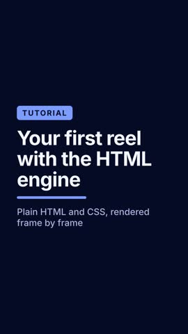

<!-- Generated by scripts/tutorials/docs.ts from cells.ts and proofs/hygen-html.json. Edit those, then run pnpm tutorials:docs. -->

# Hygen templates (CLI or any agent) + HTML

> **Status: ✅ proven 2026-11-23.** The steps below were run end to end; the [Proof](#proof) section has the result.

Make a short vertical reel with the HTML engine, driven by Hygen templates.
Matrix and other combinations: [tutorials README](../README.md).

## Prerequisites

- A running RenderWeld and an API key with the `read,write,render` scopes (step 1).
- A licence key for a real install (the Personal licence is free), or `RENDERWELD_LICENCE_MODE=off` from a checkout for local development only.
- Node.js 22 and pnpm (Hygen 6.2.11 comes with this repository), plus `curl`, `jq` and `ffprobe` for the render step. For step 5: Claude Code or Codex.

## Steps

### 1. Start the studio

Pick one. Both serve REST on `http://127.0.0.1:4321/v1` and MCP on `http://127.0.0.1:4321/mcp`.

**A. Docker (release image, needs a licence key).** The Personal licence is
free (PolyForm Noncommercial 1.0.0, claimed with a BuildBase account on the
RenderWeld store); commercial use needs a commercial licence.

```bash
git clone https://github.com/buildbase-app/reelforge-studio && cd reelforge-studio
export REELFORGE_SECRET_KEY=$(openssl rand -base64 32)       # keep a copy: it encrypts stored secrets
docker compose up -d --build                                 # 127.0.0.1:4321, hardened defaults
docker compose exec reelforge renderweld licence activate <YOUR-LICENCE-KEY>
docker compose exec reelforge renderweld keys create --name agent --scopes read,write,render
```

**B. From a checkout with pnpm (local development only).** `pnpm dev` sets
`RENDERWELD_LICENCE_MODE=off`, which skips the licence check. That is for
developing on your own machine only, never for a real install; the release
image does not allow it.

```bash
pnpm install
export RENDERWELD_CHROMIUM_PATH=/path/to/chrome-headless-shell   # Chrome Headless Shell for every engine
pnpm keys:create --name agent --scopes read,write,render       # prints rf_... once
pnpm dev
```

Keep the printed key in an environment variable, not in files you commit:

```bash
export RF=http://127.0.0.1:4321
export REELFORGE_API_KEY=rf_...      # the key printed above
export KEY=$REELFORGE_API_KEY
```

More: [DEPLOY.md](../../DEPLOY.md), [CONFIG.md](../../CONFIG.md), [licence](../../DEPLOY.md#licence).

### 2. The generator

[`examples/hygen/_templates/reel/html-title/`](../../../examples/hygen/_templates/reel/html-title): `manifest.ejs.t` is the v0.2 manifest with
the answers filled in; `index.js` reads the flags and checks them against the
template's limits ([`examples/hygen/lib/reel.js`](../../../examples/hygen/lib/reel.js)),
so bad input stops with one error that names the flag, and nothing is written.
Hygen 6.2.11 is a devDependency of this repository and needs no network to
generate. Elsewhere: `npm i -D hygen@6.2.11` and copy `examples/hygen/`.

| Flag | Required | Limit |
| --- | --- | --- |
| `--name` | yes | the project id: lowercase letters, digits and dashes |
| `--headline` | yes | up to 80 characters |
| `--subline` | no | up to 120 characters |
| `--kicker` | no | up to 40 characters |
| `--cta` | no | up to 80 characters |
| `--cta-subline` | no | up to 120 characters |
| `--cta-kicker` | no | up to 40 characters |
| `--seconds` | no | the whole reel, default 8, split evenly over the scenes |
| `--title`, `--theme`, `--accent`, `--out` | no | defaults: the headline, `midnight`, the theme's accent, `reels/<name>.json` |

### 3. Generate the manifest

```bash
export HYGEN_TMPLS=examples/hygen/_templates
pnpm exec hygen reel html-title --name tut-hygen-html \
  --title 'Tutorial: HTML engine' \
  --kicker TUTORIAL \
  --headline 'Your first reel with the HTML engine' \
  --subline 'Plain HTML and CSS, rendered frame by frame' \
  --cta-kicker NEXT \
  --cta 'Swap the props, render again' \
  --cta-subline 'Same manifest, any agent' \
  --out reel.json
```

It writes `reel.json` with the same content as [`examples/tutorials/html.json`](../../../examples/tutorials/html.json), apart
from the project id (`pnpm tutorials:test` compares them field by field):

```json
{
  "schemaVersion": "0.2",
  "projectId": "tut-hygen-html",
  "title": "Tutorial: HTML engine",
  "output": {
    "width": 1080,
    "height": 1920,
    "fps": 30,
    "format": "mp4"
  },
  "theme": "midnight",
  "scenes": [
    {
      "id": "hook",
      "engine": "html",
      "template": "html-title",
      "durationSeconds": 4,
      "props": {
        "kicker": "TUTORIAL",
        "headline": "Your first reel with the HTML engine",
        "subline": "Plain HTML and CSS, rendered frame by frame"
      }
    },
    {
      "id": "cta",
      "engine": "html",
      "template": "html-title",
      "durationSeconds": 4,
      "props": {
        "kicker": "NEXT",
        "headline": "Swap the props, render again",
        "subline": "Same manifest, any agent"
      }
    }
  ]
}
```

Hygen asks before it overwrites a file; set `HYGEN_OVERWRITE=1` (or pick a new
`--out`) when nobody can answer, e.g. in an agent's shell.

### 4. Render it

The REST script creates the project, validates it, renders it and downloads
the MP4 (each call is explained in [REST + HTML](../rest/html.md#3-make-the-reel-with-curl)):

```bash
RF=$RF KEY=$KEY examples/tutorials/rest.sh reel.json tut-hygen-html final.mp4
```

### 5. With an AI agent

**Only the CLI path above, plus the studio render, is proven for this row.**
An agent can drive the same generator: it runs `hygen` with its answers in its
shell, reads `reel.json`, then calls `create_project`, `validate_project` and
`render_project` over MCP. That MCP part is what the proven
[Claude Code row](../claude-code/html.md) does; an agent calling `hygen`
has not been run. **Codex is not proven** (OpenAI key pending).

A prompt:

```text
Make a vertical reel about a launch announcement for a note-taking app with the Hygen generator "reel html-title". Run `pnpm exec hygen reel html-title --name tut-hygen-html --out reel.json` with your texts as flags (run it without flags first: it stops with a usage line). Then read reel.json and, with the reelforge MCP tools, call create_project with it, validate_project, render_project, and get_job with waitSeconds 45 until the job succeeds. Reply with the project id, job id and render id.
```

**Claude Code** (connect it as in [step 2 of the Claude Code tutorial](../claude-code/html.md#2-connect-claude-code-to-the-studio)),
with only the generator, file reads and the studio's tools allowed:

```bash
export HYGEN_TMPLS=examples/hygen/_templates HYGEN_OVERWRITE=1
claude -p "$(cat prompt.txt)" --mcp-config mcp.json --strict-mcp-config \
  --allowedTools "Bash(pnpm exec hygen:*)" Read mcp__reelforge --max-turns 25
```

**Codex** (connect it as in [step 2 of the Codex tutorial](../codex/html.md#2-install-codex-and-connect-it-to-the-studio));
VERIFY the flags against `codex exec --help` of your version:

```bash
export HYGEN_TMPLS=examples/hygen/_templates HYGEN_OVERWRITE=1
codex exec --sandbox workspace-write -c 'approval_policy="never"' "$(cat prompt.txt)"
```

## What the agent does

The proof runs the generator, then the REST script (no model involved):

1. `hygen reel <generator> --name ... --out reel.json (offline)`
2. `GET /v1/capabilities`
3. `POST /v1/projects`
4. `POST /v1/projects/:id/validate`
5. `POST /v1/projects/:id/renders`
6. `GET /v1/jobs/:id?wait=50 (repeated)`
7. `GET /v1/renders/:id/output`

The proof run's actual calls are listed under [Proof](#proof).

## Expected output

- A job that ends `succeeded`, and a render with `final.mp4`, `poster.png` and `render-manifest.json`.
- `final.mp4`: H.264 1080x1920 at 30 fps, exactly 240 frames (8 s), with an AAC track (silent: no music was set).
- Scenes: only the `html` engine (template `html-title`).

HTML (`html-title`): 1 to 12 s, headline up to 80 characters, optional kicker and subline. The html engine also takes raw `{ html, css }` instead of a template, and renders without network access (no remote scripts or resources).

## Troubleshooting

| Symptom | Cause and fix |
| --- | --- |
| `401 unauthorized` | Missing or wrong key. Send `Authorization: Bearer rf_...`; check it with `curl -H "Authorization: Bearer $KEY" $RF/v1/capabilities`. |
| `403 forbidden_host` on `/mcp` | The Host header is not allowed (DNS-rebinding protection). Use `127.0.0.1`/`localhost`, or set `REELFORGE_PUBLIC_URL` / `REELFORGE_ALLOWED_HOSTS`. |
| `403 licence_required` / `licence_invalid` on a render | Activate a licence key (`renderweld licence activate <key>`; Personal is free). `RENDERWELD_LICENCE_MODE=off` exists for local development from a checkout only. |
| `403 forbidden` (scope) | The key lacks a scope: rendering needs `render`, creating projects `write`. Create a key with `--scopes read,write,render`. |
| An engine shows `available: false` | `RENDERWELD_CHROMIUM_PATH` is unset or wrong (checkout), or the image is not the release image. `get_capabilities` says how to fix it. |
| `invalid_manifest` | `details.issues` lists every problem with its path, e.g. `scenes.1.props.headline`. Fix all and send again. |
| The job stays `running` for minutes | Rendering is CPU-bound; one 8 s reel took 35 to 120 s on a shared 4-core machine. Wait with `get_job` `waitSeconds: 45` (or `?wait=50`); `get_job_logs` shows the stage. |
| `render_failed` with a timeout on an html or hyperframes scene | One scene ran past `render.sceneTimeoutSeconds` (default 900 s). On a slow machine raise `RENDERWELD_RENDER_SCENE_TIMEOUT_SECONDS`. |
| html, hyperframes or motion-canvas renders fail in Docker | The container needs the seccomp profile `deployment/seccomp/chrome.json` for Chromium's sandbox (`docker compose` sets it); see [DEPLOY.md](../../DEPLOY.md). |
| `Error: reel <generator>: ...` | A flag is missing, unknown or over a template limit; the message names it and ends with the usage line. Nothing was written. |
| `exists: reel.json. Overwrite? (y/N)` | Hygen asks before overwriting. Set `HYGEN_OVERWRITE=1` for runs nobody answers, or use a new `--out`. |
| `I can't find action ... for generator 'reel'` | `HYGEN_TMPLS` does not point at `examples/hygen/_templates` (relative paths start where hygen runs). |

## Proof

**Passed** (TUT-33 in [TEST_CASES.md](../TEST_CASES.md)).

| | |
| --- | --- |
| Date | 2026-11-23 10:07:08 UTC |
| Studio | RenderWeld 0.1.0, commit `9fcc722`, started from a checkout with `REELFORGE_LICENCE_MODE=off` (local development only) |
| Reproduce | `pnpm tutorials:prove hygen html` |
| Command the proof ran | `HYGEN_TMPLS=examples/hygen/_templates pnpm exec hygen reel html-title --name tut-hygen-html --title 'Tutorial: HTML engine' --kicker TUTORIAL --headline 'Your first reel with the HTML engine' --subline 'Plain HTML and CSS, rendered frame by frame' --cta-kicker NEXT --cta 'Swap the props, render again' --cta-subline 'Same manifest, any agent' --out reel.json && examples/tutorials/rest.sh reel.json tut-hygen-html final.mp4` |
| Project / job / render | `tut-hygen-html` / `job_mwt3qahgf3f7c7e246` / `run_mwt3qahg3df8a9c399` |
| Render time | 30.6 s (job start to finish, shared 4-core CPU, one render at a time) |
| Scene engines | html, html |
| ffprobe | 1080x1920, 30 fps, 240 frames (full decode), 8 s, h264 + aac, 333 KB |

Tool calls, in order (7):

1. `hygen reel html-title()`
2. `GET /v1/capabilities()`
3. `POST /v1/projects()`
4. `POST /v1/projects/tut-hygen-html/validate()`
5. `POST /v1/projects/tut-hygen-html/renders()`
6. `GET /v1/jobs/job_mwt3qahgf3f7c7e246?wait=50()`
7. `GET /v1/renders/run_mwt3qahg3df8a9c399/output()`

Poster frame (40 % into the reel, 270 px wide):



The full transcript, the MP4 and `proof.json` stay outside the repository (`$TUTORIAL_OUT/hygen/html/`); re-run the command to get your own.
