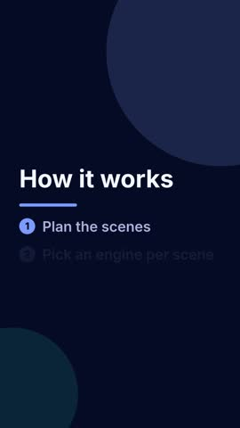

<!-- Generated by scripts/tutorials/docs.ts from cells.ts and proofs/mcp-sdk-multi-engine.json. Edit those, then run pnpm tutorials:docs. -->

# Any MCP client (TypeScript SDK script) + Multi-engine

> **Status: ✅ proven 2026-11-21.** The steps below were run end to end; the [Proof](#proof) section has the result.

Make a short vertical reel with scenes from all four engines, driven by Any MCP client.
Matrix and other combinations: [tutorials README](../README.md).

## Prerequisites

- A running ReelForge Studio and an API key with the `read,write,render` scopes (step 1).
- A licence key for a real install (the Personal licence is free), or `REELFORGE_LICENCE_MODE=off` from a checkout for local development only.
- Node.js 22 and `@modelcontextprotocol/sdk` 1.32.2 (already in this repository).

## Steps

### 1. Start the studio

Pick one. Both serve REST on `http://127.0.0.1:4321/v1` and MCP on `http://127.0.0.1:4321/mcp`.

**A. Docker (release image, needs a licence key).** The Personal licence is
free (PolyForm Noncommercial 1.0.0, claimed with a BuildBase account on the
ReelForge store); commercial use needs a commercial licence.

```bash
git clone https://github.com/buildbase-app/reelforge-studio && cd reelforge-studio
export REELFORGE_SECRET_KEY=$(openssl rand -base64 32)       # keep a copy: it encrypts stored secrets
docker compose up -d --build                                 # 127.0.0.1:4321, hardened defaults
docker compose exec reelforge reelforge licence activate <YOUR-LICENCE-KEY>
docker compose exec reelforge reelforge keys create --name agent --scopes read,write,render
```

**B. From a checkout with pnpm (local development only).** `pnpm dev` sets
`REELFORGE_LICENCE_MODE=off`, which skips the licence check. That is for
developing on your own machine only, never for a real install; the release
image does not allow it.

```bash
pnpm install
export REELFORGE_CHROMIUM_PATH=/path/to/chrome-headless-shell   # Chrome Headless Shell for every engine
pnpm keys:create --name agent --scopes read,write,render       # prints rf_... once
pnpm dev
```

Keep the printed key in an environment variable, not in files you commit:

```bash
export RF=http://127.0.0.1:4321
export REELFORGE_API_KEY=rf_...      # the key printed above
export KEY=$REELFORGE_API_KEY
```

More: [DEPLOY.md](../../DEPLOY.md), [CONFIG.md](../../CONFIG.md), [licence](../../DEPLOY.md#licence).

### 2. Get the client script

[`examples/tutorials/mcp-client.mjs`](../../../examples/tutorials/mcp-client.mjs)
is a complete MCP client with the official TypeScript SDK and no language
model: it connects over Streamable HTTP with the Bearer key, lists the tools
and calls them one by one. In this repository the SDK is already installed;
elsewhere:

```bash
mkdir reelforge-client && cd reelforge-client && npm init -y
npm i @modelcontextprotocol/sdk@1.32.2
# copy mcp-client.mjs and the manifest next to it
```

The heart of it:

```js
const client = new Client({ name: 'reelforge-tutorial', version: '1.0.0' });
await client.connect(new StreamableHTTPClientTransport(new URL(`${base}/mcp`), {
  requestInit: { headers: { Authorization: `Bearer ${key}` } },
}));
await client.callTool({ name: 'create_project', arguments: { manifest } });
const { job } = JSON.parse((await client.callTool({ name: 'render_project', arguments: { projectId } })).content[0].text);
// get_job { jobId, waitSeconds: 45 } until "succeeded", then get_render_output { jobId }
```

### 3. The manifest

[`examples/tutorials/multi-engine.json`](../../../examples/tutorials/multi-engine.json):

```json
{
  "schemaVersion": "0.2",
  "projectId": "tut-multi-engine",
  "title": "Tutorial: four engines, one reel",
  "output": {
    "width": 1080,
    "height": 1920,
    "fps": 30,
    "format": "mp4"
  },
  "theme": "midnight",
  "scenes": [
    {
      "id": "hook",
      "engine": "remotion",
      "template": "kinetic-title",
      "durationSeconds": 2,
      "props": {
        "headline": "Four engines, one reel"
      }
    },
    {
      "id": "steps",
      "engine": "motion-canvas",
      "template": "animated-explainer",
      "durationSeconds": 3,
      "props": {
        "title": "How it works",
        "points": [
          "Plan the scenes",
          "Pick an engine per scene"
        ]
      }
    },
    {
      "id": "card",
      "engine": "html",
      "template": "html-title",
      "durationSeconds": 2,
      "props": {
        "kicker": "HTML",
        "headline": "Cut to an HTML card"
      }
    },
    {
      "id": "outro",
      "engine": "hyperframes",
      "template": "hyperframes-title",
      "durationSeconds": 2,
      "props": {
        "headline": "Ends on HyperFrames",
        "subline": "Rendered and joined to the frame"
      }
    }
  ]
}
```

### 4. Run it

```bash
REELFORGE_URL=$RF REELFORGE_API_KEY=$KEY node examples/tutorials/mcp-client.mjs examples/tutorials/multi-engine.json
```

It prints one line per tool call, the job progress, then the render (size,
frames, duration, whether the poster image came back) and a `RESULT {...}`
line. Download the MP4 as in the REST tutorial:
`curl -fsS -H "Authorization: Bearer $KEY" -o reel.mp4 "$RF/v1/renders/<renderId>/output"`.

### Other MCP clients

Cursor, Windsurf, VS Code and Zed connect to the same endpoint with the same
header; their configuration snippets are in [other-clients.md](other-clients.md)
(**config documented, not proven**). Then give them the prompt from the
[Claude Code tutorial](../claude-code/multi-engine.md#3-ask-for-the-reel).

## What the agent does

The script makes these calls, always in this order (no model involved):

1. `get_capabilities`
2. `list_templates`
3. `list_projects (and delete_project on a re-run)`
4. `create_project`
5. `validate_project`
6. `render_project`
7. `get_job (repeated, waitSeconds 45)`
8. `get_render_output`

The proof run's actual calls are listed under [Proof](#proof).

## Expected output

- A job that ends `succeeded`, and a render with `final.mp4`, `poster.png` and `render-manifest.json`.
- `final.mp4`: H.264 1080x1920 at 30 fps, exactly 270 frames (9 s), with an AAC track (silent: no music was set).
- Scenes: one per engine, in the order remotion → motion-canvas → html → hyperframes.

Multi-engine: every scene is rendered by its own engine at the same size and frame rate, then joined with hard cuts to the frame. Each scene keeps its template's duration range (Remotion at most 8 s, Motion Canvas at least 2 s).

## Troubleshooting

| Symptom | Cause and fix |
| --- | --- |
| `401 unauthorized` | Missing or wrong key. Send `Authorization: Bearer rf_...`; check it with `curl -H "Authorization: Bearer $KEY" $RF/v1/capabilities`. |
| `403 forbidden_host` on `/mcp` | The Host header is not allowed (DNS-rebinding protection). Use `127.0.0.1`/`localhost`, or set `REELFORGE_PUBLIC_URL` / `REELFORGE_ALLOWED_HOSTS`. |
| `403 licence_required` / `licence_invalid` on a render | Activate a licence key (`reelforge licence activate <key>`; Personal is free). `REELFORGE_LICENCE_MODE=off` exists for local development from a checkout only. |
| `403 forbidden` (scope) | The key lacks a scope: rendering needs `render`, creating projects `write`. Create a key with `--scopes read,write,render`. |
| An engine shows `available: false` | `REELFORGE_CHROMIUM_PATH` is unset or wrong (checkout), or the image is not the release image. `get_capabilities` says how to fix it. |
| `invalid_manifest` | `details.issues` lists every problem with its path, e.g. `scenes.1.props.headline`. Fix all and send again. |
| The job stays `running` for minutes | Rendering is CPU-bound; one 8 s reel took 35 to 120 s on a shared 4-core machine. Wait with `get_job` `waitSeconds: 45` (or `?wait=50`); `get_job_logs` shows the stage. |
| `Cannot find package '@modelcontextprotocol/sdk'` | Run the script from this repository, or `npm i @modelcontextprotocol/sdk@1.32.2` next to it. |
| `fetch failed` / `ECONNREFUSED` | The studio is not running on `REELFORGE_URL`. |
| A tool result has `isError: true` | The script prints the error body and stops; the `code` and `details` say what to fix. |

## Proof

**Passed** (TUT-15 in [TEST_CASES.md](../TEST_CASES.md)).

| | |
| --- | --- |
| Date | 2026-11-21 19:44:39 UTC |
| Studio | ReelForge Studio 0.1.0, commit `85d3333`, started from a checkout with `REELFORGE_LICENCE_MODE=off` (local development only) |
| Reproduce | `pnpm tutorials:prove mcp-sdk multi-engine` |
| Command the proof ran | `node examples/tutorials/mcp-client.mjs examples/tutorials/multi-engine.json tut-mcp-sdk-multi-engine` |
| Project / job / render | `tut-mcp-sdk-multi-engine` / `job_mwqtha7967b2d2dd60` / `run_mwqtha79f5009faee3` |
| Render time | 100.2 s (job start to finish, shared 4-core CPU, one render at a time) |
| Scene engines | remotion, motion-canvas, html, hyperframes |
| ffprobe | 1080x1920, 30 fps, 270 frames (full decode), 9 s, h264 + aac, 619 KB |

Tool calls, in order (13):

1. `get_capabilities()`
2. `list_templates(engine)`
3. `list_templates(engine)`
4. `list_templates(engine)`
5. `list_templates(engine)`
6. `list_projects()`
7. `create_project(manifest)`
8. `validate_project(projectId)`
9. `render_project(projectId)`
10. `get_job(jobId, waitSeconds)`
11. `get_job(jobId, waitSeconds)`
12. `get_job(jobId, waitSeconds)`
13. `get_render_output(jobId)`

Poster frame (40 % into the reel, 270 px wide):



The full transcript, the MP4 and `proof.json` stay outside the repository (`$TUTORIAL_OUT/mcp-sdk/multi-engine/`); re-run the command to get your own.
