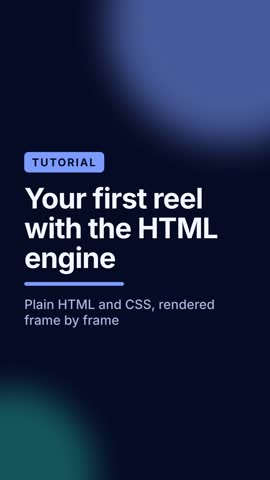

<!-- Generated by scripts/tutorials/docs.ts from cells.ts and proofs/rest-html.json. Edit those, then run pnpm tutorials:docs. -->

# REST API (curl and fetch) + HTML

> **Status: ✅ proven 2026-11-21.** The steps below were run end to end; the [Proof](#proof) section has the result.

Make a short vertical reel with the HTML engine, driven by REST API.
Matrix and other combinations: [tutorials README](../README.md).

## Prerequisites

- A running ReelForge Studio and an API key with the `read,write,render` scopes (step 1).
- A licence key for a real install (the Personal licence is free), or `REELFORGE_LICENCE_MODE=off` from a checkout for local development only.
- `curl`, `jq` and `ffprobe` (or Node.js 22 for the fetch version).

## Steps

### 1. Start the studio

Pick one. Both serve REST on `http://127.0.0.1:4321/v1` and MCP on `http://127.0.0.1:4321/mcp`.

**A. Docker (release image, needs a licence key).** The Personal licence is
free (PolyForm Noncommercial 1.0.0, claimed with a BuildBase account on the
ReelForge store); commercial use needs a commercial licence.

```bash
git clone https://github.com/buildbase-app/reelforge-studio && cd reelforge-studio
export REELFORGE_SECRET_KEY=$(openssl rand -base64 32)       # keep a copy: it encrypts stored secrets
docker compose up -d --build                                 # 127.0.0.1:4321, hardened defaults
docker compose exec reelforge reelforge licence activate <YOUR-LICENCE-KEY>
docker compose exec reelforge reelforge keys create --name agent --scopes read,write,render
```

**B. From a checkout with pnpm (local development only).** `pnpm dev` sets
`REELFORGE_LICENCE_MODE=off`, which skips the licence check. That is for
developing on your own machine only, never for a real install; the release
image does not allow it.

```bash
pnpm install
export REELFORGE_CHROMIUM_PATH=/path/to/chrome-headless-shell   # Chrome Headless Shell for every engine
pnpm keys:create --name agent --scopes read,write,render       # prints rf_... once
pnpm dev
```

Keep the printed key in an environment variable, not in files you commit:

```bash
export RF=http://127.0.0.1:4321
export REELFORGE_API_KEY=rf_...      # the key printed above
export KEY=$REELFORGE_API_KEY
```

More: [DEPLOY.md](../../DEPLOY.md), [CONFIG.md](../../CONFIG.md), [licence](../../DEPLOY.md#licence).

### 2. The manifest

[`examples/tutorials/html.json`](../../../examples/tutorials/html.json):

```json
{
  "schemaVersion": "0.2",
  "projectId": "tut-html",
  "title": "Tutorial: HTML engine",
  "output": { "width": 1080, "height": 1920, "fps": 30, "format": "mp4" },
  "theme": "midnight",
  "scenes": [
    {
      "id": "hook",
      "engine": "html",
      "template": "html-title",
      "durationSeconds": 4,
      "props": { "kicker": "TUTORIAL", "headline": "Your first reel with the HTML engine", "subline": "Plain HTML and CSS, rendered frame by frame" }
    },
    {
      "id": "cta",
      "engine": "html",
      "template": "html-title",
      "durationSeconds": 4,
      "props": { "kicker": "NEXT", "headline": "Swap the props, render again", "subline": "Same manifest, any agent" }
    }
  ]
}
```

### 3. Make the reel with curl

Step by step (needs `curl`, `jq`, `ffprobe`):

```bash
# 1. What can this server render?
curl -fsS -H "Authorization: Bearer $KEY" $RF/v1/capabilities | jq -c '[.engines[] | {id, available}]'

# 2. Create the project (the manifest's projectId is "tut-html"; we rename it)
jq '.projectId = "tut-rest-html"' examples/tutorials/html.json \
  | curl -fsS -H "Authorization: Bearer $KEY" -H 'content-type: application/json' -d @- $RF/v1/projects

# 3. Validate: errors block a render, warnings do not
curl -fsS -X POST -H "Authorization: Bearer $KEY" $RF/v1/projects/tut-rest-html/validate | jq '{ok, summary}'

# 4. Render: 202 with a job at once
JOB=$(curl -fsS -X POST -H "Authorization: Bearer $KEY" -H 'content-type: application/json' -d '{}' \
  $RF/v1/projects/tut-rest-html/renders | jq -r .job.id)

# 5. Wait: each call long-polls up to 50 s and returns as soon as the job finishes
while :; do
  S=$(curl -fsS -H "Authorization: Bearer $KEY" "$RF/v1/jobs/$JOB?wait=50" | tee job.json | jq -r .status)
  [ "$S" = queued ] || [ "$S" = running ] || break
done
jq '{status, result: .result | {renderId, frames, durationSeconds}}' job.json

# 6. Download and check
RENDER=$(jq -r .result.renderId job.json)
curl -fsS -H "Authorization: Bearer $KEY" -o final.mp4 $RF/v1/renders/$RENDER/output
ffprobe -v error -count_frames -select_streams v:0 \
  -show_entries stream=width,height,r_frame_rate,nb_read_frames:format=duration -of compact final.mp4
```

The same as one script that fails on any error: [`examples/tutorials/rest.sh`](../../../examples/tutorials/rest.sh)

```bash
RF=$RF KEY=$KEY examples/tutorials/rest.sh examples/tutorials/html.json tut-rest-html final.mp4
```

Live progress instead of polling: `curl -N -H "Authorization: Bearer $KEY" $RF/v1/jobs/$JOB/events` (Server-Sent Events).

### 4. The same with fetch

[`examples/tutorials/rest-fetch.mjs`](../../../examples/tutorials/rest-fetch.mjs) (Node 22, no dependencies) makes the same calls:

```bash
REELFORGE_URL=$RF REELFORGE_API_KEY=$KEY node examples/tutorials/rest-fetch.mjs examples/tutorials/html.json tut-rest-html final.mp4
```

### Automation tools

n8n, Make and Zapier can run the same calls with their HTTP nodes:
[automation.md](automation.md) (**documented, not proven**).

## What the agent does

The REST calls, in order (each MCP tool has a REST route: [AGENT_PLATFORM.md §6](../../AGENT_PLATFORM.md)):

1. `GET /v1/capabilities`
2. `POST /v1/projects`
3. `POST /v1/projects/:id/validate`
4. `POST /v1/projects/:id/renders`
5. `GET /v1/jobs/:id?wait=50 (repeated)`
6. `GET /v1/renders/:id/output`

The proof run's actual calls are listed under [Proof](#proof).

## Expected output

- A job that ends `succeeded`, and a render with `final.mp4`, `poster.png` and `render-manifest.json`.
- `final.mp4`: H.264 1080x1920 at 30 fps, exactly 240 frames (8 s), with an AAC track (silent: no music was set).
- Scenes: only the `html` engine (template `html-title`).

HTML (`html-title`): 1 to 12 s, headline up to 80 characters, optional kicker and subline. The html engine also takes raw `{ html, css }` instead of a template.

## Troubleshooting

| Symptom | Cause and fix |
| --- | --- |
| `401 unauthorized` | Missing or wrong key. Send `Authorization: Bearer rf_...`; check it with `curl -H "Authorization: Bearer $KEY" $RF/v1/capabilities`. |
| `403 forbidden_host` on `/mcp` | The Host header is not allowed (DNS-rebinding protection). Use `127.0.0.1`/`localhost`, or set `REELFORGE_PUBLIC_URL` / `REELFORGE_ALLOWED_HOSTS`. |
| `403 licence_required` / `licence_invalid` on a render | Activate a licence key (`reelforge licence activate <key>`; Personal is free). `REELFORGE_LICENCE_MODE=off` exists for local development from a checkout only. |
| `403 forbidden` (scope) | The key lacks a scope: rendering needs `render`, creating projects `write`. Create a key with `--scopes read,write,render`. |
| An engine shows `available: false` | `REELFORGE_CHROMIUM_PATH` is unset or wrong (checkout), or the image is not the release image. `get_capabilities` says how to fix it. |
| `invalid_manifest` | `details.issues` lists every problem with its path, e.g. `scenes.1.props.headline`. Fix all and send again. |
| The job stays `running` for minutes | Rendering is CPU-bound; one 8 s reel took 35 to 120 s on a shared 4-core machine. Wait with `get_job` `waitSeconds: 45` (or `?wait=50`); `get_job_logs` shows the stage. |
| `curl: (22) ... 4xx` | `-f` makes curl fail on an HTTP error; run the call without `-f` to see the JSON error body. |
| `409 version_conflict` | Another writer changed the project; read it again (`GET /v1/projects/:id`) and retry. |
| The download is 404 | The render was deleted by retention, or the id is a job id: use `.result.renderId` of the job. |

## Proof

**Passed** (TUT-18 in [TEST_CASES.md](../TEST_CASES.md)).

| | |
| --- | --- |
| Date | 2026-11-21 19:29:36 UTC |
| Studio | ReelForge Studio 0.1.0, commit `85d3333`, started from a checkout with `REELFORGE_LICENCE_MODE=off` (local development only) |
| Reproduce | `pnpm tutorials:prove rest html` |
| Command the proof ran | `examples/tutorials/rest.sh examples/tutorials/html.json tut-rest-html final.mp4` |
| Project / job / render | `tut-rest-html` / `job_mwqsxwkh301e9ed7c1` / `run_mwqsxwkhfc56596879` |
| Render time | 58.1 s (job start to finish, shared 4-core CPU, one render at a time) |
| Scene engines | html, html |
| ffprobe | 1080x1920, 30 fps, 240 frames (full decode), 8 s, h264 + aac, 632 KB |

Tool calls, in order (7):

1. `GET /v1/capabilities()`
2. `POST /v1/projects()`
3. `POST /v1/projects/tut-rest-html/validate()`
4. `POST /v1/projects/tut-rest-html/renders()`
5. `GET /v1/jobs/job_mwqsxwkh301e9ed7c1?wait=50()`
6. `GET /v1/jobs/job_mwqsxwkh301e9ed7c1?wait=50()`
7. `GET /v1/renders/run_mwqsxwkhfc56596879/output()`

Poster frame (40 % into the reel, 270 px wide):



The full transcript, the MP4 and `proof.json` stay outside the repository (`$TUTORIAL_OUT/rest/html/`); re-run the command to get your own.
